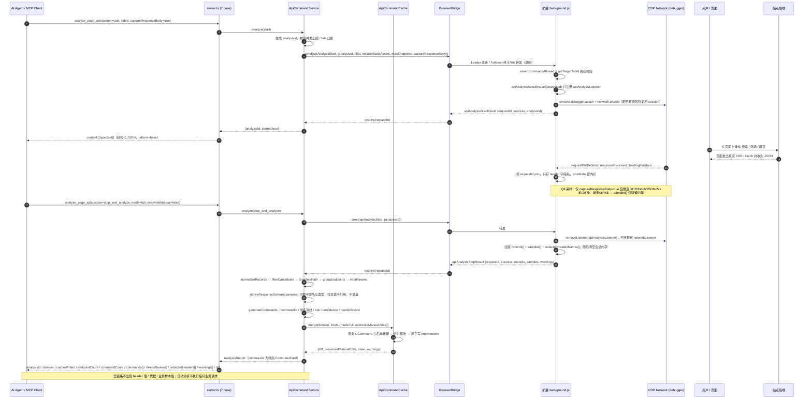
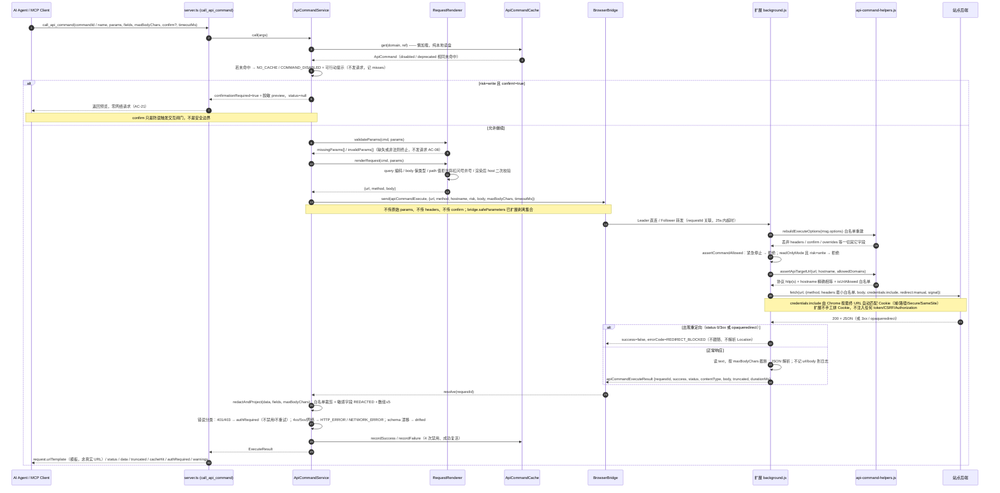
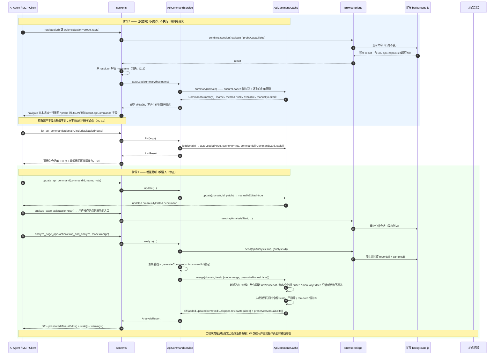
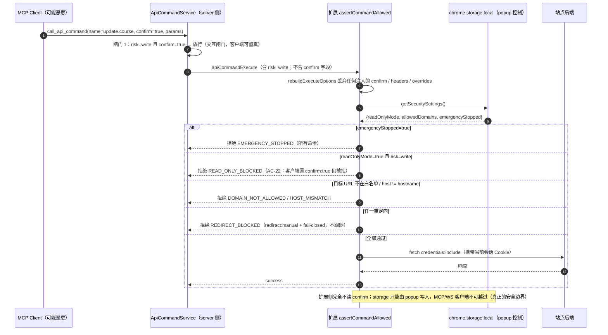
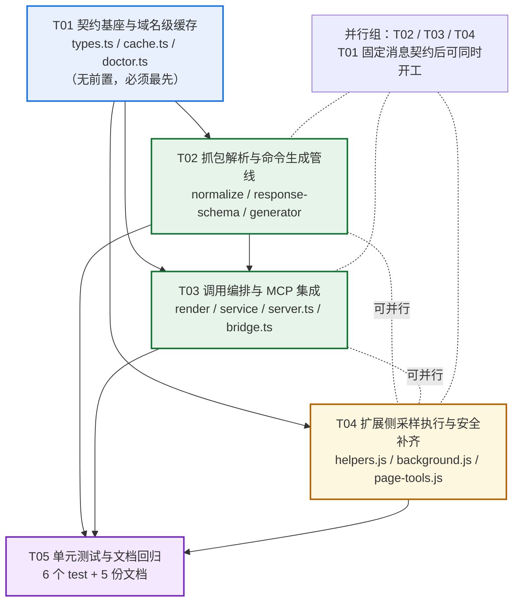

# WebPilot 增量系统设计：页面分析 → API 命令集

> **文档性质**：架构设计 + 任务分解，供工程师直接批量实现。本文只定义契约、模块、数据结构、调用流程与任务顺序，**不含实现代码**（第 3 节的类型与函数签名均为契约声明）。
> **依据**：`docs/api-command-set-prd.md`（693 行，全文）、`README.zh.md` / `README.md`、`docs/ARCHITECTURE.md`、`docs/task-sedimentation-guide.md`、`mcp-server/src/{server,bridge,selector-cache,definitions,doctor}.ts`、`browser-extension/{background,page-tools}.js`、`manifest.json`、`mcp-server/test/{selector-cache,definitions}.test.mjs`、`package.json`、`tsconfig.json`。
> **决策基线**：严格采用主理人已拍板的 Q1–Q15 与范围裁剪，**不重新讨论、不推翻**。文中标注「建议默认值」的项列入第 8 节待明确事项。
> **唯一交付物**：本文件。类图 / 时序图 / 任务依赖图均内嵌于第 3.3、4、5.3 节，不另建 `docs/system_design.md` 或独立 `.mermaid` 文件，避免工程师的实现依据分裂。
> **语言**：简体中文。**不新增 npm 依赖**。**不修改任何现有源码**（本次只产出设计；修改清单由工程师按第 5 节执行）。

---

## 0. 范围基线（先统一口径）

### 0.1 本次必交付（P0 全量 = PRD 4.1 的 10 条）

| 编号 | 交付块 | 落到本设计的模块 |
| --- | --- | --- |
| P0-01 | 页面分析模式（start / stop_and_analyze / analyze_current） | `api-command-service.ts` + `background.js` 分析会话 |
| P0-02 | 抓包解析逻辑（真实 method、query/path/body、响应 schema） | `api-command-normalize.ts` + `api-command-response-schema.ts` |
| P0-03 | API 抽象与命令生成（命名 / commandId / risk / 占位符 / 裁剪白名单） | `api-command-generator.ts` |
| P0-04 | **免开网页**的命令调用封装 | `background.js::cmdApiCommandExecute` + `api-command-render.ts` |
| P0-05 | 域名级缓存管理 | `api-command-cache.ts` |
| P0-06 | 同域名自动加载（只推荐不执行） | `server.ts` Q11 注入 + `api-command-service.ts::autoLoadSummary` |
| P0-07 | 手动重分析 / 增量更新（full / merge） | `api-command-cache.ts::merge` |
| P0-08 | 命令生成执行机制（校验 / 渲染 / 裁剪 / 错误分类 / 失败计数 / 写确认） | `api-command-render.ts` + `api-command-service.ts` |
| P0-09 | 安全边界继承与缺口补齐 | `api-command-helpers.js` + `background.js::assertCommandAllowed` |
| P0-10 | 可测性 + 文档同步 + 回归 | `mcp-server/test/*.test.mjs` + 5 份文档 |

### 0.2 P1 仅保留两项（本就在 P0 契约内，不额外扩）

1. `get_api_command_cache` 健康度（`hits / misses / consecutiveFailures / disabled / averageDurationMs`）——PRD P0-05 已要求。
2. 响应字段裁剪与 `maxBodyChars` 限制——PRD P0-08 / 5.5 已要求。

### 0.3 硬裁剪（Roadmap，见第 9 节）

导出 / 导入、`definitions/` 团队分发（Q9 否决）、写命令本地 UI 开关与审计日志、Markdown 可视化报告、分页辅助、schema 迁移工具、任务轨迹提炼、dry-run、多 Agent 共享、CSRF 运行时提取、别名语义检索、受控逐跳重定向、聚合工具 `api_command`。

### 0.4 三条不可越过的红线

- **凭据绝不持久化**：命令模板只存 URL/method/参数结构/响应结构；调用时复用浏览器当前登录会话；敏感 header 值全链路不落盘、不进报告、不进日志、不进回包。
- **不破坏现有 4 个抓包工具**（`start_network_capture` / `stop_network_capture` / `get_network_resources` / `replay_api_request`）与 40+ 工具行为（AC-26）。
- **自动加载只加载、只推荐、不自动执行、不产生任何网络请求**（AC-12）。

---

## 1. 实现方案概述与框架选型

### 1.1 技术选型（结论：零新增依赖）

| 层 | 选型 | 理由 |
| --- | --- | --- |
| MCP Server | 既有 TypeScript + `@modelcontextprotocol/sdk`（`^1.0.4`）+ `Server.setRequestHandler` 手写 JSON Schema `inputSchema` | `server.ts:224` 的 `ListToolsRequestSchema` 与 `server.ts:894` 的 `CallToolRequestSchema` 均为手写 `{type:"object",properties,required}`，**不是 zod**；新工具必须沿用此形态，返回 `content:[{type:"text"}]` + `isError` |
| Chrome 扩展 | 既有 MV3 原生 JS Service Worker（`manifest.json` 未声明 `type:"module"` → classic worker） | 无打包器、无 import；新增 helpers 文件通过 `importScripts('api-command-helpers.js')` 引入（classic SW 原生支持），**不改 manifest** |
| 哈希 | `node:crypto` `createHash` | `bridge.ts:25,81` 已使用，稳定短哈希无需新库 |
| 文件持久化 | `node:fs/promises`（`mkdir` / `writeFile` / `rename`） | `selector-cache.ts:1,95-104` 的 tmp+rename 原子写范式，直接对齐 |
| URL 处理 | 全局 `URL` / `URLSearchParams` | 两端均为 ES2022 / Chrome 运行时原生能力 |
| JSON 校验 | **手写逐条白名单重建**（对齐 `selector-cache.ts::toEntry` 与 `definitions.ts::loadDefinitions`） | 不引入 ajv / zod-to-json-schema；「丢弃未知键」比「校验后透传」更安全，且与 `ARCHITECTURE.md` 第 2 道防线同构 |
| 响应体采样 | 既有 `chrome.debugger` CDP `Network.getResponseBody` | Q8 要求；`manifest.json` 已有 `debugger` + `cookies` + `<all_urls>` 权限，无需扩权 |
| 免开网页请求 | 既有扩展侧 `fetch(..., credentials:'include')` | `background.js:1399` 已验证机制，见 1.3.1 |
| 测试 | 既有 `node:test` + `node:assert/strict`，测 `dist/` | `package.json` `"test": "npm run build && node --test"`；`tsconfig.json` `rootDir:src / outDir:dist / strict:true` |

> **Q1 工具数复核**：`server.ts` 中 `^        name: "` 共 41 条工具定义，其中 `browser_task`(723/846)、`task_workflow`(754/870) 各重复注册一次，`dedupeTools()`（218-221）去重后约 **39** 个。新增 7 个独立具名工具后约 **46** 个，低于常见 MCP 客户端限制（Claude Desktop / Cursor 无硬性小上限）。**P0 保持 7 个独立具名工具不变**；若后续客户端反馈逼近上限，再聚合为单一 `api_command`（`action` 分派，对齐 `adapter` / `webmcp`）——列为 Roadmap，**不改变 P0 契约**（PRD 5.1 + Q1）。

### 1.2 架构模式与分层

沿用既有「声明式定义 + 运行时白名单重建 + 扩展本地强制安全」三道防线（`ARCHITECTURE.md:62-70`），在其上新增第四层「域名级运行时缓存」。本次采用 **Pipeline + Repository + Message Adapter + Fail-closed Gate** 组合，不引入 MVC/MVVM（无 GUI）：

```
┌─ 传输适配层 ────────────────────────────────────────────────┐
│ server.ts（7 工具 schema + 7 case）  │  background.js（3 case）│
│ bridge.send(type, params) 透明转发    │  dispatchCommand switch │
└───────────────┬─────────────────────────────┬───────────────┘
                │ sendToExtension               │ WS requestId
┌───────────────▼─────────────────────────────▼───────────────┐
│ 编排层  api-command-service.ts（分析会话 / 7 工具 / 健康度 / 闸门）
│         api-command-render.ts（校验 + 渲染，纯函数）
├──────────────────────────────────────────────────────────────┤
│ 解析管线（纯函数，可单测）  normalize → filter → templatePath →
│         groupEndpoints → inferParams → deriveResponseSchema →
│         generateCommands
├──────────────────────────────────────────────────────────────┤
│ 契约层  api-command-types.ts（类型 / 常量 / 消息类型 / 错误码 / 白名单）
├──────────────────────────────────────────────────────────────┤
│ 存储层  api-command-cache.ts（Repository：懒加载 / 原子写 / 白名单重建）
│         → WEBPILOT_API_COMMAND_DIR/api-commands.json
└──────────────────────────────────────────────────────────────┘
```

**关键分层纪律**：解析管线与渲染层**必须是无 IO 纯函数**（否则无法按 AC-25 单测）；所有 WS 调用、文件读写、Chrome API 都集中在编排层与传输适配层。

### 1.3 六大技术难点的明确方案

#### 1.3.1 难点 1 —— 免开网页执行通道（最高优先级）

**现状精读结论（`background.js:1340-1428`）**

| 事实 | 位置 | 对本次的约束 |
| --- | --- | --- |
| `cmdReplayApiRequest` 首先 `networkCaptures.get(target)`，从 `capture.requestDetails` 用 `captureRequestId` / `urlContains` 现场定位 `detail`；无缓冲区即返回错误 | 1344-1362 | **强依赖实时抓包缓冲区**，浏览器/扩展重启即丢失 → 现状做不到免开网页 |
| 从 `detail.headers` 恢复非禁止 header（注释明写 "auth tokens etc."） | 1375-1379 | `REPLAY_FORBIDDEN_HEADERS`(1333-1338) **未剔除** `authorization` / `*token*` / `csrf` → 存量风险 |
| 从 `detail.postData` 恢复 body | 1392-1393 | 模板不持久化 |
| `fetch(url, {method, headers, body, credentials:'include', redirect:'follow'})` | 1399 | 扩展 Service Worker 上下文发起：绕过页面 CSP；`credentials:'include'` 让 Chrome 按**目标 URL** 自动附加匹配 Cookie |
| `redirect:'follow'` 自动跟随；`replayApiRequest` 不在 `TAB_SCOPED_COMMANDS`(45-57)、不在 `READ_ONLY_BLOCKED_COMMANDS`(42)；`assertCommandAllowed` 只用当前标签 URL | 90-99、1399 | 目标 URL 不受白名单/只读约束，越域重定向无校验 |

**Cookie 携带机制的确切结论（新通道复用同一已验证机制）**

- `manifest.json:6-18` 已具备 `cookies` 权限 + `<all_urls>` `host_permissions`。扩展 SW 的 `fetch` 请求由 Chrome 网络栈按**最终请求 URL** 从该 profile 的 cookie store 匹配并附加 Cookie；因为扩展自身 origin（`chrome-extension://…`）与目标不同源，**`credentials:'include'` 是必需且足够的**（默认 `same-origin` 会丢 Cookie）。
- Cookie 的**域 / 路径 / Secure / HttpOnly / SameSite** 匹配全部由 Chrome 完成，扩展**不手工拼 `Cookie` header**：这既复用 `REPLAY_FORBIDDEN_HEADERS` 的既有禁令，也避免 HttpOnly 不可读与 SameSite 语义被破坏。
- `chrome.cookies.getAll({ url })`（权限已有）**仅用于可选预检**：目标域完全无 Cookie 时在返回附 `warnings[]` 提示「可能需要重新登录」，帮助判定 `authRequired`；**绝不把任何 cookie 值写入缓存 / 日志 / 报告 / 回包**。`authRequired` 主判定仍是 401 / 403 / 跳转登录页（PRD 6.2），由 MCP 侧分类。
- **不手工注入 CSRF / Authorization / token**：命令模板不含任何 header 值；若站点强依赖 CSRF token，按 Q9/P2 裁剪为「运行时提取、绝不落盘」（Roadmap）。

**新通道 `apiCommandExecute` 的完整链路**

1. MCP 侧 `api-command-service.ts` 按 `commandId/name` 从**缓存**取 `ApiCommand`（不读 `networkCaptures`、不要求页面打开）。
2. `api-command-render.ts` 完成参数校验 + `{{param}}` 渲染 → 得到最终 `url` / `body`。**只有渲染后的 `url`/`body` 进入 WS 消息**，原始 `params` 不下发。
3. 扩展侧 `msg.options` 经**白名单重建**（`api-command-helpers.js::rebuildExecuteOptions`）：只保留 `url / method / hostname / risk / body / maxBodyChars / timeoutMs`，**丢弃 `headers` / `confirm` / `overrides` 等一切其它字段**。因此「模拟 MCP 客户端注入 Authorization」在入口即被丢弃。
4. 扩展侧 `assertApiTargetUrl(url, hostname, settings)`：协议 http(s) + `new URL(url).hostname === hostname`（Q13 精确 hostname）+ `isUrlAllowed(url, settings.allowedDomains)`（复用 `background.js:78-88`）。
5. 扩展侧 `assertCommandAllowed(msg)` 新增分支：`settings.readOnlyMode && risk === 'write'` → 抛错；紧急停止（`background.js:92`）已覆盖全部命令。**扩展侧完全不读 `confirm`**（见 1.3.5）。
6. 构造 `headers = {}`：仅当有 body 时加 `Content-Type: application/json`，可加 `Accept: application/json`。**`API_COMMAND_ALLOWED_HEADERS` 最小白名单，不从缓存/抓包恢复任何 header**。
7. 发起 `fetch(url, { method, headers, body, credentials:'include', redirect:'manual', signal: AbortSignal.timeout(timeoutMs) })`。
8. 回包 `{ success, status, contentType, body, bodyLength, truncated, durationMs, redirected?, error?, errorCode? }`；MCP 侧做响应裁剪 / 脱敏 / 健康度 / 错误分类。

**`redirect:'follow'` → `redirect:'manual'` 的代价与 P0 决策（任务指定必须说明）**

| 代价项 | 说明 |
| --- | --- |
| `opaqueredirect` 不可读 | 扩展 SW 中 `redirect:'manual'` 对重定向返回 **`opaqueredirect`（status 0、headers 不可读、拿不到 `Location`）**，无法可靠解析下一跳 URL |
| 逐跳 Cookie 重建 | 每跳都要重新以 `credentials:'include'` 发起，重新由 Chrome 计算域/路径/Secure/SameSite 匹配 |
| 逐跳安全校验 | 每跳都要重新过 `isUrlAllowed` + 精确 hostname 校验 + 协议校验 |
| 拿 Location 的手段都很重 | CDP `Fetch.enable` + `Fetch.requestPaused` 会与现有 `chrome.debugger.attach({tabId}, '1.3')`（1196）争用同一 debugger session；`chrome.webRequest.onHeadersReceived` 在 MV3 下是异步观察且需额外权限，无法可靠阻断 |
| 性能 | 逐跳串行请求会突破 G2「平均耗时 ≤ 现有 replay 的 1.5 倍」 |

> **P0 决策（fail-closed，最大跳数 = 0）**：`redirect:'manual'`；若 `resp.type === 'opaqueredirect'` 或 `status` 为 0 / 3xx，直接返回 `errorCode: "REDIRECT_BLOCKED"`（`success:false`），**不跟随、不解析 Location、不回显 Location 内容**，并计入 `warnings[]` 与失败健康度。这满足 PRD 7.4「越域重定向报错且不继续（或改用 `redirect:'manual'` 并显式报错）」与 **AC-23**，且比逐跳更保守、零额外网络请求。受控逐跳（≤3 跳）列为 Roadmap。
> **回归纪律**：`background.js:1399` 现有 `replayApiRequest` 的 `redirect:'follow'` **一行不改**（AC-26）；只有新通道使用 `manual`。

**`tabId` 与会话隔离**：`apiCommandExecute` **不加入 `TAB_SCOPED_COMMANDS`**（否则 `handleDaemonMessage:369-373` 会强制 `getTargetTabId`，破坏「页面未打开」）。若调用方显式传了 `tabId`，在 `assertCommandAllowed` 分支内沿用 `getTargetTabId` 的跨组拒绝规则；`sessionId` 由 `bridge.send` 自动附加（`bridge.ts:517-525`），保持归属。**目标页面不必打开、抓包缓冲区不必存在**（AC-06）。

#### 1.3.2 难点 2 —— 抓包解析 → 命令抽象的完整数据管线（8 阶段）

| # | 阶段 | 输入 → 输出 | 关键规则 |
| --- | --- | --- | --- |
| 1 | 采集（扩展侧） | CDP `Network.requestWillBeSent` / `responseReceived` / `loadingFinished` 三事件按 `requestId` join → `RawCapturedRecord[]` | **只存 header 字段名**（`headerNames[]`），**绝不存 header 值**；`postData` 原文只在内存 + 分析回包中；新增独立 `apiAnalysisSessions` Map 与 `apiAnalysisListener`，**不动** `networkCaptures` / `networkListener` |
| 2 | 归一化 | `RawCapturedRecord[]` → `NormalizedRecord[]` | `URL` 解析出 host / path / queryPairs / pathSegments；method 大写取**真实 HTTP method**（非 `XHR`/`fetch` 伪值）；`postData` 尝试 `JSON.parse` → `bodyFields[]`，失败标 `bodyIsJson:false` |
| 3 | 候选过滤 | → `{kept, ignored, warnings}` | 排除 `resourceType ∈ {Document,Stylesheet,Script,Image,Font,Media}` 与静态扩展名；排除 `host !== 目标 hostname`（Q13 精确，第三方/埋点）；排除埋点路径关键字 `/log /track /beacon /analytics /metrics /sentry /collect`；`includeStaticAssets=false` 默认过滤；`maxEndpoints`（默认 20）按观测次数排序截断（AC-03） |
| 4 | 路径模板化 | `path` → `{pathTemplate, pathParams[]}` | 纯数字、UUID、≥16 位高熵串、长 ID slug → `{id}`（或 `{<段名>}`）；query 动态值**不进路径模板**，转参数位；输出单花括号 `{id}` 用于分组与稳定哈希 |
| 5 | 分组聚合 | → `EndpointGroup[]` | 按 `method + pathTemplate` 聚合多次抓包样本 |
| 6 | 参数推断 | `EndpointGroup` → `ApiParam[]` | 按 `location: path/query/body` 收集字段；**样本间取值变化 → 参数**；恒定字段 → `constant:true` + 经 `isSafeLiteral()` 的 `defaultValue`（用于还原请求骨架，见第 8 节）；类型由 `typeof` 映射；`path` 段的 `{id}` 自动转 `{{id}}` 参数；**枚举只记 `enumCount`，不记真实值**（Q14） |
| 7 | 响应 schema 推导 | `ResponseBodySample[]` → `ResponseSchema` + `responseFields[]` | 递归深度上限 `MAX_SCHEMA_DEPTH=6`（超出标 `depthLimited`）；数组示例 ≤5（Q8「数组示例 ≤5」）；**只输出 `{path,type,array,isPagination,redacted}` 不输出任何值**；识别分页字段（路径含 `total/count/page/size/hasMore/next`）；命中敏感字段黑名单的字段标 `redacted:true` 且不纳入白名单 |
| 8 | 命令生成 + 报告 + 写缓存 | → `ApiCommand[]` / `AnalysisReport` / 原子写 | 见下：`commandId`、命名、`risk`、`confidence`、`needsReview`、脱敏、`full/merge` 合并 |

**阶段 8 细则**

- `commandId = "cmd_" + sha256(hostname + "\u0000" + method + "\u0000" + pathTemplate).hex.slice(0,10)` —— 稳定；**人工改名不改变 commandId**（AC-05）。
- 命名 `<verb>.<resource>[.<qualifier>]`，全小写，复用 `selector-cache.ts:25` 的 `INTENT_PATTERN = /^[a-z0-9][a-z0-9._-]{0,63}$/`。verb 映射：`GET/HEAD/OPTIONS → get|list|search|fetch`（列表型响应优先 `list`）；`POST → create|submit|run`；`PUT/PATCH → update`；`DELETE → delete`。resource 取路径模板最后有意义静态段 + 必要上级层级。冲突：先加限定词（按 query/body 关键字段），仍冲突加路径模板短哈希后缀（`-8f3a1c`）并**强制进 `needsReview[]`**。命令名禁止出现动态值 / 协议 / 端口 / query 原文。
- `risk`：`GET/HEAD/OPTIONS → read`，其余 → `write`；**「POST 列表查询」在人工确认前一律 `write`**（Q3 保守），同时进 `needsReview[]`（reason 固定文案，对齐 PRD 示例 1）。**绝不自动执行写命令**。
- `confidence`：加权（样本数 / 是否有响应 schema / method 真实性 / 是否含动态路径 / 是否第三方），0..1；<0.6 进 `needsReview[]`。
- 其它进 `needsReview[]`：命名冲突、缺响应样本（`captureResponseBody=false`）、敏感常量被迫转参数、`schemaVersion` 低版本。
- **生成物零敏感值**：不含 header 值 / 凭据 / 业务样本值；报告返回的 `commands[]` 是精简 `CommandCard`，完整定义用 `get_api_command`（AC-10 / AC-20）。

**Q8 响应体采样的落地（扩展侧，默认关闭）**

- 仅 `analyze_page_apis(action=start, captureResponseBody:true)` 时注册 `Network.loadingFinished` 监听并调 `chrome.debugger.sendCommand({tabId}, 'Network.getResponseBody', {requestId})`。
- 严格限量：**前 20 条**（`MAX_RESPONSE_SAMPLES`）、**单条 ≤64KB**（`base64Encoded` 时按解码后字节判断，超出丢弃）、**仅 XHR/Fetch 候选且 mimeType 含 `json`/`text/`、status 2xx**。
- 采样数据 `samples[]` 随 `apiAnalysisStopResult` 回传 MCP 侧，**只在分析期间驻留内存**：`deriveResponseSchema()` 返回后立即不再引用（函数返回即 GC）；`apiAnalysisStop` 回包发出后扩展侧 `apiAnalysisSessions.delete(analysisId)` 清空；`cleanupAll`（`background.js:270-283`）也一并清空。
- **样本值一律不落盘、不进入报告、不进 `logOperation`**（扩展侧只记 `sampledResponseCount`）；`AnalysisReport` 只带 `sampledResponseCount` 计数。
- **不改现有 `startNetworkCapture` 的 `networkListener`（1209-1265）**：新增独立 `apiAnalysisListener`，`start` 时 `addListener`、`stop` 时 `removeListener`。同 tab 若已有活跃 `networkCaptures`（用户同时开了现有抓包），**复用同一 debugger session，只加 listener、不重复 `attach` / 不重复 `detach`**（见第 8 节待明确事项 7）。

#### 1.3.3 难点 3 —— 域名级缓存管理器（`api-command-cache.ts`）

**与 `selector-cache.ts` 的逐条对齐表**

| `selector-cache.ts` 范式 | 本次 `ApiCommandCache` 实现 |
| --- | --- |
| `(host, intent)` 键 + `\u0000` 分隔（74-76） | 一级键 **精确 `hostname`**（小写、去端口/协议/路径，Q13 不合并 `www.` / 子域、不向父域回退），二级键 `commandId`；`domains: Record<hostname, DomainBucket>` |
| `ensureLoaded()` 懒加载（78-92） | 同；首次 `list/get/merge/report` 才读盘 |
| `persist()` tmp + rename 原子写、写失败只告警（95-104） | 同；写失败仅 `console.error`，**不阻断调用链路** |
| `toEntry(raw)` 逐条白名单重建（39-60） | `toCommand(raw, host)`：只保留声明式键，丢弃任何未知键 / 可执行字段（详见第 7 节白名单清单） |
| 坏条目 `console.error` 跳过（87） | 跳过并计入 `skippedInvalid[]` + `errors[]`（对齐 `definitions.ts:57-73` 的 `LoadResult`） |
| `MAX_CONSECUTIVE_FAILURES=4` 禁用 / 成功复活（28,152,133-134） | 同；`CommandHealth` 增加 `hits/misses/averageDurationMs/lastSuccessAt/lastFailureAt/lastError/totalDurationMs` |
| `report(host?)` 健康度（156-165） | `report(domain?)` → `domains[] / perCommand / skippedInvalid[] / errors[] / schemaVersion` |
| `WEBPILOT_SELECTOR_CACHE_DIR` 回退任务日志目录（68-71） | **`WEBPILOT_API_COMMAND_DIR`** → `WEBPILOT_TASK_LOG_DIR` → `.webpilot-task-logs`（Q15），文件名 `api-commands.json`（Q4 单文件按 hostname 分组） |
| （原版无） | **新增**：JSON 解析失败 → `rename(file, file + '.corrupt-<ts>')` 备份 + 重建空缓存 + `backupFile` 诊断（PRD 6.6 / AC-16） |

**`schemaVersion` 处理**：`SUPPORTED_SCHEMA_VERSION = 1`。`> 1` → 跳过该条并记 `errors[]`（不崩溃、不猜测）；`< 1` → 标 `needsMigration:true` + 进 `needsReview[]`，**不静默按新结构解释**（AC-18）。

**状态机**

```
                    ┌──────────── 一次成功 ────────────┐
                    ▼                                  │
  [active] ──4 次连续失败──> [disabled] ───────────────┘
     │  │  │                     ▲
     │  │  └── 401/403/登录页 ──> [authRequired]（不禁用、不计入 consecutiveFailures、不重试）
     │  └───── 响应字段名/类型明显变化 ──> [drifted]（不自动禁用，进 needsReview）
     └───── 人工 deprecated / invalidate(disable|delete) ──> [deprecated] / 删除
  [disabled] / [deprecated] 视同未命中（对齐 selector-cache.lookup:107-111）
  本次未观测到（merge）→ [stale]，不自动删（prune 默认关闭）
  staleAfterDays=30 仅提示、不按时间失效（Q5）
```

**`full` vs `merge` 合并算法**（Q6：默认保留人工修正；AC-13/14）

```
mergeCommands(existing, fresh, mode, overwriteManual):
  freshById = Map(fresh by commandId)
  diff = {added:0, updated:0, removed:0, skipped:0, reviewRequired:0}
  preservedManualEdits = [], stale = [], warnings = []

  for e of existing:
    f = freshById.get(e.commandId)
    if (!f):                                    // 本次未观测到
      if (mode === "merge"): 保留 e + stale, diff.skipped++
      else if (e.manuallyEdited && !overwriteManual):
             保留 e + stale + warnings[]（Q6 精神优先，见第 8 节待明确 1）
      else: 删除 e, diff.removed++
      continue
    if (e.manuallyEdited && !overwriteManual):
      // 保留 name / params / responseFields / note；只按 name 去重补 f 的新参数位
      // 刷新 lastVerifiedAt；健康度保留
      preservedManualEdits.push(`${e.commandId}: name, params, responseFields, note`)
      diff.skipped++
    else:
      用 f 覆盖结构字段（method/pathTemplate/urlTemplate/params/responseFields/risk/schemaVersion/source）
      若结构变化 → markDrifted + diff.reviewRequired++
      mode==="merge" ? 保留健康度 : 保留 hits 总量但清零 consecutiveFailures / disabled
      diff.updated++
  for f of fresh where !existing.has(f.commandId): diff.added++, 写入

  返回 {diff, preservedManualEdits, stale, warnings}  → persist() 原子写
```

- `overwriteManual:true` 时两种模式都覆盖人工修正（Q6）。
- `full` 返回值 `removed` 可 >0；`merge` 的 `removed` 恒为 0（除非显式 prune，P2）。
- 写入前对每条 `fresh` 再跑一次 `toCommand()` 白名单重建（**写入侧也要校验**，不只加载侧）。

#### 1.3.4 难点 4 —— 扩展 ↔ MCP 双向协议扩展

> **核心结论：协议路由不需要修改 `bridge.ts` 的转发逻辑。** `BrowserBridge.send(type, params)`（238-246）对任意 `type` 透明；Leader 走 `sendViaExtension`（484-527），Follower 走 `forwardToLeader`（576-610，608 行把 `type` + `params` 原样转发）；扩展回包只要带 `requestId` + `success` 就被 `handleExtensionConnection`（375-391）正确 resolve。新增消息类型只需 **server 侧 `sendToExtension(newType,…)` + 扩展侧 `dispatchCommand` 新 `case` + 回包带 `requestId`**。

**新增消息类型**（常量集中在 `api-command-types.ts::MSG`，扩展侧 `api-command-helpers.js` 各存一份，值必须逐字一致；见第 7 节）

| `type` | 方向 | 关键 `options` | 回包 `type` |
| --- | --- | --- | --- |
| `apiAnalysisStart` | M→E | `filter, includeStaticAssets, maxEndpoints, captureResponseBody, analysisId` | `apiAnalysisStartResult` |
| `apiAnalysisStop` | M→E | `analysisId` | `apiAnalysisStopResult`（`records[] + samples[] + redactedHeaderNames[] + warnings[]`） |
| `apiCommandExecute` | M→E | `url, method, hostname, risk, body, maxBodyChars, timeoutMs`（**无 headers / confirm**） | `apiCommandExecuteResult` |
| `error` | E→M | 复用现有 `sendToDaemon({type:'error',requestId,success:false,error})`（`background.js:380`） | — |

**请求 ID 关联、超时、并发上限**

- `requestId` 由 `bridge.ts:491` 自增注入，扩展侧每个 `cmd*` 都原样回传（参照 `background.js:1268 / 1320 / 1411`）。**分析会话用独立 `analysisId`（`an_<ts>_<seq>`）跨 start/stop 两次调用关联**，状态存**扩展侧内存 `apiAnalysisSessions`**，不依赖 MCP 进程 —— 因为 Leader 与 Follower 最终都连到**同一个扩展 WS 连接**，状态天然一致；若放 MCP 侧，Follower 的 `start` 与 `stop` 可能落在不同进程导致会话丢失。
- **超时**：`EXTENSION_TIMEOUT_MS = 30_000`（`bridge.ts:52`）。`start` / `stop` 都是立即返回的短命令（用户操作 UI 发生在两次调用之间，**不占用 bridge 调用**），不会超时。`apiCommandExecute` 由扩展侧 `AbortSignal.timeout` 控制，取 `min(timeoutMs, 25_000)`（默认 10_000，clamp 100..30000），**留余量避免触发 bridge 通用超时而被误判为「扩展断连」**。
- **并发分析会话上限**：按 `tabId` 唯一（一个 tab 一个分析会话，`chrome.debugger` 同 tab 只能 attach 一个 session），全局 `MAX_CONCURRENT_ANALYSES = 3`（不同 tab 可并行）；第 2 个针对同一 tab 的 `start` 返回 `ANALYSIS_IN_PROGRESS`（含现有 `analysisId`）。
- **tab group 会话隔离**：`apiAnalysisStart` / `apiAnalysisStop` **加入 `TAB_SCOPED_COMMANDS`**，走 `handleDaemonMessage:369-373` 的 `getTargetTabId(msg.tabId, sessionId)` 跨组拒绝；`apiCommandExecute` 不加入（见 1.3.1）。`networkCaptures` 保持不变，分析用独立 Map，**不冲突**。
- **Leader 切换 / 扩展重载**：状态在扩展侧，Leader 退出后新 Leader 连同一扩展，状态仍在；扩展 `cleanupAll`（270-283）断连清空 `networkCaptures` 时，必须**一并清空 `apiAnalysisSessions`（含 samples）并 removeListener / detach**（新增落点，见 1.3.5 表 #7）。
- **⚠ 唯一必须改 `bridge.ts` 的一处（日志脱敏，非路由）**：`safeParameters()`（`bridge.ts:131-135`）当前只剥离 `text` / `script`。`sendViaExtension` 把 `params` 记入 `ActionLog.parameters`（493-499），而 `get_action_log` 会把它返回给 Agent → 新命令的 `body` / `samples` / `records` / `postData` / `queryParams` / `headers` 含业务值，会违反 PRD 5.5 与 **AC-20**。**必须扩展剥离集合为 `{text, script, body, params, samples, records, postData, queryParams, headers}`**，属纯增强脱敏、对现有命令向后兼容（只让日志更少）。同时 server 侧调用 `send()` 时**不传原始 `params`**（只传渲染后的 `url`/`body`），双保险。

#### 1.3.5 难点 5 —— 安全补齐的具体落点（给到行号 / 函数签名）

| # | 文件与落点 | 修改内容 | 是否影响现有行为 |
| --- | --- | --- | --- |
| 1 | `background.js:42` `READ_ONLY_BLOCKED_COMMANDS` | **不改集合**（避免波及 `click/type`）；在 `assertCommandAllowed` 内按 `risk` 动态判定 | 否 |
| 2 | `background.js:45-57` `TAB_SCOPED_COMMANDS` | **增量追加** `'apiAnalysisStart'`, `'apiAnalysisStop'`；**不追加** `'apiCommandExecute'`（免开网页） | 否 |
| 3 | `background.js:90-99` `assertCommandAllowed(msg)` | 新增两分支：① `if (settings.readOnlyMode && msg.options?.risk === 'write') throw new Error('Blocked by read-only mode: API write command')`；② `if (API_EXECUTION_TYPES.has(msg.type)) { assertApiTargetUrl(msg.options?.url, msg.options?.hostname, settings.allowedDomains); }`。紧急停止（92 行）已覆盖全部命令 | 否（仅新增类型） |
| 4 | `background.js:78-88` `isUrlAllowed(url, allowedDomains)` | **不改函数本体**；在 helpers.js 新增 `assertApiTargetUrl(url, hostname, allowedDomains)` 包装：协议 http(s) + `hostname` 精确相等（Q13）+ `isUrlAllowed` 白名单 | 否 |
| 5 | `background.js:1333-1338` `REPLAY_FORBIDDEN_HEADERS` | **不修改**（AC-26 回归）；新通道用独立 `API_COMMAND_ALLOWED_HEADERS = new Set(['accept','content-type'])` 最小白名单重建 | 否 |
| 6 | `background.js:397-565` `dispatchCommand(msg, sessionId)` switch | 新增 3 个 `case`（`apiAnalysisStart` / `apiAnalysisStop` / `apiCommandExecute`） | 否 |
| 7 | `background.js:270-283` `cleanupAll()` 断连清理 | 清空 `apiAnalysisSessions`（含 samples）、`removeListener(apiAnalysisListener)`、detach 仅属于分析会话的 debugger | 否 |
| 8 | `background.js:1209-1265` `networkListener`（现有） | **不修改**；新增独立 `apiAnalysisListener`，仅分析会话期间注册 / 移除 | 否 |
| 9 | `background.js:1399` `redirect:'follow'` | **不改现有 replay**；新通道 `redirect:'manual'` + fail-closed | 否 |
| 10 | `background.js:42-99` `getSecuritySettings` / `chrome.storage.local` | **不改**；P0 复用现有 `readOnlyMode` / `allowedDomains` / `emergencyStopped`，**不新增 `allowApiWrite` 存储键**（Q10：UI 开关 P1，P0 复用现有只读模式与白名单设置） | 否 |
| 11 | `browser-extension/manifest.json` | **无需改动**（`cookies` / `debugger` / `storage` / `<all_urls>` 齐备） | 否 |
| 12 | `mcp-server/src/bridge.ts:131-135` `safeParameters` | 扩展剥离集合（见 1.3.4） | 仅日志更少 |
| 13 | `mcp-server/src/server.ts:894-1654` CallTool handler | 新增 7 个 `case`（try/catch 已有，错误统一 `isError:true`）；Q11 注入（见 1.3.6） | 否 |

**「模拟 MCP 客户端直接置 `confirm:true` 仍被扩展侧拒绝」如何做到（AC-22）**

1. `confirm` **只在 MCP server 侧** `api-command-service.ts::call()` 作为交互闸门：`risk==='write' && !confirm` → 返回 `confirmationRequired:true` + 脱敏 `preview`，**根本不调用 `sendToExtension`**（零网络请求，AC-21）。
2. 即便攻击者绕过 MCP 层直接给扩展发 `apiCommandExecute` 并塞任意 `confirm` / `headers`：`rebuildExecuteOptions()` 白名单重建会**丢弃这两个字段**；`assertCommandAllowed` **完全不读 `confirm`**，只读 `chrome.storage.local` 的 `readOnlyMode`（由 popup 控制，扩展不暴露任何改 storage 的远程命令，MCP/WS 客户端不可写）。
3. 因此 `readOnlyMode=true` 时写命令 **100% 被扩展侧拒绝**；`emergencyStopped=true` 时所有命令被拒；目标 URL 不在白名单 / host 与 `hostname` 不等 → 拒绝；`redirect:'manual'` 出现任何重定向 → `REDIRECT_BLOCKED`。四道独立闸门，客户端无法越过（PRD 7.3 的「真正不可绕过的边界」）。

> **存量风险的处理决定**：现有 `replayApiRequest` 会把抓包里的 `authorization` / `x-csrf-token` 等 header 原样透传（1375-1379 注释明确）。**本次不修复**（改 `REPLAY_FORBIDDEN_HEADERS` 会破坏依赖该行为的既有用户，违反 AC-26）。新通道从源头不接收 header；存量加固列入 Roadmap，并在第 8 节待明确事项 6 供主理人确认。

#### 1.3.6 难点 6 —— 回归安全（AC-26）

| 保证项 | 措施 |
| --- | --- |
| 现有 4 个抓包工具 | `startNetworkCapture` / `stopNetworkCapture` / `getNetworkResources` / `replayApiRequest` 的扩展 handler、消息 `type`、回包字段、`server.ts` 的 4 个 `case`（1101-1156）**一行不改** |
| 抓包缓冲区 | `networkCaptures` Map（44）、`requestDetails` 结构（1220-1229）、`resources` 结构（1236-1249）、1000 条上限（1216-1219 / 1262）、清理（276-281）**不改**；分析用平行 `apiAnalysisSessions` Map |
| CDP 监听 | 现有 `networkListener`（1209-1265）**不改**；新增独立 listener 且 `stop` 时移除 |
| 安全常量 | `READ_ONLY_BLOCKED_COMMANDS` 原成员、`REPLAY_FORBIDDEN_HEADERS`、`redirect:'follow'`、40 条既有 `TAB_SCOPED_COMMANDS` 成员**原样保留**，只增量追加新类型 |
| 采样开关 | `captureResponseBody` **默认 `false`**；仅分析期间、仅显式开启时注册 `loadingFinished` 与调 `getResponseBody`；`stop` 回包后立即丢弃 |
| Q11 注入 | `case "navigate"` 返回文本**追加一行**摘要；`case "webmcp"` 的 `probe` 分支在 `JSON.stringify` 前**追加 `result.apiCommands` 字段**。原有字段语义与前缀不变。摘要来自**纯本地缓存读取**，零网络请求 |
| 环境变量 | 新 `WEBPILOT_API_COMMAND_DIR` 只在缓存模块与 doctor 读取，不改变任何默认目录行为 |
| 测试 | 新增 6 个测试文件，**不修改** `selector-cache.test.mjs` / `definitions.test.mjs`（它们作为回归基线继续全绿） |

> **⚠ Q11 注入点的准确落点**：`probe_page_capabilities` 在 README 中是逻辑工具名，但 `server.ts` 中**没有独立的 `name:"probe_page_capabilities"` 定义**——它的实际注册形态是 `webmcp` 聚合工具的 `action:"probe"` 分支（`server.ts:1636-1638`，`sendToExtension("probeCapabilities",{tabId})`）。因此 Q11 必须注入到 **`case "webmcp"` 的 `probe` 分支**与 **`case "navigate"`（902-906）**，不要新建独立工具。host 从 `result.url`（`page-tools.js:927` 的 `location.href`）/ `navigate` 的 `result.url` 解析，避免额外扩展调用（G3「≤1 次工具调用」）。

---

## 2. 模块划分与完整文件清单

> 路径均相对仓库根 `D:/mycode/webdoc/`。预估行数含注释与空行，供排期参考。

### 2.1 MCP Server（TypeScript，编译到 `dist/`）

| 相对路径 | 职责 | 新增/修改 | 预估行数 | 任务 | 覆盖 PRD 输出块 |
| --- | --- | --- | --- | --- | --- |
| `mcp-server/src/api-command-types.ts` | 全部 `interface`/`type`、常量阈值、消息类型常量 `MSG`、错误码 `ApiErrorCode`、白名单/黑名单清单 | 新增 | ~230 | T01 | 契约（全 5 块） |
| `mcp-server/src/api-command-cache.ts` | 域名级缓存 Repository：懒加载 / 原子写 / 损坏备份 / 逐条白名单重建 / `schemaVersion` / `full`·`merge` / 健康度 / 状态机 / `report` / `summary` | 新增 | ~340 | T01 | ④ 域名级缓存管理 |
| `mcp-server/src/api-command-normalize.ts` | 归一化、候选过滤、路径模板化、分组聚合、参数推断、`isSafeLiteral` | 新增 | ~300 | T02 | ② 抓包解析逻辑 |
| `mcp-server/src/api-command-response-schema.ts` | 响应 schema 推导（深度/数组上限）、`responseFields` 生成、响应裁剪 + 脱敏 + 截断 | 新增 | ~200 | T02 | ② ③ |
| `mcp-server/src/api-command-generator.ts` | 稳定 `commandId`、命名与消歧、`risk` 判定、`confidence`、`needsReview`、命令组装 | 新增 | ~230 | T02 | ③ API 抽象 |
| `mcp-server/src/api-command-render.ts` | 参数校验（必填/类型/enum/path 注入防护）+ `{{param}}` 渲染 + URL 编码 + host 二次校验 | 新增 | ~170 | T03 | ⑤ 命令生成执行机制 |
| `mcp-server/src/api-command-service.ts` | 7 工具编排、分析会话编排、自动加载摘要、写确认闸门、错误分类、失败计数、回包组装 | 新增 | ~420 | T03 | ①⑤ 页面分析引擎 + 执行机制 |
| `mcp-server/src/server.ts` | 7 工具 `inputSchema` 注册（`dedupeTools` 数组内）、7 个 `case` 分发、模块单例初始化（对齐 143-145）、Q11 注入 | 修改 | +230 | T03 | 传输适配 |
| `mcp-server/src/bridge.ts` | `safeParameters()` 剥离集合扩展（日志脱敏，1 处 ~6 行） | 修改 | +6 | T03 | 安全 |
| `mcp-server/src/doctor.ts` | `checkBuildArtifacts` 的 `required[]`(50) 追加 6 个 dist 文件；`checkEnvironment` 的 `dirVars[]`(87) 追加 `WEBPILOT_API_COMMAND_DIR`；新增缓存自检（列出 `skippedInvalid[]`） | 修改 | +25 | T01 | P0-10 / AC-27 |

### 2.2 Chrome 扩展（MV3 原生 JS）

| 相对路径 | 职责 | 新增/修改 | 预估行数 | 任务 | 覆盖 PRD 输出块 |
| --- | --- | --- | --- | --- | --- |
| `browser-extension/api-command-helpers.js` | 常量（与 `types.ts` 对齐的 `MSG`、限量阈值）、`assertApiTargetUrl`、`rebuildExecuteOptions`、`API_COMMAND_ALLOWED_HEADERS`、`API_SENSITIVE_HEADER_RE`、敏感字段黑名单、采样候选判定、日志脱敏 helper | 新增 | ~180 | T04 | ⑤⑨ 安全 + 执行 |
| `browser-extension/background.js` | `apiAnalysisSessions` Map；3 个新 `case`；独立 `apiAnalysisListener`（含 Q8 采样）；`cmdApiCommandExecute`（`fetch credentials:include` + `redirect:manual` + fail-closed）；`assertCommandAllowed` 新分支；`TAB_SCOPED_COMMANDS` 追加；`cleanupAll` 清空 | 修改 | +260 | T04 | ①②④⑤ 采集 + 执行 + 安全 |
| `browser-extension/page-tools.js` | 在 `apiEndpoints: []`(934) 与 `result.apiEndpoints`(1130) 处加注释：此嗅探 `method` 为 `XHR`/`fetch` 伪值，**不能作为解析数据源**，真实解析走 `analyze_page_apis` | 修改 | +4 | T04 | 回归澄清 |
| `browser-extension/manifest.json` | **确认性检查，不修改**（`cookies` / `debugger` / `storage` / `<all_urls>` 齐备；未声明 `type:"module"` → classic SW 可用 `importScripts`） | 不改 | 0 | T04 | 依赖确认 |

> helpers 文件通过 `importScripts('api-command-helpers.js')` 在 `background.js` 顶部引入（classic service worker 原生支持）。若未来 manifest 改为 `"type":"module"`，须同步改为静态 `import` —— 见第 8 节待明确事项 5。

### 2.3 测试（测 `dist/` 产物）

| 相对路径 | 职责 | 新增/修改 | 预估行数 | 任务 |
| --- | --- | --- | --- | --- |
| `mcp-server/test/api-command-types.test.mjs` | 常量 / 正则 / 错误码 / 白名单清单契约 | 新增 | ~60 | T05 |
| `mcp-server/test/api-command-normalize.test.mjs` | 归一化、静态资源过滤、埋点过滤、路径归一、参数推断、安全字面量拒绝、`maxEndpoints` | 新增 | ~160 | T05 |
| `mcp-server/test/api-command-render.test.mjs` | `missingParams` / `invalidParams` / `UNSAFE_PATH_PARAM`、query 编码、body 保类型、`{{param}}` 渲染、host 二次校验 | 新增 | ~150 | T05 |
| `mcp-server/test/api-command-cache.test.mjs` | 原子写 / 懒加载 / 重启加载 / 损坏备份 / 白名单跳过 / `schemaVersion` 高低版本 / `full`·`merge` / 人工修正保留 / 4 次禁用与复活 | 新增 | ~220 | T05 |
| `mcp-server/test/api-command-security.test.mjs` | 确认闸门（不发请求）、敏感字段 `[REDACTED]`、header 名清单不含值、`rebuildExecuteOptions` 丢弃 `confirm`/`headers`、错误码分类 | 新增 | ~130 | T05 |
| `mcp-server/test/api-command-schema.test.mjs` | 响应 schema 深度上限 / 数组 ≤5 / 无样本值 / 裁剪 / `maxBodyChars` 截断 | 新增 | ~120 | T05 |
| `mcp-server/test/selector-cache.test.mjs`、`definitions.test.mjs` | **不修改**，作为回归基线 | 不改 | 0 | T05 |

### 2.4 文档

| 相对路径 | 职责 | 新增/修改 | 预估行数 | 任务 |
| --- | --- | --- | --- | --- |
| `docs/api-command-set-design.md` | 本设计文档（唯一交付物） | 新增 | 本文 | — |
| `README.md` | 英文工具表新增 7 工具；新增「API command set」章节；环境变量 `WEBPILOT_API_COMMAND_DIR`；安全边界补充 | 修改 | +30 | T05 |
| `README.zh.md` | 中文工具表（76-111 区段）新增 7 工具；新增章节；环境变量（183/187 同类位置）；安全边界（195-201）补充 | 修改 | +35 | T05 |
| `docs/ARCHITECTURE.md` | 组件总览（11-25）新增 5 个模块与 `api-commands.json`；沉淀层表格加「域名级 API 命令缓存」；安全边界加「目标 URL 校验 / 只读拦截写命令 / fail-closed 重定向」；目录与产物加新环境变量 | 修改 | +40 | T05 |
| `docs/task-sedimentation-guide.md` | 「实战案例」(53-68) 标注该手工流程已产品化为 `analyze_page_apis`；明确「本地运行时缓存」vs「可分发资产」边界与 Q9 否决结论 | 修改 | +15 | T05 |
| `mcp-server/skills/webpilot-browser/SKILL.md` | 新增「按域名 API 命令集」决策路径（`list_api_commands` → `call_api_command`）、写命令确认纪律、`apiCommands` 摘要含义、凭据不落盘纪律 | 修改 | +30 | T05 |

> **覆盖率自检**：① 页面分析引擎 = `service.ts` + `background.js` 分析会话 + Q8 采样；② 抓包解析逻辑 = `normalize.ts` + `response-schema.ts`；③ API 抽象与调用封装 = `generator.ts` + `render.ts`；④ 域名级缓存管理 = `cache.ts`；⑤ 命令生成执行机制 = `service.ts` + `server.ts` + `background.js::cmdApiCommandExecute`。**5 块全覆盖**，且 `server.ts` 注册/分发、`background.js` 协议处理、中英文 README、`ARCHITECTURE.md`、SKILL.md、测试文件均已列入。

---

## 3. 数据结构与接口

> 以下均为**契约签名**（声明，无实现体）。所有类型集中定义在 `mcp-server/src/api-command-types.ts`；扩展侧 `api-command-helpers.js` 用 JSDoc 保持同名同形（值必须逐字一致）。

### 3.1 常量与错误码

```ts
// ===== api-command-types.ts =====
export const SCHEMA_VERSION = 1;
export const SUPPORTED_SCHEMA_VERSION = 1;
export const MAX_CONSECUTIVE_FAILURES = 4;        // 对齐 selector-cache.ts:28
export const MAX_ENDPOINTS_DEFAULT = 20;
export const MAX_RESPONSE_SAMPLES = 20;           // Q8：前 20 条
export const MAX_RESPONSE_SAMPLE_BYTES = 64 * 1024; // Q8：单条 ≤64KB
export const MAX_SCHEMA_DEPTH = 6;
export const MAX_ARRAY_SAMPLES = 5;
export const MAX_BODY_CHARS_DEFAULT = 50000;
export const MAX_BODY_CHARS_MIN = 1000;
export const MAX_BODY_CHARS_MAX = 500000;
export const STALE_AFTER_DAYS = 30;               // Q5：仅提示，不失效
export const MAX_CONCURRENT_ANALYSES = 3;
export const API_EXEC_TIMEOUT_MS = 25000;        // < bridge.ts 的 30_000
export const COMMAND_NAME_PATTERN = /^[a-z0-9][a-z0-9._-]{0,63}$/;  // 复用 INTENT_PATTERN
export const PARAM_NAME_PATTERN = /^[a-z0-9_]{1,64}$/;
export const PARAM_PLACEHOLDER_RE = /\{\{([a-z0-9_]{1,64})\}\}/g;    // Q12：只支持 {{name}}

export const HTTP_METHODS = ["GET","HEAD","POST","PUT","PATCH","DELETE","OPTIONS"] as const;
export type HttpMethod = typeof HTTP_METHODS[number];
export type Risk = "read" | "write";
export type ParamLocation = "path" | "query" | "body";
export type ParamType = "string" | "number" | "boolean" | "object" | "array";
export type AnalysisMode = "full" | "merge";

/** M→E 消息类型常量；扩展侧 api-command-helpers.js 必须逐字一致 */
export const MSG = {
  ANALYSIS_START: "apiAnalysisStart",
  ANALYSIS_STOP:  "apiAnalysisStop",
  COMMAND_EXECUTE: "apiCommandExecute",
} as const;
export type ApiMessageType = typeof MSG[keyof typeof MSG];

export type ApiErrorCode =
  | "NO_CACHE" | "COMMAND_NOT_FOUND" | "COMMAND_DISABLED" | "COMMAND_DEPRECATED"
  | "MISSING_PARAMS" | "INVALID_PARAMS" | "UNSAFE_PATH_PARAM" | "HOST_MISMATCH_AFTER_RENDER"
  | "CONFIRMATION_REQUIRED" | "READ_ONLY_BLOCKED" | "EMERGENCY_STOPPED"
  | "DOMAIN_NOT_ALLOWED" | "HOST_MISMATCH" | "INVALID_URL"
  | "REDIRECT_BLOCKED" | "AUTH_REQUIRED" | "DRIFTED" | "DISABLED_AFTER_FAILURES"
  | "ANALYSIS_IN_PROGRESS" | "NO_ANALYSIS_SESSION" | "NO_EXTENSION"
  | "EXTENSION_TIMEOUT" | "NETWORK_ERROR" | "HTTP_ERROR"
  | "MAX_ENDPOINTS_EXCEEDED" | "SCHEMA_VERSION_UNSUPPORTED" | "WRITE_FAILED";
```

### 3.2 抓包归一化记录与响应体样本

```ts
/** 扩展侧产出：header 只存「字段名」，绝不存值 */
export interface RawCapturedRecord {
  requestId: string;
  url: string;
  method: string;                 // CDP 真实 HTTP method（大写）
  host: string;
  path: string;
  query: string;
  status: number;
  mimeType: string;
  resourceType?: string;          // CDP params.type: XHR / Fetch / Document / ...
  initiatorType?: string;
  timestamp: number;
  headerNames: string[];          // 小写字段名清单，无值
  postData?: string | null;       // 原始请求体；仅内存 + 分析回包，绝不落盘
  hasPostData: boolean;
}

/** Q8：响应体样本，仅分析期间驻留内存，stop 后立即丢弃 */
export interface ResponseBodySample {
  requestId: string;
  contentType: string;
  status: number;
  bodyText: string;               // ≤64KB（base64 解码后）
  truncated: boolean;
}

export interface NormalizedRecord {
  requestId: string;
  host: string;
  method: HttpMethod;
  path: string;
  pathSegments: string[];
  queryPairs: Array<{ name: string; value: string }>;
  bodyFields: Array<{ name: string; value: unknown; type: ParamType }>; // 值只在内存
  bodyIsJson: boolean;
  status: number;
  mimeType: string;
  resourceType?: string;
  timestamp: number;
  headerNames: string[];
}

export interface EndpointGroup {
  method: HttpMethod;
  pathTemplate: string;           // 单花括号 {id}，用于分组与稳定哈希
  pathParams: string[];
  records: NormalizedRecord[];
  host: string;
}
```

### 3.3 请求模板与 API 命令定义

```ts
export interface ApiParam {
  name: string;                   // PARAM_NAME_PATTERN
  location: ParamLocation;
  type: ParamType;
  required: boolean;
  description?: string;
  enumCount?: number;             // Q14：只记「观测到 N 个取值」，不记真实值
  allowedValues?: Array<string | number | boolean>; // 仅人工显式写入且通过 isSafeLiteral
  constant?: boolean;             // 观测期间取值恒定
  defaultValue?: string | number | boolean;        // 仅安全字面量，见第 8 节待明确 3
}

export interface SchemaField {
  path: string;                   // 点路径 + [] 标记，如 "data.items[].id"
  type: ParamType | "null";
  array: boolean;
  isPagination?: boolean;
  redacted?: boolean;             // 命中敏感字段黑名单
}

export interface ResponseSchema {
  fields: SchemaField[];
  depthLimited: boolean;
  sampleCount: number;            // 参与推导的样本条数（不含值）
}

/** 单花括号 {id} 用于结构标识；双花括号 {{name}} 用于渲染（Q12） */
export interface RequestTemplate {
  method: HttpMethod;
  urlTemplate: string;            // 绝对 URL 模板，含 {{param}}；host 精确 === domain
  pathTemplate: string;           // 含 {id} 的规范化路径
  bodyTemplate?: Record<string, unknown> | null;  // 只含安全字面量与 "{{param}}" 占位
  /** 请求体编码形态：缺省即 json（与该字段引入前完全等价）；form = x-www-form-urlencoded */
  bodyFormat?: BodyFormat;
  queryTemplate?: Record<string, string>;
}

export interface CommandHealth {
  hits: number;
  misses: number;
  consecutiveFailures: number;
  disabled: boolean;
  totalDurationMs: number;
  lastSuccessAt?: string;
  lastFailureAt?: string;
  lastError?: string;
  drifted?: boolean;
  authRequired?: boolean;
  needsMigration?: boolean;
  stale?: boolean;
}

export interface ApiCommand {
  commandId: string;              // cmd_<10 hex>
  name: string;                   // <verb>.<resource>[.<qualifier>]
  domain: string;                 // 精确 hostname
  risk: Risk;
  confidence: number;             // 0..1
  schemaVersion: number;          // 1
  manuallyEdited: boolean;
  deprecated: boolean;
  note?: string;
  request: RequestTemplate;
  params: ApiParam[];
  responseFields: string[];       // 白名单点路径
  responseSchema: ResponseSchema;
  redactedHeaderNames: string[];  // 字段名清单，无值
  source: { analysisId: string; analyzedAt: string; generatedBy: string };
  health: CommandHealth;
  analyzedAt: string;
  lastVerifiedAt: string;
  createdAt: string;
  updatedAt: string;
}

/** 对外精简视图（analyze / list 返回） */
export interface CommandCard {
  commandId: string;
  name: string;
  method: HttpMethod;
  pathTemplate: string;
  risk: Risk;
  confidence?: number;
  params?: ApiParam[];
  paramNames: string[];
  responseFields: string[];
  manuallyEdited: boolean;
  disabled: boolean;
  drifted?: boolean;
  schemaVersion: number;
  updatedAt: string;
}

/** Q11：注入 navigate / probe 的极简摘要，只推荐不执行 */
export interface CommandSummary {
  commandId: string;
  name: string;
  method: HttpMethod;
  risk: Risk;
  available: boolean;             // !disabled && !deprecated
  manuallyEdited: boolean;
}
```

### 3.3b 请求体编码形态（`bodyFormat`）

请求体不是只有 JSON 一种形态。阿里云控制台网关这类接口用
`application/x-www-form-urlencoded`（表单编码），修复前命令会**丢掉整个请求体** →
「URL 正确、body 为空」→ 服务端按缺参拒绝。

**两档形态，缺省即 json**（与 `bodyFormat` 引入前的产物形状、渲染行为逐字等价，旧缓存无需迁移）：

| 形态 | 判定 | 渲染 | Content-Type |
|---|---|---|---|
| `json`（缺省） | 体解析为 JSON 对象 | `JSON.stringify` | 由扩展侧默认补 `application/json` |
| `form` | 体解析为 urlencoded 字段 | `encodeFormBody()`：键值都百分号编码，空格编成 `+`（与 `URLSearchParams` 一致），对象/数组按 JSON 字符串落盘 | 渲染层补 `application/x-www-form-urlencoded`（命令自带 / 调用方传入的 content-type 优先） |

**记录级形态判定**（`api-command-normalize.ts` 的 `resolveBodyEncoding()`，单一事实源）：

| 记录级 | 含义 | 命令产物 |
|---|---|---|
| `none` | 无请求体 | 不生成 bodyTemplate |
| `json` | JSON 对象 | bodyTemplate + `bodyFormat` 缺省 |
| `form` | 表单编码 | bodyTemplate + `bodyFormat:"form"` + `FORM_BODY_REVIEW_REASON`（字段映射需人工确认一次） |
| `other` | **有请求体但形态无法表示**（纯文本 / 二进制 / 空对象 / JSON 数组），或组内形态不一致 | **不生成 bodyTemplate**，显式进 `needsReview`（`NON_JSON_BODY_REVIEW_REASON`）—— 不做静默截断 |

旧记录（没有记录级形态字段）按既有事实回退推导：`bodyIsJson=true → json`；
有 body 字段且非 JSON → `form`（归一化层只有 urlencoded 分支会解析出非 JSON 字段）；
其余 → `none`。回退是**推导**不是猜测。

### 3.4 缓存文件结构

```ts
/** 单文件 api-commands.json，按 hostname 分组（Q4） */
export interface ApiCommandCacheFile {
  version: 1;
  generatedBy: string;            // WebPilot 版本
  updatedAt: string;              // ISO 8601 UTC
  domains: Record<string, DomainBucket>;
}
export interface DomainBucket {
  host: string;                   // 精确 hostname（小写）
  updatedAt: string;
  commands: ApiCommand[];
}
export interface CacheLoadDiagnostics {
  skippedInvalid: Array<{ host: string; commandId?: string; reason: string }>;
  errors: Array<{ source: string; error: string }>;
  backupFile?: string;            // *.corrupt-<ts>
}
export interface CacheReport {
  domains: Array<{ host: string; commandCount: number; updatedAt: string }>;
  perCommand: Array<CommandCard & {
    hits: number; misses: number; consecutiveFailures: number; disabled: boolean;
    averageDurationMs: number; lastSuccessAt?: string; lastError?: string;
  }>;
  skippedInvalid: CacheLoadDiagnostics["skippedInvalid"];
  errors: CacheLoadDiagnostics["errors"];
  schemaVersion: number;
}
```

### 3.5 分析报告与执行结果

```ts
export interface AnalysisDiff {
  added: number; updated: number; removed: number; skipped: number; reviewRequired: number;
}
export interface ReviewItem { commandId: string; reason: string; }

export interface AnalysisReport {
  analysisId: string;
  domain: string;
  cacheWritten: boolean;
  endpointCount: number;
  commandCount: number;
  commands: CommandCard[];
  needsReview: ReviewItem[];
  redactedHeaders: string[];      // 字段名清单，无值
  warnings: string[];
  diff: AnalysisDiff;
  preservedManualEdits: string[];
  stale: string[];
  mode: AnalysisMode;
  sampledResponseCount: number;   // 只给计数，不给样本值
}

export interface ListResult {
  domain: string;
  autoLoaded: boolean;
  cacheHit: boolean;
  total: number;
  commands: CommandCard[];
  stale: string[];
  warnings: string[];
}

export interface ExecuteResult {
  commandId: string;
  name: string;
  request: { method: HttpMethod; urlTemplate: string; durationMs: number };
  status: number | null;
  contentType?: string;
  data?: unknown;                 // 裁剪 + 脱敏 + 截断后的数据
  truncated: boolean;
  cacheHit: boolean;
  authRequired: boolean;
  confirmationRequired?: boolean;
  preview?: { method: HttpMethod; urlTemplate: string; paramNames: string[]; risk: Risk };
  warnings: string[];
  error?: { code: ApiErrorCode; message: string };
}
```

### 3.6 扩展消息 Envelope

```ts
/** bridge.send 自动附加 requestId / sessionId / agentKey / agentScope（bridge.ts:517-525） */
export interface ApiExtensionRequest<T = Record<string, unknown>> {
  type: ApiMessageType;
  requestId: number;
  sessionId: string;
  agentKey?: string;
  agentScope?: "session" | "host";
  tabId?: number;                 // 分析用；执行可省略
  analysisId?: string;
  options: T;                     // 扩展侧必须经 rebuild*Options 白名单重建
}
export interface AnalysisStartOptions {
  analysisId: string;
  filter?: { urlContains?: string; mimeType?: string };
  includeStaticAssets: boolean;   // 默认 false
  maxEndpoints: number;           // 默认 20
  captureResponseBody: boolean;   // Q8 默认 false
}
export interface AnalysisStopOptions { analysisId: string; }

export interface AnalysisStopResult {
  success: boolean;
  analysisId: string;
  records: RawCapturedRecord[];
  samples: ResponseBodySample[];  // Q8：仅在分析期间存在
  redactedHeaderNames: string[];
  warnings: string[];
  sampledResponseCount: number;
  error?: string;
}

/** 注意：无 headers 字段、无 confirm 字段、无 overrides —— 扩展侧不接收 */
export interface CommandExecuteOptions {
  url: string;                    // 已渲染的最终 URL（非模板）
  method: HttpMethod;
  hostname: string;               // 精确 hostname（Q13）
  risk: Risk;
  body?: string | null;
  maxBodyChars: number;
  timeoutMs: number;
}
export interface CommandExecuteResult {
  success: boolean;
  status?: number;
  statusText?: string;
  contentType?: string;
  body?: unknown;                 // json 或截断文本
  bodyLength?: number;
  truncated: boolean;
  durationMs: number;
  redirected?: boolean;
  error?: string;
  errorCode?: ApiErrorCode;
}
```

### 3.7 关键函数签名（声明，无实现体）

```ts
// ---- api-command-normalize.ts（纯函数）----
export function normalizeRecords(raw: RawCapturedRecord[], domain: string): NormalizedRecord[];
export function filterCandidates(
  records: NormalizedRecord[],
  opts: { includeStaticAssets: boolean; maxEndpoints: number },
): { kept: NormalizedRecord[]; ignored: number; warnings: string[] };
export function templatePath(path: string): { pathTemplate: string; pathParams: string[] };
export function groupEndpoints(records: NormalizedRecord[]): EndpointGroup[];
export function inferParams(group: EndpointGroup): ApiParam[];
export function isSafeLiteral(value: unknown): boolean;   // 拒绝 JWT/邮箱/手机/长随机串/黑名单字段名
export function redactHeaderNames(names: string[]): string[];

// ---- api-command-response-schema.ts（纯函数）----
export function deriveResponseSchema(samples: ResponseBodySample[]): ResponseSchema;
export function deriveResponseFields(schema: ResponseSchema): string[];
export function redactAndProject(
  data: unknown, fields: string[], maxBodyChars: number, maxArraySamples?: number,
): { data: unknown; truncated: boolean; redactedFields: string[] };
export function compareSchema(actual: ResponseSchema, expected: ResponseSchema): boolean; // 漂移检测

// ---- api-command-generator.ts（纯函数）----
export function stableCommandId(domain: string, method: HttpMethod, pathTemplate: string): string;
export function classifyRisk(method: HttpMethod, group: EndpointGroup): Risk; // POST 列表查询一律 write
export function generateCommands(
  groups: EndpointGroup[],
  ctx: { domain: string; analysisId: string; generatedBy: string; schema: Map<string, ResponseSchema> },
): { commands: ApiCommand[]; needsReview: ReviewItem[]; redactedHeaders: string[] };

// ---- api-command-render.ts（纯函数）----
export function validateParams(
  command: ApiCommand, params: Record<string, unknown>,
): { missingParams: string[]; invalidParams: string[] };
export function renderRequest(
  command: ApiCommand, params: Record<string, unknown>,
): { url: string; method: HttpMethod; body?: string };  // 抛 ApiErrorCode 对应错误

// ---- api-command-cache.ts（Repository）----
export class ApiCommandCache {
  constructor(file?: string);                         // WEBPILOT_API_COMMAND_DIR 回退链
  ensureLoaded(): Promise<void>;
  list(domain: string, opts?: { includeDisabled?: boolean; keyword?: string; risk?: Risk }): Promise<ListResult>;
  get(domain: string, ref: { commandId?: string; name?: string }): Promise<ApiCommand | undefined>;
  merge(domain: string, fresh: ApiCommand[], opts: { mode: AnalysisMode; overwriteManual: boolean }):
    Promise<{ diff: AnalysisDiff; preservedManualEdits: string[]; stale: string[]; warnings: string[] }>;
  update(domain: string, commandId: string, patch: CommandPatch): Promise<ApiCommand | undefined>;
  invalidate(domain: string, opts: { commandId?: string; action: "disable" | "delete" | "clear_domain" }):
    Promise<{ affected: number; remaining: number }>;
  recordSuccess(domain: string, commandId: string, durationMs: number): Promise<void>;
  recordFailure(domain: string, commandId: string, code: ApiErrorCode, message: string): Promise<void>;
  markDrifted(domain: string, commandId: string): Promise<void>;
  summary(domain: string): Promise<CommandSummary[]>;   // Q11，纯本地、零网络请求
  report(domain?: string): Promise<CacheReport>;
  diagnostics(): CacheLoadDiagnostics;
}
export type CommandPatch = Partial<Pick<ApiCommand, "name" | "params" | "responseFields" | "note" | "deprecated">>;

// ---- api-command-service.ts（编排）----
export type SendFn = (type: string, params: Record<string, unknown>) => Promise<any>;
export class ApiCommandService {
  constructor(cache: ApiCommandCache, send: SendFn);
  analyze(args: AnalyzeArgs): Promise<AnalysisReport>;       // start / stop_and_analyze / analyze_current
  list(args: ListArgs): Promise<ListResult>;
  get(args: GetArgs): Promise<ApiCommand>;
  call(args: CallArgs): Promise<ExecuteResult>;              // 含 confirm 闸门 + 错误分类 + 健康度
  update(args: UpdateArgs): Promise<{ updated: boolean; manuallyEdited: boolean; command: ApiCommand }>;
  invalidate(args: InvalidateArgs): Promise<{ affected: number; remaining: number }>;
  cacheReport(domain?: string): Promise<CacheReport>;
  autoLoadSummary(domain: string): Promise<CommandSummary[]>;  // Q11
}

// ---- api-command-helpers.js（扩展侧，JSDoc 同名）----
// assertApiTargetUrl(url, hostname, allowedDomains) -> void | throws
// rebuildStartOptions(raw) -> AnalysisStartOptions
// rebuildStopOptions(raw)  -> AnalysisStopOptions
// rebuildExecuteOptions(raw) -> CommandExecuteOptions   // 丢弃 headers/confirm/overrides
// isSampleCandidate(detail) -> boolean                 // Q8 限量判定
// safeLogForApiExecute(msg) -> object                  // 只含 commandId/method/hostname/status/durationMs
```

### 3.8 Mermaid 类图（模块关系）

```mermaid
classDiagram
    direction TB

    class RawCapturedRecord {
      +string requestId
      +string url
      +string method
      +string[] headerNames
      +string postData
    }
    class ResponseBodySample {
      +string requestId
      +string bodyText
      +boolean truncated
    }
    class NormalizedRecord {
      +string requestId
      +HttpMethod method
      +string path
      +string[] pathSegments
      +QueryPair[] queryPairs
      +BodyField[] bodyFields
    }
    class EndpointGroup {
      +HttpMethod method
      +string pathTemplate
      +NormalizedRecord[] records
    }
    class ApiParam {
      +string name
      +ParamLocation location
      +ParamType type
      +boolean required
      +number enumCount
    }
    class RequestTemplate {
      +HttpMethod method
      +string urlTemplate
      +string pathTemplate
      +object bodyTemplate
    }
    class ResponseSchema {
      +SchemaField[] fields
      +boolean depthLimited
      +number sampleCount
    }
    class ApiCommand {
      +string commandId
      +string name
      +string domain
      +Risk risk
      +number confidence
      +number schemaVersion
      +boolean manuallyEdited
      +boolean deprecated
      +RequestTemplate request
      +ApiParam[] params
      +string[] responseFields
      +CommandHealth health
    }
    class CommandCard {
      +string commandId
      +string name
      +string[] paramNames
      +boolean disabled
    }
    class CommandSummary {
      +string name
      +HttpMethod method
      +Risk risk
      +boolean available
    }
    class ApiCommandCacheFile {
      +number version
      +string generatedBy
      +Record domains
    }
    class AnalysisReport {
      +string analysisId
      +string domain
      +AnalysisDiff diff
      +ReviewItem[] needsReview
      +string[] warnings
    }
    class ExecuteResult {
      +number status
      +object data
      +boolean truncated
      +boolean authRequired
      +ApiErrorCode errorCode
    }

    class ApiCommandNormalizer {
      +normalizeRecords(raw, domain) NormalizedRecord[]
      +filterCandidates(records, opts) FilterResult
      +templatePath(path) TemplateResult
      +groupEndpoints(records) EndpointGroup[]
      +inferParams(group) ApiParam[]
      +isSafeLiteral(value) boolean
    }
    class ResponseSchemaEngine {
      +deriveResponseSchema(samples) ResponseSchema
      +deriveResponseFields(schema) string[]
      +redactAndProject(data, fields, maxChars) ProjectResult
      +compareSchema(actual, expected) boolean
    }
    class CommandGenerator {
      +stableCommandId(domain, method, path) string
      +classifyRisk(method, group) Risk
      +generateCommands(groups, ctx) GenerationResult
    }
    class RequestRenderer {
      +validateParams(cmd, params) ValidationResult
      +renderRequest(cmd, params) RenderedRequest
    }
    class ApiCommandCache {
      +ensureLoaded() Promise
      +list(domain, opts) Promise~ListResult~
      +get(domain, ref) Promise~ApiCommand~
      +merge(domain, fresh, opts) Promise~MergeResult~
      +update(domain, id, patch) Promise~ApiCommand~
      +invalidate(domain, opts) Promise~InvalidateResult~
      +recordSuccess(domain, id, ms) Promise
      +recordFailure(domain, id, code, msg) Promise
      +summary(domain) Promise~CommandSummary[]~
      +report(domain) Promise~CacheReport~
      +diagnostics() CacheLoadDiagnostics
    }
    class ApiCommandService {
      +analyze(args) Promise~AnalysisReport~
      +list(args) Promise~ListResult~
      +get(args) Promise~ApiCommand~
      +call(args) Promise~ExecuteResult~
      +update(args) Promise~UpdateResult~
      +invalidate(args) Promise~InvalidateResult~
      +cacheReport(domain) Promise~CacheReport~
      +autoLoadSummary(domain) Promise~CommandSummary[]~
    }
    class ServerTools {
      +setRequestHandler(schema, handler) void
      +sendToExtension(type, params) Promise
      +injectApiCommandsSummary(result, host) void
    }
    class BrowserBridge {
      +send(type, params) Promise
    }
    class ExtensionBackground {
      +Map apiAnalysisSessions
      +Map networkCaptures
      +assertCommandAllowed(msg) void
      +dispatchCommand(msg, sessionId) void
      +cmdApiAnalysisStart(opts, tabId, requestId) void
      +cmdApiAnalysisStop(opts, tabId, requestId) void
      +cmdApiCommandExecute(opts, tabId, requestId) void
    }
    class ExtensionHelpers {
      +assertApiTargetUrl(url, host, allowed) void
      +rebuildExecuteOptions(raw) CommandExecuteOptions
      +isSampleCandidate(detail) boolean
      +safeLogForApiExecute(msg) object
    }

    RawCapturedRecord ..> NormalizedRecord : 归一化
    ResponseBodySample ..> ResponseSchema : 仅推字段与类型
    NormalizedRecord ..> EndpointGroup : 聚合
    EndpointGroup o-- ApiParam : 推断
    EndpointGroup o-- RequestTemplate : 模板化
    ApiCommand *-- RequestTemplate : 组合
    ApiCommand *-- ApiParam : 组合
    ApiCommand *-- ResponseSchema : 组合
    ApiCommand ..> CommandCard : 精简视图
    ApiCommand ..> CommandSummary : 自动加载摘要
    ApiCommandCacheFile o-- ApiCommand : 按 hostname 分组

    ApiCommandNormalizer ..> NormalizedRecord : 产出
    ApiCommandNormalizer ..> EndpointGroup : 产出
    ResponseSchemaEngine ..> ResponseSchema : 产出
    CommandGenerator ..> ApiCommand : 产出
    RequestRenderer ..> ApiCommand : 消费
    ApiCommandService --> ApiCommandNormalizer : 解析
    ApiCommandService --> ResponseSchemaEngine : 响应处理
    ApiCommandService --> CommandGenerator : 生成
    ApiCommandService --> RequestRenderer : 渲染
    ApiCommandService --> ApiCommandCache : 读写缓存
    ApiCommandService ..> AnalysisReport : 产出
    ApiCommandService ..> ExecuteResult : 产出
    ServerTools --> ApiCommandService : 7 个 case 分发
    ServerTools --> BrowserBridge : sendToExtension
    ServerTools ..> CommandSummary : Q11 注入
    BrowserBridge --> ExtensionBackground : Leader 直连 / Follower 转发
    ExtensionBackground --> ExtensionHelpers : 安全校验与白名单重建
    ExtensionBackground ..> RawCapturedRecord : 采集
    ExtensionBackground ..> ResponseBodySample : Q8 采样
    ApiCommandCache ..> ApiCommandCacheFile : 原子写 tmp+rename
```



---

## 4. 程序调用流程（Mermaid 时序图）

### 4.1 序列 A：首次分析（`start` → 用户操作 UI → `stop_and_analyze`）



### 4.2 序列 B：免开网页调用（含写确认闸门 + 扩展侧不可绕过的安全校验）



### 4.3 序列 C：同域名再次访问自动加载 + 增量更新（Q11 + merge）



### 4.4 序列 D：写命令的四道独立闸门（AC-21 / AC-22 / AC-23）



---

## 5. 有序任务列表（工程师严格按此顺序批量实现）

> **粒度**：每个任务 = 一组可一次写完的相关文件（3–10 个）。**编号即实现顺序**。**验收要点**直接引用 PRD 第 9 节 AC 编号，便于 QA 对照。

### 5.1 任务总表

| 任务 | 任务名 | 前置 | 优先级 | 可并行 | 涉及文件数 | 覆盖 AC |
| --- | --- | --- | --- | --- | --- | --- |
| **T01** | 契约基座与域名级缓存管理器 | 无 | P0 | 必须最先，独立 | 3 | AC-11/13/14/15/16/17/18/19/27 |
| **T02** | 抓包解析与命令生成纯函数管线 | T01 | P0 | **可与 T04 并行** | 3 | AC-01/02/03/04/05/10/20 |
| **T03** | 调用编排、渲染与 MCP 工具集成 | T01, T02 | P0 | **可与 T04 并行** | 4 | AC-06/07/08/09/12/13/14/21/26 |
| **T04** | 扩展侧分析采样、免开网页执行与安全补齐 | T01 | P0 | **可与 T02 / T03 并行**（消息契约由 T01 固定） | 4 | AC-06/07/20/22/23/24/26 |
| **T05** | 单元测试、文档同步与回归验收 | T01–T04 | P0 | 收尾（文档可在 T03/T04 定稿后并行起草） | 11 | AC-25/26/27 + 全量回归 |

> **并行说明**：T01 必须先完成（它固定了 `MSG` 常量、消息 envelope 字段、缓存契约）。T01 完成后，**T02 与 T04 可完全并行**（T04 只依赖 T01 的消息类型常量与 options 白名单，不依赖解析实现）；**T03 与 T04 也可并行**（server 侧 case 里只引用常量字符串与回包字段名）。T03 依赖 T02（service 需要调用解析与生成函数）。T05 最后收尾。

### 5.2 任务详情

#### T01 — 契约基座与域名级缓存管理器（P0，无前置）

**涉及文件**
| 文件 | 动作 |
| --- | --- |
| `mcp-server/src/api-command-types.ts` | 新增（第 3.1–3.6 节全部类型 / 常量 / `MSG` / `ApiErrorCode` / 白名单清单） |
| `mcp-server/src/api-command-cache.ts` | 新增（`ApiCommandCache` 全部方法，对齐 1.3.3） |
| `mcp-server/src/doctor.ts` | 修改（`required[]`、`dirVars[]`、缓存自检） |

**实现要点**
- 完全对齐 `selector-cache.ts`：`ensureLoaded` 懒加载、`persist()` tmp+rename、`toCommand()` 逐条白名单重建、4 次失败禁用 / 成功复活、写失败只告警。
- 增强点：损坏 JSON 备份 `*.corrupt-<ts>` 后重建；`skippedInvalid[]` / `errors[]` / `backupFile` 诊断；`schemaVersion` 高低版本处理；`full` / `merge` 合并算法（含人工修正保护）；`disabled` / `drifted` / `authRequired` / `stale` 状态机。
- 环境变量回退链：`WEBPILOT_API_COMMAND_DIR` → `WEBPILOT_TASK_LOG_DIR` → `.webpilot-task-logs`；文件名 `api-commands.json`。

**验收要点**
- `tsc` strict 全量编译通过；`dist/` 生成 6 个新 `.js`（其余由 T02/T03 产出）。
- 缓存可「写入 → 新实例加载」；`npm run doctor` 能列出 `WEBPILOT_API_COMMAND_DIR` 与被跳过条目（AC-11 / AC-27）。
- 损坏文件不崩溃、备份、其余条目正常（AC-16）；注入外域 URL / 字面凭据 / 未知可执行字段的条目被跳过并计数（AC-17）。
- `schemaVersion` 高版本跳过、低版本 `needsMigration`（AC-18）；`disabled` / `deprecated` 视同未命中、登录失效不禁用（AC-19）。
- `full` / `merge` 返回 `diff`，人工修正保留、仅 `overwriteManual:true` 覆盖（AC-13 / AC-14）；连续 4 次失败禁用、一次成功复活（AC-15）。

#### T02 — 抓包解析与命令生成纯函数管线（P0，依赖 T01，可与 T04 并行）

**涉及文件**
| 文件 | 动作 |
| --- | --- |
| `mcp-server/src/api-command-normalize.ts` | 新增 |
| `mcp-server/src/api-command-response-schema.ts` | 新增 |
| `mcp-server/src/api-command-generator.ts` | 新增 |

**实现要点**
- 三个文件**全部为无 IO 纯函数**（禁 `fs` / 禁 `send` / 禁 `Date.now()` 作为业务输入，时间由调用方传入），否则 T05 无法单测。
- 严格按 1.3.2 的 8 阶段；真实 HTTP method（**绝不使用 `page-tools.js` 的 `XHR`/`fetch` 伪值**）；路径 `{id}` 归一；query/path/body 参数推断；响应 schema 深度 ≤6、数组 ≤5、**只输出字段名与类型**。
- `isSafeLiteral()` 拒绝 JWT 三段式 / 邮箱 / 手机号 / ≥16 位高熵串 / 命中敏感黑名单字段名；枚举只记 `enumCount`（Q14）。
- 命名复用 `INTENT_PATTERN`，冲突消歧并强制进 `needsReview`；`commandId` 稳定哈希；`risk` 保守（POST 列表查询一律 `write` + `needsReview`）。
- `redactAndProject()` 实现响应裁剪 + 敏感字段 `[REDACTED]` + `maxBodyChars` clamp 1000..500000。

**验收要点**
- 报告每条含 `method / pathTemplate / params[] / responseSchema / risk / confidence`（AC-01）；区分 query/path/body、路径数字/UUID 归一、method 真实（AC-02）。
- `includeStaticAssets=false` 忽略静态资源、`maxEndpoints` 生效（AC-03）；样本值不出现在任何输出（AC-04）。
- 命令名符合正则、无动态值、冲突进 `needsReview`、人工改名不改 `commandId`（AC-05）。
- 生成物不含 header 值 / 凭据 / 业务样本值；字面敏感值被拒绝或转占位符（AC-10 / AC-20）。

#### T03 — 调用编排、渲染与 MCP 工具集成（P0，依赖 T01+T02，可与 T04 并行）

**涉及文件**
| 文件 | 动作 |
| --- | --- |
| `mcp-server/src/api-command-render.ts` | 新增 |
| `mcp-server/src/api-command-service.ts` | 新增 |
| `mcp-server/src/server.ts` | 修改（+7 schema、+7 case、单例初始化、Q11 注入） |
| `mcp-server/src/bridge.ts` | 修改（`safeParameters` 剥离集合，1 处 ~6 行） |

**实现要点**
- **7 个独立具名工具**（Q1，不聚合）：`analyze_page_apis` / `list_api_commands` / `get_api_command` / `call_api_command` / `update_api_command` / `invalidate_api_commands` / `get_api_command_cache`；`snake_case`、手写 JSON Schema `inputSchema`、返回 `content:[{type:"text",text:JSON字符串}]` + `isError`。
- `server.ts` 单例初始化对齐 143-145 行；`case` 分发放在 `switch(name)` 内（901-1645），异常由既有 catch 统一 `isError:true`。
- **Q11 注入点务必准确**：`case "navigate"`（902-906）追加一行文本摘要；`case "webmcp"` 的 `action==="probe"` 分支（1636-1638）在 `JSON.stringify` 前追加 `result.apiCommands`。**不存在独立 `probe_page_capabilities` case**。
- `confirm` 闸门只在 server 侧；写命令未确认 → `confirmationRequired` + 脱敏 preview，**不调用 `sendToExtension`**。
- 错误分类（401/403 → `authRequired` 不禁用不重试；4xx/5xx/网络 → 分类返回；schema 漂移 → `drifted`），不抛未处理异常。
- `bridge.ts::safeParameters` 剥离集合扩展为 `{text, script, body, params, samples, records, postData, queryParams, headers}`，且 server 侧 `send()` 不传原始 `params`（AC-20 双保险）。

**验收要点**
- 全新 MCP 会话、页面未打开、无抓包缓冲区时 `call_api_command` 成功（AC-06）；携带当前会话 Cookie、未登录 `authRequired:true` 且缓存/日志无凭据（AC-07）。
- 缺必填返回 `missingParams[]` 且**不发请求**；类型/enum 校验；query 编码、body 保类型；path 值含斜杠问号井号被拒（AC-08）。
- 默认按 `responseFields` 白名单裁剪、敏感字段 `[REDACTED]`、数组示例受限、超长 `truncated:true`（AC-09）。
- 到达页面后 ≤1 次调用拿到命令摘要、**零网络请求、零自动执行**（AC-12）；两种 mode 返回 `diff`（AC-13）；人工修正保留（AC-14）；写命令未确认无网络请求（AC-21）。
- 现有 40+ 工具与 4 个抓包工具行为不变（AC-26）。

#### T04 — 扩展侧分析采样、免开网页执行与安全补齐（P0，依赖 T01，可与 T02/T03 并行）

**涉及文件**
| 文件 | 动作 |
| --- | --- |
| `browser-extension/api-command-helpers.js` | 新增 |
| `browser-extension/background.js` | 修改（+3 case、分析会话、采样、执行、安全、清理） |
| `browser-extension/page-tools.js` | 修改（仅加注释说明 `apiEndpoints` 不能作解析源） |
| `browser-extension/manifest.json` | **确认不改** |

**实现要点**
- 严格按 1.3.5 的 13 个落点表逐项实施，**不得改动被标注「不改」的现有函数/常量/行**。
- `MSG` 常量与 T01 逐字一致；所有回包必须带原 `requestId` + `success`。
- Q8 采样：`captureResponseBody` 默认 `false`；仅候选 XHR/Fetch + JSON/文本 + 2xx；前 20 条、单条 ≤64KB；`stop` 回包后清空 `apiAnalysisSessions`（含 samples）；`cleanupAll` 同样清空。
- `cmdApiCommandExecute`：`fetch(url, {credentials:'include', redirect:'manual'})` + `AbortSignal.timeout(min(timeoutMs,25000))`；`opaqueredirect` / 3xx → `REDIRECT_BLOCKED`；最小 header 白名单；日志只记 `commandId/method/hostname/status/durationMs`。
- `assertCommandAllowed` **完全不读 `confirm`**；P0 复用现有 `readOnlyMode` / `allowedDomains` / `emergencyStopped`，**不新增 UI 开关、不新增 `allowApiWrite` 存储键**。
- `apiAnalysisStart/Stop` 加入 `TAB_SCOPED_COMMANDS`；`apiCommandExecute` **不加入**。
- 现有 `networkCaptures` / `networkListener` / `replayApiRequest`（含 `redirect:'follow'`）/ `REPLAY_FORBIDDEN_HEADERS` **一行不改**。

**验收要点**
- `startNetworkCapture` / `getNetworkResources` / `replayApiRequest` 回归无破坏（AC-26）；采样默认关闭、仅分析期间开启。
- 免开网页调用成功、自动携带 Cookie（AC-06 / AC-07）。
- 只读模式开启 → 扩展侧拒绝写命令（模拟客户端直接置 `confirm:true` 仍被拒）；紧急停止拒绝全部会触发扩展请求的命令（AC-22）。
- 目标 URL 不在白名单 → 拒绝；`overrides.url` 跨 host → 拒绝/丢弃；越域重定向 → 报错且不跟随（AC-23）。
- 命令只在所属 hostname 内执行、跨会话 `tabId` 拒绝沿用、CSRF/token 类字段不进入缓存（AC-24）。
- 全链路检索不到 `Authorization` / `Cookie` / `token` / `csrf` 的**值**（AC-20）。

#### T05 — 单元测试、文档同步与回归验收（P0，依赖 T01–T04，收尾）

**涉及文件**
| 文件 | 动作 |
| --- | --- |
| `mcp-server/test/api-command-types.test.mjs` | 新增 |
| `mcp-server/test/api-command-normalize.test.mjs` | 新增 |
| `mcp-server/test/api-command-render.test.mjs` | 新增 |
| `mcp-server/test/api-command-cache.test.mjs` | 新增 |
| `mcp-server/test/api-command-security.test.mjs` | 新增 |
| `mcp-server/test/api-command-schema.test.mjs` | 新增 |
| `README.md` | 修改 |
| `README.zh.md` | 修改 |
| `docs/ARCHITECTURE.md` | 修改 |
| `docs/task-sedimentation-guide.md` | 修改 |
| `mcp-server/skills/webpilot-browser/SKILL.md` | 修改 |

**实现要点**
- 测试写法对齐 `selector-cache.test.mjs`：`import { test } from "node:test"` + `assert/strict` + `mkdtemp(tmpdir())` + `t.after(rm)`，导入 `../dist/*.js`；**不修改**现有两个测试文件。
- 四类必测：解析、模板渲染、缓存校验、安全闸门（AC-25）；额外覆盖响应 schema 与常量契约。
- README 中英文工具表逐条列出 7 个新工具；`docs/ARCHITECTURE.md` 组件图与沉淀层表格同步；`task-sedimentation-guide.md` 手工案例标注「已产品化」并写明 Q9 否决的脱敏边界；SKILL.md 增加决策路径。
- 逐条走查第 10 节 AC 映射表。

**验收要点**
- `npm test`（`tsc` + `node --test` 测 `dist/`）**全绿**，新增测试覆盖四类（AC-25）。
- `npm run doctor` 列出新环境变量与被跳过的缓存条目（AC-27）。
- 现有 40+ 工具回归无破坏（AC-26）；中英文工具表与 docs 同步（AC-27）。

### 5.3 任务依赖图



---

## 6. 依赖包列表

**结论：无新增 npm 依赖、无新增框架、无新增构建工具、无新增扩展权限。**

| 能力 | 使用的既有依赖 / 原生 API | 出处 |
| --- | --- | --- |
| MCP 工具注册与调用 | `@modelcontextprotocol/sdk@^1.0.4`（`Server` / `ListToolsRequestSchema` / `CallToolRequestSchema`） | `package.json:42`、`server.ts:8-13` |
| Leader-Follower WS | `ws@^8.18.0` | `package.json:45`、`bridge.ts:24` |
| 稳定短哈希 | `node:crypto` `createHash` | `bridge.ts:25,81`（已使用） |
| 原子写 / 懒加载 / 损坏备份 | `node:fs/promises` + `node:path` | `selector-cache.ts:1-2` |
| URL 解析与编码 | 全局 `URL` / `URLSearchParams` | `background.js:1367`、`page-tools.js:1106` |
| JSON 定义加载范式 | 既有 `definitions.ts::loadDefinitions` | 仅参照，不新增库 |
| 测试 | 既有 `node:test` + `node:assert/strict` | `package.json:36`、`selector-cache.test.mjs` |
| 响应体采样 | `chrome.debugger` CDP `Network.getResponseBody` | `manifest.json` 已有 `debugger` |
| 会话 Cookie | 扩展侧 `fetch(credentials:'include')` + 可选 `chrome.cookies.getAll` | `manifest.json` 已有 `cookies` + `<all_urls>` |
| 本地安全设置 | `chrome.storage.local` | `background.js:69-76` |
| helpers 引入 | `importScripts()`（classic MV3 service worker） | `manifest.json` 未声明 `type:"module"` |

> `zod@^3.23.8` / `turndown` / `turndown-plugin-gfm` 均为既有依赖，**本次不新增也不改动版本**。`package.json` 与 `tsconfig.json` **不修改**。

---

## 7. 共享知识 / 跨文件约定

### 7.1 命名规范

| 项 | 规范 |
| --- | --- |
| MCP 工具名 | `snake_case` 动词/名词短语，7 个新工具名严格按 Q1，**不聚合** |
| 扩展消息 `type` | lowerCamelCase（`apiAnalysisStart` / `apiAnalysisStop` / `apiCommandExecute`），与现有 `startNetworkCapture` / `replayApiRequest` 风格一致；回包 `type` = 请求 `type` + `Result` |
| 命令名 `name` | `<verb>.<resource>[.<qualifier>]`，复用 `INTENT_PATTERN = /^[a-z0-9][a-z0-9._-]{0,63}$/`；禁止动态值 / 协议 / 端口 / query 原文 |
| `commandId` | `cmd_` + 10 位小写 hex（`sha256(hostname \0 method \0 pathTemplate)`）；**人工改名不改变** |
| 参数名 | `/^[a-z0-9_]{1,64}$/`；保留字（`confirm` / `domain` / `tabId` / `action` / `fields` / `maxBodyChars` 等工具级参数）**不得**用作参数名 |
| 占位符 | **只支持 `{{name}}`**（Q12）；类型/必填/枚举放 `params[].type/required/enumCount`，不做 `{{page:number}}` 之类模板语法 |
| 单花括号 vs 双花括号 | `pathTemplate` 用 **`{id}`**（结构标识、分组、哈希）；`urlTemplate` / `bodyTemplate` 用 **`{{name}}`**（渲染）。**两者不可混用** |
| `hostname` 键 | 小写、去端口/协议/路径、**精确匹配，不合并 `www.` / 子域、不向父域回退**（Q13）；与 `isUrlAllowed` 的「`host === domain || host.endsWith('.'+domain)`」白名单匹配语义**刻意区分** |
| 时间 | 全部 ISO 8601 UTC 字符串（`new Date().toISOString()`） |
| 缓存文件 | 单文件 `api-commands.json`，`{version, generatedBy, updatedAt, domains:{[hostname]:DomainBucket}}`；损坏备份 `api-commands.json.corrupt-<ts>` |

### 7.2 消息类型常量表（两端逐字一致）

| 常量键 | 值 | 方向 | 回包 `type` | 是否 `TAB_SCOPED_COMMANDS` |
| --- | --- | --- | --- | --- |
| `MSG.ANALYSIS_START` | `apiAnalysisStart` | M→E | `apiAnalysisStartResult` | **是**（追加） |
| `MSG.ANALYSIS_STOP` | `apiAnalysisStop` | M→E | `apiAnalysisStopResult` | **是**（追加） |
| `MSG.COMMAND_EXECUTE` | `apiCommandExecute` | M→E | `apiCommandExecuteResult` | **否**（免开网页） |
| （既有） | `error` | E→M | — | 沿用 `background.js:380` |

### 7.3 错误码表

| 分类 | 错误码 | 触发 |
| --- | --- | --- |
| 缓存/查找 | `NO_CACHE` / `COMMAND_NOT_FOUND` / `COMMAND_DISABLED` / `COMMAND_DEPRECATED` | 未分析过 / 引用不存在 / `disabled` / `deprecated` 视同未命中 |
| 参数 | `MISSING_PARAMS` / `INVALID_PARAMS` / `UNSAFE_PATH_PARAM` / `HOST_MISMATCH_AFTER_RENDER` | 缺必填（不发请求）/ 类型或 enum 不符 / path 值含 `/ ? #` / 渲染后 host 漂移 |
| 确认与安全 | `CONFIRMATION_REQUIRED` / `READ_ONLY_BLOCKED` / `EMERGENCY_STOPPED` / `DOMAIN_NOT_ALLOWED` / `HOST_MISMATCH` / `INVALID_URL` / `REDIRECT_BLOCKED` | 写命令未确认 / 只读模式 / 紧急停止 / 目标 URL 白名单 / 同源 / 协议 / fail-closed 重定向 |
| 运行时 | `AUTH_REQUIRED` / `DRIFTED` / `DISABLED_AFTER_FAILURES` / `HTTP_ERROR` / `NETWORK_ERROR` / `EXTENSION_TIMEOUT` / `NO_EXTENSION` | 401/403 / schema 漂移 / 连续 4 次 / 4xx·5xx / fetch 抛错 / 超时 / 扩展离线 |
| 分析会话 | `ANALYSIS_IN_PROGRESS` / `NO_ANALYSIS_SESSION` / `MAX_ENDPOINTS_EXCEEDED` | 同 tab 重复 start / stop 找不到会话 / 截断提示 |
| 存储 | `SCHEMA_VERSION_UNSUPPORTED` / `WRITE_FAILED` | 高版本跳过 / 原子写失败（只告警不阻断） |

> 所有错误经 `server.ts` 既有 catch 统一返回 `{content:[{type:"text",text}], isError:true}`；业务可预期错误**优先返回结构化 `ExecuteResult.error`，不抛未处理异常**（AC-04 / P0-04）。

### 7.4 常量阈值表（Q8 / Q5 / selector-cache 对齐）

| 常量 | 值 | 依据 |
| --- | --- | --- |
| `SCHEMA_VERSION` / `SUPPORTED_SCHEMA_VERSION` | `1` | PRD 6.5 |
| `MAX_RESPONSE_SAMPLES` | `20` | **Q8**：响应体采样前 20 条 |
| `MAX_RESPONSE_SAMPLE_BYTES` | `64 * 1024` | **Q8**：单条 ≤64KB |
| 采样候选 | 仅 XHR/Fetch + mimeType 含 `json`/`text/` + status 2xx | **Q8** |
| 样本值 | **不落盘、不进报告、不进日志**；仅分析期间内存 | **Q8** |
| `MAX_SCHEMA_DEPTH` | `6` | 递归深度上限（任务指定） |
| `MAX_ARRAY_SAMPLES` | `5` | 数组示例 ≤5（Q8 / PRD 5.5） |
| `MAX_CONSECUTIVE_FAILURES` | `4` | 对齐 `selector-cache.ts:28` |
| `MAX_ENDPOINTS_DEFAULT` | `20` | PRD 5.1 建议值 |
| `MAX_BODY_CHARS_DEFAULT / MIN / MAX` | `50000 / 1000 / 500000` | PRD 5.5，与 `background.js:1398` 一致 |
| `STALE_AFTER_DAYS` | `30`（**仅提示，不失效**） | Q5 |
| `MAX_CONCURRENT_ANALYSES` | `3`（按 tab 唯一，全局上限） | 本设计（1.3.4） |
| `API_EXEC_TIMEOUT_MS` | `25000`（< bridge 30_000） | 本设计（1.3.4） |
| 重定向 | `redirect:'manual'` + 最大跳数 0（fail-closed） | 本设计（1.3.1） |
| `overrides.url` | **默认关闭**（P0 不实现） | Q7 |
| `staleAfterDays` | 不按时间失效 | Q5 |
| `overwriteManual` | 默认 `false` | Q6 |
| `mode` | 默认 `merge` | PRD 5.1 |
| `includeStaticAssets` | 默认 `false` | PRD 5.1 |
| `captureResponseBody` | 默认 `false`，仅分析期间开启 | Q8 + 回归安全 |

### 7.5 白名单字段清单（三处白名单重建）

**(a) 缓存加载 / 写入前 `toCommand(raw, host)` 允许键**

```
commandId, name, domain, risk, confidence, schemaVersion, manuallyEdited, deprecated, note,
request{ method, urlTemplate, pathTemplate, bodyTemplate, queryTemplate, headers, bodyFormat },
params[]{ name, location, type, required, description, enumCount, allowedValues, constant, defaultValue },
responseFields[], responseSchema{ fields[], depthLimited, sampleCount },
redactedHeaderNames[], source{ analysisId, analyzedAt, generatedBy },
health{ hits, misses, consecutiveFailures, disabled, totalDurationMs,
        lastSuccessAt, lastFailureAt, lastError, drifted, authRequired, needsMigration, stale },
analyzedAt, lastVerifiedAt, createdAt, updatedAt
```

- **丢弃任何未知键**，尤其 `computed` / `script` / `eval` / `headers`（值）/ `cookie` / `authorization` / `token` / 任意函数字段（对齐 `ARCHITECTURE.md` 第 2 道防线）。
- 校验：`hostname` 合法（无协议/路径/通配符）；`method ∈ HTTP_METHODS`；`urlTemplate` 为 http(s) 且 `host === 所属 hostname`；参数名 `PARAM_NAME_PATTERN`；`responseFields` 仅点路径字符串；`risk ∈ {read, write}`；`schemaVersion` 高低版本按 1.3.3 处理。
- 疑似凭据字面量（长随机串 / JWT 三段式 / Cookie 片段）/ 外域 URL / 异常嵌套 / 超长字段 → **跳过 + 告警 + `skippedInvalid[]`**。

**(b) 扩展侧 `msg.options` 白名单**

| 消息 | 允许键 | 明确丢弃 |
| --- | --- | --- |
| `apiAnalysisStart` | `analysisId, filter{urlContains,mimeType}, includeStaticAssets, maxEndpoints, captureResponseBody` | 其余全部 |
| `apiAnalysisStop` | `analysisId` | 其余全部 |
| `apiCommandExecute` | `url, method, hostname, risk, body, maxBodyChars, timeoutMs` | **`headers`、`confirm`、`overrides`、任意注入字段**（AC-22 关键） |

**(c) 请求 header 白名单**

- `API_COMMAND_ALLOWED_HEADERS = new Set(['accept','content-type'])`；仅当有 body 时设 `Content-Type: application/json`，可设 `Accept: application/json`。
- **绝不从缓存 / 抓包 / 消息恢复任何 header 值**。
- 敏感 header 名正则（**字段名可展示，值绝不**）：`/^(authorization|cookie|set-cookie|proxy-authorization)$/i` 或 `/token|secret|key|csrf|xsrf|auth/i`；报告中以 `redactedHeaders[]` 字段名清单出现，值统一 `[REDACTED]` 且不泄露原值长度。
- `REPLAY_FORBIDDEN_HEADERS`（`background.js:1333-1338`）**不修改**（AC-26）。

**(d) 响应敏感字段黑名单**（命中即 `[REDACTED]` 或丢弃，且不纳入 `responseFields`）

```
password, token, secret, authorization, cookie, session, csrf, xsrf,
phone, email, id_card, access_key, api_key, private_key, credential
```

### 7.6 日志脱敏规则

| 位置 | 规则 |
| --- | --- |
| `bridge.ts::safeParameters`（**必须修改**） | 剥离 `text, script, body, params, samples, records, postData, queryParams, headers`；`get_action_log` 只暴露 `commandId / method / hostname / risk / status / durationMs` |
| `server.ts` 调用 `send()` 时 | **不传原始 `params`**；只传渲染后的 `url` / `body`（body 仍由 bridge 剥离），双保险 |
| `background.js::logOperation` | 新命令只记 `action, commandId, method, hostname, status, durationMs, success`；**不记真实 `url`（含 query 值）、不记 body、不记响应体、不记任何 header 值**（注意：现有 `cmdReplayApiRequest:1409` 记了 `url`，那是存量行为，不改） |
| 采样日志 | 只记 `sampledResponseCount`，**不记样本内容** |
| 分析报告 / 缓存 / 返回 / 导出 | 检索不到 `Authorization` / `Cookie` / `token` / `csrf` 的**值**（AC-20） |
| `request.urlTemplate` | 返回的是**模板**而非真实 URL，`params` 实际值不回显、不落日志（PRD 示例 3 注） |

### 7.7 测试约定

- `npm test` = `npm run build`（`tsc`，`rootDir:src` → `outDir:dist`，`strict:true`）+ `node --test`；**测试驱动 `dist/` 产物**（`import ... from "../dist/xxx.js"`），保证测的是发布物。
- 写法对齐 `selector-cache.test.mjs`：`mkdtemp(join(tmpdir(), "webpilot-apicmd-"))` + `t.after(() => rm(dir,{recursive:true,force:true}))`，缓存类测试用**临时文件路径**注入构造函数，不污染真实目录。
- 纯函数测试（normalize / render / schema / generator）**不依赖扩展、不依赖网络、不依赖真实缓存文件**。
- 安全闸门测试：用 mock `SendFn` 计数，**断言「未确认 / 缺必填 / 只读拒绝」时 `send` 调用次数为 0**（AC-21 / AC-08 可自动化验证）。
- 现有 `selector-cache.test.mjs` / `definitions.test.mjs` **不修改**，作为回归基线。
- 每个 `describe`/`test` 名称用简体中文，与现有测试一致。

### 7.8 其它跨文件约定

- 所有 MCP 工具返回统一为 `content:[{type:"text", text: JSON.stringify(obj,null,2)}]` + `isError`；**不新增返回形态**。
- 所有新增 `console.error` 日志前缀统一 `[api-command]`，便于 `doctor` / 排障过滤。
- `generatedBy` 取 `package.json` 版本号（`1.1.1`），**不硬编码**到多处（由 `types.ts` 导出常量或由 service 注入）。
- `analysisId` 格式 `an_<ISO时间戳紧凑>_<序号>`；`commandId` 格式 `cmd_<10hex>`。
- 扩展侧 helpers 通过 `importScripts('api-command-helpers.js')` 引入，且**不得**引用任何 MCP 侧模块（两端只共享常量值与字段形状，不共享代码）。

---

## 8. 待明确事项（不推翻第 3 节已拍板决策；均给建议默认值）

| # | 事项 | 建议默认值 | 影响面 | 需谁确认 |
| --- | --- | --- | --- | --- |
| 1 | `mode:full` 下「本次未观测到 **且** `manuallyEdited`」的条目是否也 `removed`？PRD 6.4 写「未观测到的旧端点 `removed`」，但 Q6 写「默认保留人工修正」 | **保留并标 `stale`、计入 `skipped`、附 `warnings[]` 提示**（人工资产保护优先）；仅 `overwriteManual:true` 才真正删除。非人工条目按 PRD 正常 `removed` | `diff.removed` 计数、AC-13/14 | 主理人 |
| 2 | AC-08 要求「enum 校验生效」，但 Q14 要求不落盘真实枚举值，二者如何共存？ | **自动分析产出的命令不写 `allowedValues`**（只写 `enumCount`）；enum 值级校验**仅对人工通过 `update_api_command` 显式写入且经 `isSafeLiteral()` 的 `allowedValues` 生效**；自动产出只做类型校验 | AC-08 解释、参数校验 | 主理人 / QA |
| 3 | 请求体中「恒定字段」如何落盘才能还原请求骨架？ | 允许 `defaultValue` 落盘，但**仅限安全字面量**（布尔、小整数、≤32 字符纯小写字母/数字/短连词），且经 `isSafeLiteral()` 与字段名黑名单；不安全常量 → 转为必填参数并进 `needsReview[]`。若主理人要求「任何字面值都不可落盘」，则改为恒定字段一律转必填参数（会牺牲 G1 开箱可用率） | G1 / AC-10 | 主理人 |
| 4 | `apiCommandExecute` 完全不校验 tab group 是否过松？ | 建议：**允许省略 `tabId`（免开网页前提），但保留 `sessionId` 归属**；显式传 `tabId` 时沿用 `getTargetTabId` 跨组拒绝。不强制要求页面打开 | AC-06 / AC-24 | 主理人 |
| 5 | 扩展 helpers 的引入方式 | 当前 `manifest.json` 未声明 `type:"module"` → classic SW → **`importScripts('api-command-helpers.js')`，不改 manifest**。若未来改为 module worker，须同步改 manifest + 静态 `import` | T04 实现 | 工程师按现状执行即可 |
| 6 | 现有 `replayApiRequest` 透传 `authorization` / `x-csrf-token` 等敏感 header 的**存量风险**是否一并修复？ | **本次不修复**（改 `REPLAY_FORBIDDEN_HEADERS` 会破坏依赖该行为的既有用户，违反 AC-26）；新通道从源头不接收 header。列入 Roadmap「存量安全加固」 | AC-26 / 安全 | 主理人 |
| 7 | 分析会话与现有 `start_network_capture` 同时作用于同一 tab 时的 debugger 冲突 | `apiAnalysisStart` 检测到该 tab 已有活跃 `networkCaptures` → **复用同一 debugger session，只 `addListener`、不重复 `attach`**；`apiAnalysisStop` 只 `removeListener` 自己的、**不 `detach` 别人的**；仅分析独占 tab 时才 attach/detach | AC-26 | 工程师按此实现即可 |
| 8 | `analyze_current` action 的语义 | PRD 5.1 列出但未展开。建议：**对当前已存在的 `networkCaptures` 缓冲区做一次性解析（不新建分析会话、不采样响应体）**，作为兼容入口；主流程仍是 `start → 操作 → stop_and_analyze` | P0-01 完整性 | 主理人 |

> 以上 8 项**均不改变** Q1–Q15 与范围裁剪。工程师若未收到额外拍板，**一律按「建议默认值」实现**。

---

## 9. Roadmap（本次明确不实现）

### 9.1 被裁剪的 P1（PRD 4.2）

| 项 | 裁剪理由 |
| --- | --- |
| `export_api_commands` / `import_api_commands`、与 `definitions/` 打通、团队分发 | **Q9 否决**：与 `task-sedimentation-guide.md:66`「内部域名 / 接口路径 / 枚举值不写入可分发资产」冲突；缓存是本地运行时资产，按域名隔离、不随包分发 |
| 分析结果 Markdown 可视化报告 | 硬裁剪（P0 只交付结构化 JSON 报告） |
| 写命令本地 UI 开关 + 脱敏审计日志 | **Q10**：UI 开关放 P1，P0 复用现有 `readOnlyMode` 与白名单；审计日志不实现 |
| 响应裁剪增强 / 分页辅助（一次拉多页合并） | 硬裁剪；P1 仅保留「响应字段裁剪 + `maxBodyChars`」（本就在 P0 契约内） |
| 登录态失效**增强**提示 | P0 已实现最小 `authRequired:true` + 人工接管提示（AC-07 / PRD 6.2）；更丰富的提示 / UI 归 P1 |
| 命令人工修正 `update_api_command` | **注意**：本项在 P0 契约内（`list_api_commands` 返回 `manuallyEdited`、AC-14 要求保留修正、PRD 示例 5），**P0 已实现**；此处仅说明 PRD 4.2 的编号归属差异，不裁剪 |

### 9.2 被裁剪的 P2（PRD 4.3）

schema 版本迁移工具（P0 只做「高版本跳过 / 低版本标 `needsMigration`」）、从成功任务 JSONL 自动提炼命令候选、dry-run / 预演、多 Agent 共享命令库、CSRF / 临时 token 运行时提取、命令别名与语义检索。

### 9.3 本设计新增列入 Roadmap 的项

| 项 | 说明 |
| --- | --- |
| 聚合工具 `api_command`（`action` 分派） | Q1 的备选：仅当工具总数逼近客户端上限时启用；**不改变 P0 的 7 个独立具名工具契约** |
| 受控逐跳重定向（≤3 跳，每跳白名单 + 同源 + Cookie 重建） | P0 采用 `redirect:'manual'` + fail-closed；逐跳需 CDP `Fetch` 域 / `webRequest` 支持，代价见 1.3.1 |
| 存量 `replayApiRequest` 敏感 header 加固 | 见第 8 节待明确 6，与 AC-26 回归冲突，后续版本处理 |
| `overrides.url` 同源覆写 | Q7 默认关闭；P1 开启时需同源 + 白名单双校验 |
| `allowApiWrite` 本地开关与审计日志 | Q10 的 P1 部分 |

---

## 10. 附录：验收标准（AC-01…AC-27）→ 任务 / 模块映射

| AC | 摘要 | 主责任务 | 主责模块 |
| --- | --- | --- | --- |
| AC-01 | 完整分析流程返回结构化报告，每条含 method/pathTemplate/params/responseSchema/risk/confidence | T02, T03 | normalize / generator / service |
| AC-02 | 区分 query/path/body、路径归一、真实 method | T02 | normalize |
| AC-03 | 静态资源过滤、maxEndpoints 生效 | T02 | normalize::filterCandidates |
| AC-04 | 样本值不出现在报告/缓存 | T02, T04 | response-schema / 扩展采样 |
| AC-05 | 命令名正则、冲突进 needsReview、commandId 稳定 | T02 | generator |
| AC-06 | 全新会话 / 页面未打开 / 无抓包缓冲区仍调用成功 | T03, T04 | service::call / cmdApiCommandExecute |
| AC-07 | 自动携带 Cookie、未登录 authRequired、无凭据落盘 | T03, T04 | 扩展 fetch + 错误分类 |
| AC-08 | 缺必填不发请求、类型/enum、渲染、path 注入防护 | T03 | render |
| AC-09 | 白名单裁剪、敏感 REDACTED、数组上限、超长截断 | T02, T03 | response-schema::redactAndProject |
| AC-10 | 命令定义不含 header 值/凭据/业务样本值 | T02 | generator + isSafeLiteral |
| AC-11 | 落盘 JSON、重启/重载后仍 cacheHit | T01 | cache::persist/ensureLoaded |
| AC-12 | 再次访问返回摘要、零网络请求、零自动执行 | T03 | server Q11 注入 + service::autoLoadSummary |
| AC-13 | full / merge 均返回 diff | T01, T03 | cache::merge |
| AC-14 | 人工修正保留、仅 overwriteManual 覆盖 | T01 | cache::merge |
| AC-15 | 4 次禁用、成功复活、健康度报告 | T01, T03 | cache::record* / report |
| AC-16 | 缓存损坏不崩溃、跳过、备份、告警 | T01 | cache::ensureLoaded |
| AC-17 | 白名单校验：外域 URL / 字面凭据 / 未知可执行字段被跳过 | T01 | cache::toCommand |
| AC-18 | schemaVersion 高跳过 / 低标 needsMigration | T01 | cache::toCommand |
| AC-19 | 登录失效不禁用、disabled/deprecated 视同未命中 | T01, T03 | 状态机 + 错误分类 |
| AC-20 | 全链路检索不到敏感 header 的**值** | T02, T03, T04 | 脱敏 + bridge.safeParameters + 日志纪律 |
| AC-21 | 写命令未确认返回 confirmationRequired 且零网络请求 | T03 | service::call 闸门 |
| AC-22 | 只读模式扩展侧拒绝写命令（confirm:true 无效）、紧急停止拒绝全部 | T04 | assertCommandAllowed |
| AC-23 | 目标 URL 白名单、跨 host 覆写拒绝、越域重定向不跟随 | T04 | assertApiTargetUrl + redirect:manual |
| AC-24 | 命令只在所属 hostname 内、跨会话 tabId 拒绝、CSRF 不进缓存 | T02, T04 | 生成约束 + 扩展校验 |
| AC-25 | npm test 全绿，新增四类单测 | T05 | 6 个 test 文件 |
| AC-26 | 现有 40+ 工具与 4 个抓包工具回归无破坏 | T03, T04, T05 | 不改既有 case/handler/常量 |
| AC-27 | doctor 列出跳过条目与新环境变量、中英文文档同步 | T01, T05 | doctor + 5 份文档 |

---

## 11. 图索引

| 图 | 位置 |
| --- | --- |
| 类图（模块与数据结构关系） | 第 3.8 节 |
| 时序图 A：首次分析 | 第 4.1 节 |
| 时序图 B：免开网页调用 | 第 4.2 节 |
| 时序图 C：同域名自动加载 + 增量更新 | 第 4.3 节 |
| 时序图 D：写命令四道闸门 | 第 4.4 节 |
| 任务依赖图 | 第 5.3 节 |
| 缓存状态机 | 第 1.3.3 节（ASCII 图） |
| 分层架构图 | 第 1.2 节（ASCII 图） |

> **本文件为本次架构设计与任务分解的唯一交付物**。所有 Mermaid 图均内嵌，未另存 `.mermaid` 文件，避免工程师在多个文件间产生依据分歧。
