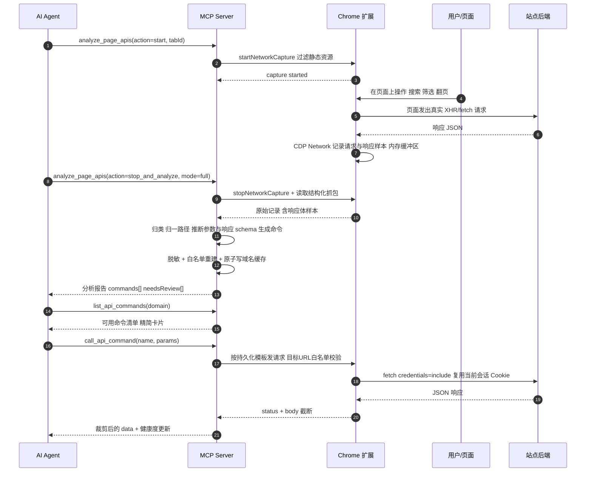

# WebPilot 增量 PRD：页面分析与 API 命令集

> 本文为**增量 PRD**，只描述本次新增 / 变更的产品语义与用户可见契约，且自包含到可直接进入架构设计阶段。
> 本文**不做**架构设计、模块划分、文件清单、类 / 函数签名，也不做竞品与市场调研。具体实现形态由架构设计阶段决定。
> 文中出现的环境变量名、文件名、正则、计数阈值均为**产品建议默认值**，标注为「建议」的项可在第 9 节拍板调整。

## 0. 项目信息

| 项 | 内容 |
| --- | --- |
| Language | 简体中文（与用户要求一致） |
| Programming Language | **沿用既有技术栈**：TypeScript MCP Server（`@modelcontextprotocol/sdk`）+ Chrome MV3 扩展（原生 JS）。本项目为既有工程，用户已指定，不引入 Vite / React / MUI / Tailwind 等新框架 |
| Project Name | `webpilot_api_command_set`（特性代号，snake_case；仓库仍为 `webdoc`） |
| 文档类型 | 简单 PRD（增量），不含竞品 / 市场规模 / 竞争象限图 |
| 关联文档 | `README.zh.md`、`docs/ARCHITECTURE.md`、`docs/task-sedimentation-guide.md`、`docs/adapter-authoring.md`、`mcp-server/skills/webpilot-browser/SKILL.md` |

### 0.1 原始需求复述

> 为「软件开发页面分析与接口转化能力」实现将网站功能抽象为可直接调用的 API 命令集：
> 1. **页面分析模式**：通过抓包解析页面操作背后的网络请求，识别接口地址、请求方法、参数结构及响应格式；
> 2. **API 调用封装**：将解析结果转化为简化的 API 调用封装，使用户无需打开网页即可快速执行对应功能；
> 3. **域名维度持久化缓存**：以域名维度持久化分析结果与接口映射，同一域名再次访问时自动加载已生成的 API 能力，并支持手动重新分析或增量更新；
> 4. **输出范围**：页面分析引擎、抓包解析逻辑、API 抽象与调用封装、域名级缓存管理、命令生成执行机制。

### 0.2 范围边界（本次不做）

- 不改变现有 40+ 工具、任务循环、工作流、适配器、WebMCP 双通道、会话隔离的既有语义，只在其之上新增能力并补齐安全缺口。
- 不新增任意 JS 执行能力（`execute_js` 保持禁用）；不内置模型 / 规划器；不做无上限自主循环、多 Agent 并发写操作、CAPTCHA 绕过。
- 不新增 GUI 页面；本次用户可见界面 = MCP 工具契约 + 扩展弹窗中可能新增的开关（P1）。
- 不做竞品 / 市场分析（用户未要求）。
- 不把命令定义写入 `definitions/` 下的可分发资产（适配器 / 工作流 / Skill），除非第 9 节 Q9 拍板通过并按脱敏规则处理。

---

## 1. 产品定义

### 1.1 价值主张（一句话）

把「抓包 → 人工看懂接口 → 手工拼 `replay_api_request`」这条目前只能靠 Agent 现场摸索、写在 Skill 文档里的手工流程，产品化为「**一次分析 → 按域名沉淀 → 免开网页、按名调用**」的站点 API 命令集。

### 1.2 产品目标（3 条，正交且可度量）

| 编号 | 目标 | 度量口径 |
| --- | --- | --- |
| **G1 分析产出率** | 首次分析即可自动产出可直接调用的命令，而不是一堆原始抓包记录 | 一次 `analyze_page_apis` 对已登录站点产出 ≥1 条含 `method / pathTemplate / params / responseSchema / risk` 的命令；报告须给出 `commandCount`、`confidence`、`needsReview[]`；需人工改名的命令占比可作为分析质量指标 |
| **G2 免开网页调用** | 命令调用与「目标页面是否打开」「抓包缓冲区是否还在」解耦 | 在全新 MCP 会话、目标页面未打开、无活跃抓包缓冲区的条件下，`call_api_command` 成功率 ≥95%（登录态有效前提）；平均耗时不高于现有 `replay_api_request` 的 1.5 倍 |
| **G3 域名级复用** | 同域名再次访问即自动获得能力，无需重复分析 | 到达页面后 ≤1 次工具调用即可拿到可用命令清单；`get_api_command_cache` 可查 `hits / misses / consecutiveFailures / disabled`；同一域名在缓存有效期内重复分析次数显著下降 |

> 安全不是第 4 条目标，而是**贯穿全部目标的硬约束**（见第 7 节）：任何目标不得以持久化凭据、绕过白名单或跳过写操作确认为代价达成。

---

## 2. 现状与差距

### 2.1 已核实的现状约束（读码结论）

| 现状 | 出处 | 对本次需求的约束 |
| --- | --- | --- |
| 抓包由 `chrome.debugger` 的 CDP `Network` 域实现，`networkCaptures` 是**扩展内存 Map**（`tabId → {resources, requestDetails, active, filter, startedAt}`），上限 1000 条；记录了 url / method / headers / postData / status / mimeType / type | `background.js` 1190–1265 | **没有响应体**；缓冲区随扩展 / 浏览器重启丢失；抓包是原始记录，不是结构化产物 |
| `get_network_resources` 在 server 侧被格式化为文本行，仅含 url / status / mimeType / type / requestId 与截断 500 字符的 postData | `server.ts` 1116–1133 | 无结构化 JSON 产物，无法直接消费 |
| `probe_page_capabilities` 的 `apiEndpoints` 基于 `performance.getEntriesByType('resource')`，按 `pathPrefixes`（路径前 3 段）聚合，字段只有 `prefix / count / methods / sampleUrl / avgDurationMs`；`method` 实为 `XHR` 或 `fetch` 伪值 | `page-tools.js` 1100–1133 | **拿不到真实 HTTP method、请求头、请求体、响应体**，只能「嗅探」不能「解析」 |
| `replay_api_request` 依赖 `capture.requestDetails` 定位模板（`captureRequestId` 或 `urlContains`），`fetch(..., credentials:'include')` 自动携带会话 Cookie、绕过页面 CSP；`REPLAY_FORBIDDEN_HEADERS` 剔除 cookie / origin / referer 等 | `background.js` 1333–1428 | **调用强依赖本次会话的实时抓包缓冲区** → 现状做不到「免开网页直接调用」；也不持久化任何模板 |
| `replayApiRequest` **不在** `TAB_SCOPED_COMMANDS` 集合中，也**不在** `READ_ONLY_BLOCKED_COMMANDS`（仅 `click / clickAt / type`）中；`assertCommandAllowed` 只用**当前标签页 URL** 校验白名单，且 `redirect:'follow'` 会跟随跳转 | `background.js` 42–99、1399 | 现状下重放任意 URL 不受域名白名单 / 只读模式约束 → **本次产品化必须补齐的安全缺口** |
| `selector-cache.ts` 是域名级持久化的现成先例：`(hostname, intent)` 键、`selector-cache.json`、tmp+rename 原子写、懒加载、逐条白名单校验跳过坏条目、连续 4 次失败禁用、成功复活、`report()` 健康度 | `selector-cache.ts` 全文 | 缓存语义可直接对齐，但条目需承载远多于一个 selector 的信息 |
| `definitions.ts` 声明式 JSON 运行时加载：内置 + 外部目录按 id 覆盖，单条校验失败只跳过并记 `errors[]`；`WEBPILOT_ADAPTER_DIR` / `WEBPILOT_WORKFLOW_DEF_DIR` 支持改 JSON 免重构建 | `definitions.ts`、`README.zh.md` 183 | 命令定义的可审查 / 可导出 / 可覆盖机制有现成范式；「加载时白名单重建」是缓存校验的参照 |
| 工作流强制 `{{parameter}}` 占位符，存储层拒绝字面 `type` 文本；适配器 spec 丢弃可执行字段 | `README.zh.md` 179、`ARCHITECTURE.md` 67 | 参数模板与「字面敏感输入不得落盘」有现成纪律，应扩展到 URL / query / body |
| `docs/task-sedimentation-guide.md` 已完整记录手工流程：抓包获取列表 API → 覆写 `size` → `replay_api_request` 拉全量；并明确「内部域名、接口路径、枚举值、业务数据一律不写入 workflow / 适配器 / Skill」 | 53–68 行 | **本次正是把该手工流程产品化**；同时必须区分「可分发的人工沉淀资产」与「本地运行时缓存」两类边界（见 7.6） |

### 2.2 差距表：已有底层能力 → 本次要产品化的能力 → 差距

| # | 已有底层能力 | 本次要产品化的能力（用户核心需求） | 差距 |
| --- | --- | --- | --- |
| 1 | `start_network_capture` / `stop_network_capture` + CDP 原始抓包 | **页面分析模式**：一键启动 / 停止并产出分析报告（需求 1、4） | 必须人工串联「start → 操作 UI → get → replay」；无分析会话概念、无过滤噪声（静态资源）、无自动停止与汇总 |
| 2 | `get_network_resources` 文本化资源列表 + `probe_page_capabilities.apiEndpoints` 前缀聚合 | **抓包解析逻辑**：识别接口地址、方法、参数结构、响应格式（需求 1、4） | 无请求归类 / 路径模板归一、无 query / path / body 参数推断、无响应体样本与响应字段 schema、无置信度 |
| 3 | `replay_api_request` 可覆写 URL / 参数 / 请求体并携带会话 Cookie | **API 抽象与调用封装**：命名命令 + 参数模板，免开网页调用（需求 2、4） | 缓冲区一失效即不可用；必须 `captureRequestId` / `urlContains` 现场定位；无持久化模板、无命令名、无参数校验 |
| 4 | `selector-cache.ts` 域名级持久化 + 健康度 + 原子写 + 白名单校验 | **域名级缓存管理 + 自动加载**（需求 3、4） | 只缓存单元素定位符；没有命令集条目、没有自动加载时机、没有版本 / schema、没有全量 / 增量语义 |
| 5 | `definitions.ts` 声明式 JSON + 外部目录覆盖 + 严格白名单校验 | **命令定义可审查 / 可导出 / 可覆盖**（P1） | 命令产物尚无落盘格式与校验契约；无法按团队分发或手工修正 |
| 6 | 工作流 `{{parameter}}` 占位符 + 存储层拒绝字面敏感输入 | **参数模板约定**（需求 2、4） | 占位符目前只用于 `type` 文本，需扩展到 URL 路径、query、body 与响应裁剪路径 |
| 7 | 三层沉淀模型 + Skill 中的手工「抓包 → 重放拉全量」经验 | **命令生成执行机制**（需求 4） | 经验只存在于文档，不可复用、不可按域名自动加载，换一个站点要重来一遍 |
| 8 | 扩展弹窗本地强制：域名白名单 / 只读模式 / 紧急停止 | **同等安全边界覆盖新命令**（约束） | 见 2.1：`replayApiRequest` 未纳入白名单与只读拦截；写操作无确认；目标 URL 与重定向未校验 |

---

## 3. 用户故事

| 编号 | 用户故事 | 覆盖场景 |
| --- | --- | --- |
| **US1** | As a AI Agent 操作者，I want 对当前站点启动一次「页面分析」、完成几个页面操作后自动得到接口清单与命令草稿，so that 我不用手工读抓包记录、自己拼 URL 和请求体 | 首次分析某站点 |
| **US2** | As a AI Agent，I want 用 `call_api_command` 按命令名 + 参数直接取回结构化数据，so that 目标页面不必打开、抓包缓冲区不必存在，也能执行对应功能 | 免开网页直接调用 |
| **US3** | As a 回访用户，I want 再次访问同一域名时自动加载已生成的命令集，so that 我到达页面后一次查询就能看到可用 API 能力，无需重新分析 | 再次访问同域名自动加载 |
| **US4** | As a 站点维护者，I want 在接口改版后手动「重新分析」并全量覆盖旧命令，so that 陈旧 / 失效的命令不会继续被误用 | 手动重新分析（全量覆盖） |
| **US5** | As a 站点维护者，I want 在站点新增功能后做「增量更新」时只合并新增命令、并保留我手工改过的命令名与参数模板，so that 我的修正不会被一次同步抹掉 | 增量更新（保留人工修正） |
| **US6** | As a 安全责任人，I want 所有写类命令在执行前必须显式确认、并受本地只读开关与域名白名单约束，so that Agent 不会因为一次误判就对线上站点产生副作用 | 安全边界（写操作确认） |
| **US7** | As a 已登录用户，I want 命令调用自动复用我当前浏览器会话、且登录过期时明确提示我接管，so that 凭据既不用我填、也不会被写进任何文件 | 凭据与登录态 |

---

## 4. 需求池（P0 / P1 / P2）

优先级定义：**P0 = Must have（本次必须交付，完整覆盖用户 4 点核心需求）**；**P1 = Should have（体验增强与工程化）**；**P2 = Nice to have（后续）**。

### 4.1 P0

| 编号 | 需求 | 说明 | 优先级 | 验收要点 |
| --- | --- | --- | --- | --- |
| **P0-01** | 页面分析模式（一键启动 / 停止 / 解析） | 新增 `analyze_page_apis`，包裹现有抓包能力：`start` 启动过滤后的 CDP 抓包 → 用户 / Agent 操作页面 → `stop_and_analyze` 停止并产出报告。默认排除静态资源 | P0 | 一次完整流程返回结构化报告（非文本行）；含 `endpointCount / commandCount / needsReview[] / warnings[]`；不改变现有 4 个抓包工具的行为 |
| **P0-02** | 抓包解析逻辑 | 按「method + 规范化路径模板」聚合去重；识别接口地址、请求方法、参数结构（query / path / body 的非敏感字段）、响应格式（JSON 字段名 + 类型 + 数组 / 分页路径）；路径中数字 / UUID / ID 归一为 `{id}`；输出置信度与待复核标记 | P0 | 报告每条含 `method / pathTemplate / params[] / responseSchema / risk / confidence`；真实 method 而非 `XHR` / `fetch` 伪值；动态值不进路径模板 |
| **P0-03** | API 抽象与命令生成 | 每条接口抽象为命名命令：命令 ID + 名称 + method + URL 模板 + 参数模板（`{{param}}`）+ 响应裁剪白名单 + `risk` 标记 + 来源与版本 | P0 | 命令名符合正则、无动态值；冲突按消歧规则处理并进 `needsReview`；生成的定义中不含任何 header 值 / 凭据 / 业务样本值 |
| **P0-04** | 免开网页的命令调用封装 | 新增 `call_api_command`：按**持久化命令模板**发起请求，自动携带当前浏览器会话 Cookie、绕过页面 CSP；不依赖实时抓包缓冲区、不要求目标页面打开（要求扩展在线 + 登录态有效） | P0 | 全新会话、页面未打开、无抓包缓冲区时仍调用成功；失败按 HTTP 状态 / 网络错误 / 结构漂移分类返回，不抛未处理异常 |
| **P0-05** | 域名级缓存管理 | 以 hostname 为键持久化命令集；懒加载、原子写、逐条白名单校验、健康度（hits / misses / 连续失败 / 平均耗时）、损坏与不可信数据安全处理 | P0 | 重启 MCP 进程 / 重载扩展后仍可加载；`get_api_command_cache` 可查健康度；坏条目跳过且告警、不影响其余条目 |
| **P0-06** | 同域名自动加载 | 导航后 / 能力探测时按域名自动加载命令集并对外可见；**只加载、不自动执行**（沿用 `recommend_workflows` 纪律） | P0 | 到达页面后 ≤1 次工具调用可拿到可用命令清单；自动加载不产生任何网络请求 |
| **P0-07** | 手动重分析 / 增量更新 | `mode: full`（全量覆盖）与 `mode: merge`（合并新增、保留人工修正）两种语义；可手动失效 / 弃用某域名或某条命令 | P0 | 两种模式均返回 `added / updated / removed / skipped / reviewRequired` 计数；`merge` 不覆盖 `manuallyEdited` 字段 |
| **P0-08** | 命令生成执行机制 | 命令 ID 稳定、参数校验（必填 / 类型 / 枚举）、模板渲染、响应裁剪与截断、错误分类与失败计数、写操作确认闸门 | P0 | 缺必填参数返回 `missingParams[]` 且**不发请求**；path 参数含 `/ ? #` 被拒；写命令无 `confirm` 不发送请求 |
| **P0-09** | 安全边界继承与缺口补齐 | 敏感 header 脱敏、凭据绝不持久化、目标 URL（而非当前标签 URL）纳入域名白名单、只读模式拦截写命令、紧急停止拒绝全部命令、重定向与跨域校验 | P0 | 全链路检索不到 Authorization / Cookie / token 的值；只读模式下写命令在**扩展侧**被拒（MCP 客户端无法绕过） |
| **P0-10** | 可测性 | 解析、模板渲染、缓存校验、安全闸门均有单元测试；`npm test`（`tsc` + `node --test` 测 `dist/`）全绿；现有工具回归无破坏；README 中英文工具表与文档同步 | P0 | 新增测试覆盖上述四类；`npm run doctor` 可列出被跳过的缓存条目 |

### 4.2 P1

| 编号 | 需求 | 说明 | 优先级 | 验收要点 |
| --- | --- | --- | --- | --- |
| **P1-01** | 命令导出 / 导入为可审查 JSON | 复用 `definitions.ts` 范式：内置 + 外部目录按 commandId 覆盖，改 JSON 免重构建（建议 `WEBPILOT_API_COMMAND_DIR`）；导出时强制二次脱敏 | P1 | 外部 JSON 加载时同样逐条白名单校验；导出文件内不含凭据 / 业务样本；同 id 后者覆盖前者 |
| **P1-02** | 命令健康度与自动禁用 | 对齐 `selector-cache` 的 Health 与 `get_adapter_health`：连续失败自动禁用、成功复活、结构漂移标记 | P1 | 连续 4 次失败禁用、一次成功复活；报告含成功率 / 平均耗时 / 最近错误 |
| **P1-03** | 命令人工修正 API | `update_api_command` 支持改名、改参数模板、改裁剪规则、加备注、标记 deprecated，并置 `manuallyEdited: true` | P1 | 修正后 `merge` 与 `full`（默认）均保留；返回中可见 `manuallyEdited` |
| **P1-04** | 响应裁剪增强与分页辅助 | 调用方可传 `fields` 覆盖白名单、数组示例条数上限；列表类命令支持按分页参数一次拉取多页并合并 | P1 | 裁剪后 token 量显著下降；分页合并结果带 `pagesFetched / truncated` |
| **P1-05** | 分析结果可视化报告 | 输出可读 Markdown 摘要：端点表、参数表、响应字段表、示例调用、待复核项 | P1 | 报告可直接贴给人工审阅；不含任何敏感值 |
| **P1-06** | 写命令本地开关 + 审计日志 | 扩展弹窗新增「允许 API 写命令」本地开关（默认关闭），MCP 客户端不可绕过；写命令调用记录脱敏审计日志 | P1 | 开关关闭时扩展侧拒绝所有写命令；日志只含命令 ID / method / 脱敏 URL 模板 / status / 耗时 |
| **P1-07** | 登录态失效的显式提示 | 401 / 403 / 跳转登录页时返回 `authRequired: true` 与人工接管提示，不禁用命令、不重试 | P1 | 不写入任何凭据；人工重新登录后同一命令可直接成功 |

### 4.3 P2

| 编号 | 需求 | 说明 | 优先级 | 验收要点 |
| --- | --- | --- | --- | --- |
| **P2-01** | schema 版本迁移工具 | 旧版本缓存自动迁移或引导重建，不静默猜测 | P2 | 迁移前后命令可调用；失败可回滚 |
| **P2-02** | 从成功任务 JSONL 自动提炼命令候选 | 衔接 `task-sedimentation-guide.md` 中期「辅助沉淀」规划，人确认后入库 | P2 | 候选需人工确认才写缓存 |
| **P2-03** | dry-run / 预演 | 返回「将要发送的请求摘要」而不实际发送，供 Agent 自检 | P2 | 不产生网络请求；摘要脱敏 |
| **P2-04** | 多 Agent 共享命令库 | 读共享、写经 leader 序列化，与 Leader-Follower 架构一致 | P2 | 并发写不丢数据；会话隔离保持 |
| **P2-05** | CSRF / 临时 token 运行时提取 | 运行时从当前页面 / 响应提取并注入，**绝不落盘** | P2 | 缓存与日志检索不到 token 值 |
| **P2-06** | 命令别名与语义检索 | 按自然语言 / 关键词检索命令 | P2 | 检索不触发执行 |

---

## 5. 命令集的用户侧交互设计（重点）

### 5.1 拟新增 MCP 工具一览

命名与现有工具保持一致：`snake_case`、动词或名词短语、入参为 `object`、返回为 MCP `content: [{ type:"text", text: JSON 字符串 }]` 并带 `isError`（沿用 `server.ts` 现有风格）。以下为**产品契约**，参数名可在架构阶段微调，但语义与返回字段须保留。

| 工具名 | 用途 | 关键入参 | 返回结构（顶层字段） |
| --- | --- | --- | --- |
| `analyze_page_apis` | 页面分析模式：启动 / 停止并解析 / 全量或增量写缓存 | `action`: `start` / `stop_and_analyze` / `analyze_current`；`tabId`；`mode`: `full` / `merge`（默认 `merge`）；`urlContains` / `mimeType`（抓包过滤）；`includeStaticAssets`（默认 `false`）；`maxEndpoints`（建议 20）；`captureResponseBody`（见 9-Q8）；`overwriteManual`（默认 `false`）；`dryRun` | `analysisId`, `domain`, `cacheWritten`, `endpointCount`, `commandCount`, `commands[]`, `needsReview[]`, `redactedHeaders[]`, `warnings[]`, `diff{added,updated,removed,skipped,reviewRequired}` |
| `list_api_commands` | 列出某域名可用命令（自动加载入口） | `domain`（默认当前标签域名）；`includeDisabled`（默认 `false`）；`keyword`；`risk` | `domain`, `autoLoaded`, `cacheHit`, `total`, `commands[]`（精简卡片）, `stale[]`, `warnings[]` |
| `get_api_command` | 查看单条命令完整定义 | `commandId` 或 `name`；`domain` | 单条完整定义（含 `params[]` / `responseFields[]` / `schemaVersion` / `manuallyEdited` / `health` / `source`） |
| `call_api_command` | **按名执行**（免开网页） | `commandId` 或 `name`；`domain`（默认按当前标签）；`params`（object）；`fields`（裁剪覆盖）；`maxBodyChars`（默认 50000，clamp 1000..500000）；`confirm`（write 必为 `true`）；`tabId`（会话归属）；`timeoutMs` | `commandId`, `name`, `request{method,urlTemplate,durationMs}`, `status`, `contentType`, `data`, `truncated`, `cacheHit`, `authRequired`, `warnings[]`, `error` |
| `update_api_command` | 人工修正 / 弃用命令 | `commandId`；`name` / `params` / `responseFields` / `note` / `deprecated`；`domain` | `updated`, `manuallyEdited: true`, `command`（更新后定义） |
| `invalidate_api_commands` | 失效 / 删除缓存（域名级或单命令级） | `domain`；`commandId`（可选）；`action`: `disable` / `delete` / `clear_domain` | `affected`, `remaining` |
| `get_api_command_cache` | 缓存健康度报告（对齐 `get_selector_cache`） | `domain`（可选） | `domains[]`, `perCommand{hits,misses,consecutiveFailures,disabled,averageDurationMs,lastSuccessAt,lastError}`, `skippedInvalid[]`, `errors[]`, `schemaVersion` |
| `export_api_commands` / `import_api_commands`（**P1**） | 导出 / 导入可审查 JSON | `domain`；`path`；`redact`（默认 `true`）；`overwrite` | `exported`, `redactedFields[]`, `warnings[]` |

> **命名冲突检查**：以上名称均未出现在现有工具表中（`start_network_capture` / `stop_network_capture` / `get_network_resources` / `replay_api_request` / `probe_page_capabilities` / `get_selector_cache` / `adapter` / `webmcp` 等），不冲突。
> **待拍板**：是否改为单一聚合工具 `api_command`（`action: analyze / list / get / call / update / invalidate / cache / export`），与 `adapter` / `webmcp` 风格一致 —— 见 9-Q1。

### 5.2 典型调用序列

#### 序列 A：首次分析 → 生成命令 → 调用



#### 序列 B：再次访问同域名（自动加载）

1. Agent 调用 `navigate` 打开同域名页面（或已在页面上直接调用 `probe_page_capabilities`）。
2. 能力探测返回中附带该域名 `apiCommands` 摘要（命令名 / method / risk / 可用状态），或 Agent 调用 `list_api_commands(domain)`。
3. MCP Server 懒加载缓存、逐条白名单校验，`autoLoaded: true`、`cacheHit: true`。
4. **不产生任何网络请求、不自动执行任何命令**。
5. Agent 直接 `call_api_command` → 扩展按模板发起请求（无需打开接口所在页面、无需重新抓包）。

#### 序列 C：增量更新（保留人工修正）

1. `analyze_page_apis(action: start)` → 操作站点**新增**的功能入口 → `stop_and_analyze(mode: merge)`。
2. 解析器按 `commandId` 与已有缓存比对：新增端点 → 追加；结构变化 → 更新并标 `drifted` / 进 `needsReview`；结构一致 → 仅刷新 `lastVerifiedAt`；`manuallyEdited` 条目 → 只补新参数，**不覆盖** name / params / responseFields / note。
3. 返回 `diff{added,updated,removed:0,skipped,reviewRequired}` 与 `stale[]`（本次未再观测到但保留的旧命令）。

### 5.3 命令名的生成与消歧规则

**格式**：`<verb>.<resource>[.<qualifier>]`，全小写，段内可用 `_`，层级用 `.`；**建议直接复用** `selector-cache.ts` 的 `INTENT_PATTERN`（`/^[a-z0-9][a-z0-9._-]{0,63}$/`，最长 64 字符），保证与既有 intent 命名体系一致。

| 规则 | 说明 |
| --- | --- |
| verb 生成 | 由真实 HTTP method + 语义推断：`GET` → `get` / `list` / `search` / `fetch`；`POST` → `create` / `submit` / `run`；`PUT` / `PATCH` → `update`；`DELETE` → `delete`。列表型响应优先 `list` |
| resource 生成 | 取规范化路径模板中最后一个有意义的静态段，保留必要的上级层级消歧：`/api/v1/courses/search` → `courses.search`；`/api/v1/courses/{id}` → `courses.get`；`/api/v1/courses/{id}/lessons` → `courses.lessons.list` |
| 路径模板归一 | 数字、UUID、长随机串、常见 ID 形态一律替换为 `{id}` 或 `{<段名>}`；query 中的动态值不进路径模板，转为参数位 |
| 同路径不同 method | 用 verb 区分：`get.courses` 与 `update.courses` |
| 同 method 同路径但语义不同 | 追加限定词（按 query / body 关键字段命名），如 `courses.list.by_project` / `courses.list.by_keyword` |
| 仍冲突 | 追加路径模板短哈希后缀（如 `-8f3a1c`），并**强制进 `needsReview[]`** 要求人工重命名 |
| 禁止项 | 命令名中不得出现动态值（ID / 枚举值 / 页码 / token / 邮箱）、协议、端口、query 原文 |
| 命令 ID | 建议 `commandId = <hostname> + method + pathTemplate` 的规范化短哈希（如 `cmd_8f3a1c2d90`）。**人工重命名不改变 commandId**，避免已保存的调用方引用失效 |
| `risk` 标记 | 默认：`GET / HEAD / OPTIONS` → `read`；其余 → `write`。**例外**：`task-sedimentation-guide.md` 案例中的「POST 列表查询」实际是只读的；分析阶段可依据「请求体为筛选 / 分页字段、响应为列表、路径无状态变更动词」推断为 `read`，但**必须标 `needsReview`，且在人工确认前一律按 `write` 保守处理**（默认值，见 9-Q3） |
| 稳定性 | 命令一旦生成，其 `commandId` 在全量重分析中尽量保持稳定；被移除的端点按 `mode` 语义处理（见 6.4） |

### 5.4 参数模板 `{{param}}` 约定

承接工作流既有纪律（`README.zh.md` 179、`ARCHITECTURE.md` 67）：**可复用经验与任务专属 / 敏感输入严格分离，字面敏感输入一律不得落盘**。本次把该约定从 `type` 文本扩展到 URL、query、body 与响应裁剪路径。

| 约定 | 内容 |
| --- | --- |
| 语法 | `{{paramName}}`（如 `{{keyword}}`、`{{project_id}}`、`{{page}}`）。**建议默认值**：MVP 只在 `params[]` 中描述 `type / required / enum / description / location`，不在占位符字符串里编码类型或可选性（见 9-Q12） |
| 参数名正则 | 建议 `/^[a-z0-9_]{1,64}$/`；保留字（`confirm` / `domain` / `tabId` 等工具级参数）不得用作参数名 |
| 出现位置 | URL path（`{id}` 渲染为 `{{id}}`）、query string、JSON body 的标量位、以及**仅非敏感** header。**禁止**出现在 `Cookie` / `Authorization` / 任何 `*token*` / `*secret*` / CSRF header 中 |
| 参数推断 | 同一规范化路径多次抓包中**取值发生变化**的字段 → 推断为参数（`page` / `size` / `keyword` / `project_id`）；恒定字段保留为模板常量；枚举型字段只记录字段名与「观测到 N 个取值」，**不落盘真实枚举值 / 业务样本值**（与 `task-sedimentation-guide.md` 的脱敏边界一致，见 9-Q14） |
| 必填与校验 | 调用时 `params` 必须提供全部 `required: true` 的参数，缺失返回 `missingParams[]` 且**不发送请求**；类型不符返回 `invalidParams[]`；`enum` 约束在渲染前校验 |
| 渲染 | query / path 值做 URL 编码；body 值保持 JSON 类型（数字不转字符串）；**path 参数禁止包含 `/`、`?`、`#`、协议片段**，防止拼出越权路径 |
| 字面量拒绝 | 与 `assertWorkflowSafe` 对齐：保存命令定义时，若某参数位是硬编码的具体值（尤其长随机串、JWT 三段式、邮箱、手机号、token 形态），拒绝写入或强制转为占位符 |
| `overrides.url` | **建议默认关闭**；若开启（P1），仅允许同源同 host 覆写且仍须通过白名单校验（见 7.4、9-Q7） |

### 5.5 响应字段裁剪规则

目的：控制返回 token 量、隐藏敏感字段、给 Agent 稳定可预期的结构。

| 规则 | 内容 |
| --- | --- |
| 结构化返回 | 沿用现有 `replay_api_request` 的 JSON 解析：`content-type` 含 `json` 时解析为对象，否则返回截断文本并标注 `contentType` |
| `responseFields` 白名单 | 分析阶段从响应样本推断并写入命令定义，采用点路径 + 数组标记，如 `["data.total", "data.items[].id", "data.items[].title", "data.items[].status"]`。默认只保留顶层标量 + 常用列表路径；数组元素最多保留 N 条示例（建议 5）用于说明结构，**示例值不落盘** |
| 敏感字段黑名单 | 命中即掩码或丢弃：`password` / `token` / `secret` / `authorization` / `cookie` / `session` / `csrf` / `xsrf` / `phone` / `email` / `id_card` / `access_key` 等（可配置）。掩码值统一为 `[REDACTED]`，不返回原值长度 |
| 长度上限 | `maxBodyChars` 默认 50000，clamp 到 `1000..500000`（对齐现有实现）；超长返回 `truncated: true` |
| 调用期覆盖 | `call_api_command.fields` 可覆盖白名单；`raw: true` 列为 P1 且须在返回中明确提示风险 |
| schema 记录 | 只记录字段名、类型、是否数组、是否分页字段，**不记录真实值**；响应 schema 明显漂移时标 `drifted` 并建议增量更新 |
| 日志纪律 | 命令调用日志只记录 commandId / method / 脱敏 URL 模板 / status / durationMs；不记录参数值、请求体、响应体、任何 header 值（对齐 `get_action_log`） |

### 5.6 具体调用示例（入参与返回示意）

> 以下 JSON 均为**示意**，用于固定契约形状；不含真实业务数据、域名与凭据。

#### 示例 1：首次分析某站点（`analyze_page_apis`）

入参：

```json
{
  "action": "stop_and_analyze",
  "tabId": 42,
  "mode": "full",
  "includeStaticAssets": false,
  "maxEndpoints": 20,
  "captureResponseBody": true,
  "overwriteManual": false
}
```

返回示意：

```json
{
  "analysisId": "an_2026xxxx_001",
  "domain": "console.example.com",
  "cacheWritten": true,
  "endpointCount": 6,
  "commandCount": 4,
  "commands": [
    {
      "commandId": "cmd_8f3a1c2d90",
      "name": "list.courses",
      "method": "POST",
      "pathTemplate": "/api/v1/courses/search",
      "risk": "write",
      "confidence": 0.86,
      "params": [
        { "name": "keyword", "location": "query", "type": "string", "required": false },
        { "name": "project_id", "location": "body", "type": "string", "required": true },
        { "name": "page", "location": "body", "type": "number", "required": false },
        { "name": "size", "location": "body", "type": "number", "required": false }
      ],
      "responseFields": ["data.total", "data.items[].id", "data.items[].title", "data.items[].status"]
    }
  ],
  "diff": { "added": 4, "updated": 0, "removed": 0, "skipped": 2, "reviewRequired": 1 },
  "needsReview": [
    { "commandId": "cmd_8f3a1c2d90", "reason": "POST 请求体为筛选与分页字段、响应为列表，疑似只读查询；人工确认前按 write 处理" }
  ],
  "redactedHeaders": ["authorization", "cookie", "x-csrf-token"],
  "warnings": ["2 个静态资源端点已按 includeStaticAssets=false 忽略"]
}
```

#### 示例 2：再次访问同域名自动加载（`list_api_commands`）

入参：

```json
{ "domain": "console.example.com", "includeDisabled": false }
```

返回示意：

```json
{
  "domain": "console.example.com",
  "autoLoaded": true,
  "cacheHit": true,
  "total": 4,
  "commands": [
    {
      "commandId": "cmd_8f3a1c2d90",
      "name": "list.courses",
      "method": "POST",
      "pathTemplate": "/api/v1/courses/search",
      "risk": "write",
      "paramNames": ["keyword", "project_id", "page", "size"],
      "responseFields": ["data.total", "data.items[].id", "data.items[].title", "data.items[].status"],
      "manuallyEdited": false,
      "disabled": false,
      "schemaVersion": 1,
      "updatedAt": "2026-xx-xxTxx:xx:xxZ"
    }
  ],
  "stale": [],
  "warnings": []
}
```

> 自动加载**只返回清单，不执行任何命令**；若 `probe_page_capabilities` 中附带该摘要，字段名建议为 `apiCommands`。

#### 示例 3：免开网页读命令调用（`call_api_command`）

入参：

```json
{
  "commandId": "cmd_8f3a1c2d90",
  "params": { "keyword": "产品", "project_id": "P-001", "page": 1, "size": 100 },
  "fields": ["data.total", "data.items[].id", "data.items[].title"],
  "maxBodyChars": 50000
}
```

返回示意：

```json
{
  "commandId": "cmd_8f3a1c2d90",
  "name": "list.courses",
  "request": {
    "method": "POST",
    "urlTemplate": "https://console.example.com/api/v1/courses/search?keyword={{keyword}}",
    "durationMs": 312
  },
  "status": 200,
  "contentType": "application/json",
  "data": {
    "data": {
      "total": 2,
      "items": [
        { "id": "C-001", "title": "示例条目一" },
        { "id": "C-002", "title": "示例条目二" }
      ]
    }
  },
  "truncated": false,
  "cacheHit": true,
  "authRequired": false,
  "warnings": []
}
```

> 注意：返回的 `request.urlTemplate` 是**模板**而非真实 URL，且不出现任何 token / Cookie；`params` 的实际值不回显、不落日志。

#### 示例 4：写命令的确认闸门（`call_api_command` 两次调用）

第一次入参（未确认）：

```json
{
  "name": "update.course",
  "params": { "id": "C-001", "title": "新标题" }
}
```

返回示意：

```json
{
  "commandId": "cmd_2b71e0a4c33",
  "name": "update.course",
  "confirmationRequired": true,
  "preview": {
    "method": "PATCH",
    "urlTemplate": "https://console.example.com/api/v1/courses/{{id}}",
    "paramNames": ["id", "title"],
    "risk": "write"
  },
  "status": null,
  "warnings": ["写命令需显式 confirm=true；本地只读开关与域名白名单仍独立生效"]
}
```

第二次入参（显式确认）：

```json
{
  "name": "update.course",
  "params": { "id": "C-001", "title": "新标题" },
  "confirm": true
}
```

返回示意：

```json
{
  "commandId": "cmd_2b71e0a4c33",
  "status": 200,
  "data": { "ok": true },
  "cacheHit": true,
  "authRequired": false,
  "truncated": false,
  "warnings": []
}
```

> `confirm` 由 MCP 客户端提供，**客户端可自行置真**，因此它只是防误触发，不是不可绕过的边界；真正不可绕过的是扩展弹窗本地开关（见 7.3）。

#### 示例 5：人工修正后的增量更新（保留修正）

`update_api_command` 入参：

```json
{
  "commandId": "cmd_8f3a1c2d90",
  "name": "courses.search_by_project",
  "note": "该 POST 是只读列表查询，已人工确认"
}
```

随后 `analyze_page_apis(action:"stop_and_analyze", mode:"merge")` 返回示意：

```json
{
  "analysisId": "an_2026xxxx_002",
  "domain": "console.example.com",
  "cacheWritten": true,
  "diff": { "added": 1, "updated": 0, "removed": 0, "skipped": 4, "reviewRequired": 0 },
  "preservedManualEdits": ["cmd_8f3a1c2d90: name, note"],
  "stale": [],
  "warnings": []
}
```

---

## 6. 域名级缓存的生命周期语义

### 6.1 缓存键设计

| 项 | 语义 |
| --- | --- |
| 一级键 | **精确 `hostname`**（小写、去端口、去协议与路径）。建议**不自动合并** `www.` 与子域、不向父域回退匹配（见 9-Q13）；与 `isUrlAllowed` 的「`host === domain` 或 `host.endsWith('.'+domain)`」白名单匹配语义**刻意区分**，避免把子域命令误用到父域 |
| 二级键 | `commandId`（稳定短哈希，见 5.3）；命令名可被人工修正但不改变键 |
| 条目内容 | 命令定义（method / pathTemplate / URL 模板 / `params[]` / `responseFields[]` / `risk` / `schemaVersion` / `source` / `manuallyEdited` / `note`）+ 健康度（hits / misses / consecutiveFailures / disabled / lastSuccessAt / lastFailureAt / lastError / totalDurationMs / analyzedAt / lastVerifiedAt） |
| 存储位置 | 建议 `WEBPILOT_API_COMMAND_DIR`，回退 `WEBPILOT_TASK_LOG_DIR` / `.webpilot-task-logs/`；单文件 `api-commands.json` 按 hostname 分组（对齐 `selector-cache.json` 范式，见 9-Q4） |
| 写入方式 | 懒加载 + **tmp + rename 原子写**；写失败只告警、不阻断调用链路（对齐 `selector-cache.ts` 的 `persist()`） |
| 分发属性 | **本地运行时资产**，不随 npm 包分发、不上报、不写入 `definitions/` / Skill / workflow 等可分发资产（区别见 7.6） |

### 6.2 命中与失效规则

| 事件 | 规则 |
| --- | --- |
| 命中 | `list_api_commands` / `call_api_command` 按 hostname 查；`disabled` / `deprecated` 条目**视同未命中**（对齐 `selector-cache.lookup`）；命中记 `hits`、记耗时 |
| 未命中 | 记 `misses` 并返回可行动提示：「该域名尚无命令集，请调用 `analyze_page_apis`」或「该命令已禁用，请重新分析 / 启用」 |
| 连续失败 | 建议连续 **4 次**失败（4xx / 5xx / 网络错误 / 响应结构与 schema 明显不符）→ 自动 `disabled`，提示重新分析；**一次成功即复活**（对齐 `selector-cache` 的 `MAX_CONSECUTIVE_FAILURES = 4`） |
| 结构漂移 | 响应字段名 / 类型明显变化 → 标 `drifted` 并进 `needsReview[]`，**不自动禁用**（接口演进常见，禁用过于激进） |
| 陈旧 | **建议默认不按时间失效**（接口结构比 DOM 稳定）；记录 `analyzedAt` / `lastVerifiedAt`，提供可配置 `staleAfterDays`（建议 30）仅提示、不自动删除（见 9-Q5） |
| 登录态失效 | 401 / 403 / 跳转登录页 → **不禁用命令**，返回 `authRequired: true` + 人工接管提示（沿用任务循环「登录页暂停」策略）；凭据不落盘 |
| 手动失效 | `invalidate_api_commands` 支持 `disable` / `delete` / `clear_domain`；被删除命令若再次被观测到，按新命令重新生成 |
| 不再观测到 | `mode: full` 移除；`mode: merge` 保留并标 `stale`，不自动删（可配置 prune，默认关闭） |

### 6.3 自动加载时机

1. **MCP 进程启动**：懒加载（`ensureLoaded` 模式，对齐 `selector-cache.ts`），首次访问缓存时才读盘。
2. **导航 / 能力探测**：`navigate` 后或 `probe_page_capabilities` 返回中，按当前域名附带 `apiCommands` 摘要（命令名 / method / risk / 可用状态 / `manuallyEdited`）。
3. **显式查询**：`list_api_commands(domain)`、`get_api_command`、`get_api_command_cache`。
4. **纪律**：自动加载**只加载、只推荐、不自动执行**（与 `recommend_workflows`「从不自动执行」一致）；加载失败 / 部分条目被跳过时，返回 `warnings[]` 与 `errors[]`，不影响页面浏览主流程。

### 6.4 全量覆盖 vs 增量更新（差异表）

| 维度 | `mode: full`（手动重新分析 / 全量覆盖） | `mode: merge`（增量更新，**默认值**） |
| --- | --- | --- |
| 触发 | 用户显式指定 `full`（接口改版、缓存明显失真） | 默认；站点新增功能 / 例行补充 |
| 已有命令 | 以本次分析结果为准重建（尽量保持 `commandId` 稳定） | 按 `commandId` 合并 |
| 新增端点 | 写入 | 追加 `added` |
| 结构一致 | 覆盖刷新 | 跳过或仅刷新 `lastVerifiedAt`（`skipped`） |
| 结构变化 | 覆盖 | 更新结构字段、标 `drifted`、进 `reviewRequired` |
| **人工修正** | **默认保留** `name / params / responseFields / note`；仅 `overwriteManual: true` 时覆盖（见 9-Q6） | **始终保留**，只补充新发现的参数位 |
| 本次未观测到的旧端点 | `removed` | 保留并标 `stale`，不自动删 |
| 健康度计数 | 重置（或保留 `hits` 总量但清零连续失败，见架构阶段定） | 保留 |
| 返回值 | `diff{added,updated,removed,skipped,reviewRequired}` + `preservedManualEdits[]` | 同左，`removed` 恒为 0（除非显式 prune） |
| 用户可预期性 | 「回到刚分析完的状态」 | 「只加新的、不动我改过的」 |

### 6.5 版本与 schema 兼容

- 缓存文件带 `version` / `generatedBy`（WebPilot 版本）/ `updatedAt`；每条命令带 `schemaVersion`（建议起始 `1`）。
- **加载时按白名单重建**：只保留允许键，未知键一律丢弃（参照 `definitions.ts` 的 `validate` 与 `selector-cache.toEntry`）。
- `schemaVersion` **高于**当前支持版本 → 跳过该条并记 `errors[]`（不崩溃、不猜测）；**低于** → 尝试迁移或标 `needsMigration` + 进 `needsReview[]`，不静默按新结构解释。
- **单条校验失败只跳过该条**，其余条目正常加载（对齐 `loadDefinitions` 的 `errors[]` 行为）。
- 外部 JSON 目录（P1）：内置 → 外部按 `commandId` 覆盖，同 id 后者覆盖前者；外部定义同样在加载时校验，永远无法注入可执行 JS 或字面凭据。

### 6.6 损坏 / 不可信数据的处理

| 情形 | 处理 |
| --- | --- |
| JSON 解析失败 / 文件损坏 | 整体跳过、告警、备份为 `*.corrupt-<timestamp>` 后重建空缓存；**不静默丢数据、不崩溃** |
| 逐条白名单校验 | `hostname` 必须是合法 host（不含协议 / 路径 / 通配符）；`method` 必须在 `GET / HEAD / POST / PUT / PATCH / DELETE / OPTIONS` 枚举内；URL 模板必须 http(s) 且 **host 与所属 hostname 一致**；参数名匹配 `/^[a-z0-9_]{1,64}$/`；`responseFields` 只保留点路径字符串；`risk` 限于 `read / write`；**丢弃任何可执行字段 / 未知键**（对齐适配器 spec 丢弃 `computed`） |
| 可疑条目 | 外域 URL、字面凭据（长随机串 / JWT / Cookie 片段）、超长字段、异常嵌套 → **跳过 + 告警 + 计入 `skippedInvalid[]`**，绝不带病加载 |
| 原子写失败 | 只告警，不阻断调用链路（对齐 `selector-cache.persist()`） |
| 可观测性 | `get_api_command_cache` 返回 `skippedInvalid[]` / `errors[]`；`npm run doctor` 能列出被跳过的条目 |
| 权限 | 缓存文件仅本机用户可读；不随包分发、不写入任何可分发资产 |

---

## 7. 安全与隐私边界

### 7.1 敏感 header 脱敏

- 分析阶段 CDP 抓到的 request / response headers（含 `Authorization`、`Cookie`、`Set-Cookie`、`X-Token`、任意 `*token*` / `*key*` / `*secret*` / `*csrf*` / `*xsrf*`）**一律不进入**：分析报告、命令定义、缓存文件、调用返回、操作日志。
- 对外最多展示**字段名清单**（如 `redactedHeaders: ["authorization","cookie","x-csrf-token"]`），值统一 `[REDACTED]`，且不泄露原值长度。
- 与现状一致：`REPLAY_FORBIDDEN_HEADERS` 已剔除 cookie / origin / referer 等；`get_action_log` 已按「不含输入文本与脚本」脱敏。本次把同一纪律前移到「分析与缓存」环节。
- 响应体样本（用于推断 schema）只提取**字段名与类型**，不保留样本值；样本本身不落盘。

### 7.2 凭据是否可持久化 —— **明确结论：否，绝不持久化任何凭据**

| 项 | 结论 |
| --- | --- |
| Cookie / Session / Authorization / Bearer token / CSRF token / API Key | **一律不写缓存、不写日志、不写导出文件** |
| 理由 | 沿用既有策略：「凭据从不落盘，依赖真实浏览器登录会话 + 人工接管」（`README.zh.md` 161、`ARCHITECTURE.md` 70） |
| 命令模板保存什么 | 仅 URL 模板、method、参数结构（含 `{{param}}` 占位符）、响应结构与裁剪规则、risk、健康度 —— **不含任何 header 值** |
| 调用时如何鉴权 | 扩展侧以 `fetch(..., credentials: 'include')` 复用 Chrome **当前**会话 Cookie（现有 `replayApiRequest` 已如此）；临时态 token 由浏览器现场提供，**不缓存**。登录过期 → `authRequired: true` + 人工接管（P1-07） |
| 兜底 | 缓存加载时若发现疑似凭据字面量（长随机串、JWT 三段式、Cookie 片段），该条判为不可信并跳过（见 6.6） |

### 7.3 写操作确认

1. 命令定义带 `risk: read | write`；`call_api_command` 对 `write` 命令**必须显式 `confirm: true`**，否则返回 `confirmationRequired` + 脱敏 `preview`，**且不发送任何网络请求**（示例 4）。
2. **重要边界认知**：`confirm` 由 MCP 客户端提供，客户端可自行置真，因此它只是「防 Agent 误触发」的交互闸门，**不是不可绕过的安全边界**。
3. 真正不可绕过的是**扩展弹窗本地开关**（对齐 `assertCommandAllowed` 的本地强制机制）：
   - **P0**：只读模式下，`write` 命令在扩展侧被拒绝；紧急停止下所有命令被拒绝。
   - **P1（9-Q10 待拍板）**：新增「允许 API 写命令」本地开关，**默认关闭**；关闭时扩展侧拒绝一切写命令，与 `READ_ONLY_BLOCKED_COMMANDS` 同一机制，MCP 客户端无法越过。
4. 写命令的审计日志只记 commandId / method / 脱敏 URL 模板 / status / 耗时（P1-06）。

### 7.4 域名白名单 / 只读模式如何继承（并补齐现状缺口）

**现状缺口（必须补齐）**：`replayApiRequest` 不在 `TAB_SCOPED_COMMANDS` 中，`assertCommandAllowed` 只用**当前标签页 URL** 校验白名单；`READ_ONLY_BLOCKED_COMMANDS` 只含 `click / clickAt / type`。因此现状下重放任意 URL 既不受白名单约束、也不受只读模式约束。命令集一旦可「免开网页」调用，这个缺口会被放大。

| 控制 | 本次产品要求 |
| --- | --- |
| 域名白名单 | 命令执行时校验的是**目标请求 URL**（而非当前标签 URL），沿用 `isUrlAllowed` 的 host 匹配规则；目标 host 必须等于命令所属 hostname（或在白名单内）；协议仅 http(s) |
| 只读模式 | 所有 `write` 命令纳入扩展侧拒绝集合；`read` 命令允许；与「允许 API 写命令」本地开关取交集（两者任一关闭即拒绝写） |
| 紧急停止 | 所有新增命令（含 `list_api_commands` 这类纯本地查询？建议：纯本地查询允许，凡会触发扩展请求的命令一律拒绝） |
| `overrides.url` | 默认关闭；开启时强制同源同 host + 白名单双重校验，禁止把请求导向未授权域 |
| 重定向 | 现有 `redirect: 'follow'` 可能把请求带往外域；要求**每一跳的目标 URL 都通过白名单校验**，越域重定向报错且不继续（或改用 `redirect:'manual'` 并显式报错） |
| 会话隔离 | 命令仍归属 `sessionId`；跨会话 `tabId` 拒绝规则沿用；Cookie 只用于目标域自身，不跨会话共享 |
| 静态资源 / 抓取范围 | 分析阶段默认排除静态资源，`urlContains` / `mimeType` 过滤仅作用于分析，不扩大执行权限 |

### 7.5 跨域与 CSRF 风险

- **跨域**：命令只在其所属 hostname 内执行；URL 模板的 host 在生成与加载时双重校验；禁止跨站调用与跨 host 覆写；越域重定向按 7.4 处理。
- **CSRF 本质**：命令在扩展上下文以 `credentials:'include'` 发起，浏览器自动携带目标域 Cookie，效果等同于页面自身请求。风险不在「伪造跨站」，而在「Agent 可触发状态变更」。
- **缓解组合**：`confirm` 闸门（7.3）+ 本地只读开关（P1）+ 目标 URL 同源 / 白名单校验（7.4）+ 脱敏审计日志；**不自动从抓包复制 `csrf` / `xsrf` token 到缓存**（token 属会话态，落盘即失效且有泄露风险）。若站点强依赖 CSRF token，列为 P2-05「运行时提取、绝不落盘」。
- **不做**：不代填凭据、不绕过 CAPTCHA、不提供任意 `execute_js`。

### 7.6 缓存文件的白名单校验（参照 `definitions.ts` / `selector-cache.ts`）

- 加载时**逐条白名单重建**：只保留声明式键（method / pathTemplate / URL 模板 / `params[]` / `responseFields[]` / risk / health / version），丢弃任何可执行字段与未知键 —— 与 `ARCHITECTURE.md` 第 2 道防线（适配器 spec 丢弃 `computed`、工作流动作按键白名单重建、`type` 文本必须 `{{param}}`）同构。
- 单条失败只跳过并记 `errors[]`，不中断整体（对齐 `loadDefinitions`）；外部目录 JSON（P1）同等校验，**永远无法注入可执行 JS 或字面凭据**。
- **边界澄清（重要）**：`task-sedimentation-guide.md` 66 行要求「内部域名、接口路径、枚举值、业务数据一律不写入 workflow / 适配器 / Skill」。该约束针对的是**可分发、可共享的人工沉淀资产**。本次域名级缓存是**本地运行时资产**（按域名隔离、不上报、可清除、不随包分发），按用户核心需求 3 **必须**记录接口路径与参数结构；但仍严格执行：不记录凭据、不记录真实枚举值 / 业务样本值、不写入任何可分发资产。若未来要做命令导出 / 团队分发（9-Q9），必须**二次脱敏 + 人工审阅**，把「接口路径」也视为敏感信息按目标团队范围裁剪。

---

## 8. 界面影响（UI Design Draft）

本次无新增 GUI 页面；用户可见界面为 MCP 工具契约与扩展弹窗：

- **MCP 侧**：新增 7 个工具（P0）+ 2 个（P1），返回统一为结构化 JSON 文本 + `isError`；`probe_page_capabilities` 返回中可选附带 `apiCommands` 摘要（9-Q11）。
- **扩展弹窗**：P1 新增「允许 API 写命令」开关（默认关闭）与「查看 / 清除域名命令缓存」入口；与现有「域名白名单 / 只读模式 / 紧急停止」并列，保持**本地强制、MCP 客户端不可绕过**。
- **文档**：`README.md` / `README.zh.md` 工具表、`docs/ARCHITECTURE.md`、`docs/task-sedimentation-guide.md`（把手工流程标注为「已产品化，见 `analyze_page_apis`」）、`mcp-server/skills/webpilot-browser/SKILL.md` 同步更新。

---

## 9. 验收标准（可测试条目清单）

### 9.1 页面分析与解析

- [ ] **AC-01** `analyze_page_apis(start)` → 页面操作 → `stop_and_analyze` 返回结构化报告，含 ≥1 条端点，每条含 `method / pathTemplate / params[] / responseSchema / risk / confidence`。
- [ ] **AC-02** 解析能区分 query / path / body 参数并识别 JSON 响应字段与类型；路径中的数字 / UUID 归一为 `{id}`；`method` 是真实 HTTP 方法而非 `XHR` / `fetch`。
- [ ] **AC-03** `includeStaticAssets=false` 时静态资源端点被忽略；`maxEndpoints` 生效。
- [ ] **AC-04** 响应体样本只用于推断 schema，报告 / 缓存中不出现样本真实值。

### 9.2 命令生成与调用

- [ ] **AC-05** 生成的命令名符合 5.3 正则、不含动态值；冲突按消歧规则处理并进 `needsReview[]`；`commandId` 稳定，人工改名后不变。
- [ ] **AC-06** 在**全新 MCP 会话、目标页面未打开、无活跃抓包缓冲区**的条件下，`call_api_command` 仍能成功（登录态有效）。
- [ ] **AC-07** 调用自动携带当前会话 Cookie；未登录时返回 `authRequired: true`，且缓存 / 日志中检索不到任何凭据。
- [ ] **AC-08** 缺 `required` 参数返回 `missingParams[]` 且**不发请求**；类型 / enum 校验生效；`{{param}}` 渲染正确（query 编码、body 保类型）；path 参数含 `/ ? #` 被拒。
- [ ] **AC-09** 响应裁剪：默认只返回 `responseFields` 白名单字段；敏感字段名命中被 `[REDACTED]`；`data.items[]` 示例条数受限；超长返回 `truncated: true`。
- [ ] **AC-10** 命令定义中不含 header 值 / 凭据 / 业务样本值；字面敏感值被拒绝写入或强制转占位符。

### 9.3 域名级缓存

- [ ] **AC-11** 分析后落盘 JSON；重启 MCP 进程 / 重载扩展后 `list_api_commands` 仍能加载（`cacheHit: true`）。
- [ ] **AC-12** 再次访问同域名，`probe_page_capabilities` / `list_api_commands` 返回可用命令摘要，**且不自动执行任何命令、不产生网络请求**。
- [ ] **AC-13** `mode: full` 全量覆盖、`mode: merge` 合并新增；两者都返回 `diff{added,updated,removed,skipped,reviewRequired}`。
- [ ] **AC-14** 人工修正后 `merge` 与 `full`（默认）均保留 `name / params / responseFields / note`；仅 `overwriteManual:true` 覆盖。
- [ ] **AC-15** 连续 4 次失败自动禁用、一次成功复活；`get_api_command_cache` 报告 hits / misses / consecutiveFailures / disabled / averageDurationMs。
- [ ] **AC-16** 缓存 JSON 损坏：不崩溃、跳过坏条目、备份损坏文件、其余条目正常加载并告警。
- [ ] **AC-17** 白名单校验：注入外域 URL / 字面凭据 / 未知可执行字段的条目被跳过并计入 `errors[]` / `skippedInvalid[]`。
- [ ] **AC-18** `schemaVersion` 高于支持版本 → 跳过并告警；低版本 → 标 `needsMigration`，不静默猜测。
- [ ] **AC-19** 登录失效不禁用命令；`disabled` / `deprecated` 条目视同未命中。

### 9.4 安全边界

- [ ] **AC-20** 全链路（分析报告 / 命令定义 / 缓存文件 / 返回 / 日志 / 导出）检索不到 `Authorization` / `Cookie` / `token` / `csrf` 的**值**。
- [ ] **AC-21** `write` 命令未带 `confirm:true` → 返回 `confirmationRequired` 且**无网络请求发生**（可通过后端计数 / 抓包验证）。
- [ ] **AC-22** 只读模式开启 → 扩展侧拒绝 `write` 命令（模拟 MCP 客户端直接置 `confirm:true` 仍被拒）；紧急停止 → 拒绝所有会触发扩展请求的命令。
- [ ] **AC-23** 域名白名单：命令目标 URL 不在白名单 → 拒绝；`overrides.url` 跨 host → 拒绝；越域重定向 → 报错且不跟随。
- [ ] **AC-24** CSRF / token 类字段不进入缓存；命令只在所属 hostname 内执行；跨会话 `tabId` 拒绝规则沿用且 Cookie 不跨会话共享。

### 9.5 工程与回归

- [ ] **AC-25** `npm test`（`tsc` 构建 + `node --test` 驱动 `dist/`）全绿；新增单元测试覆盖解析 / 模板渲染 / 缓存校验 / 安全闸门四类。
- [ ] **AC-26** 现有 40+ 工具、`start/stop_network_capture` / `get_network_resources` / `replay_api_request` / `probe_page_capabilities` 行为回归无破坏。
- [ ] **AC-27** `npm run doctor` 能列出被跳过的缓存条目与新环境变量；`README.md` / `README.zh.md` 工具表与 docs 文档同步更新。

---

## 10. 待确认问题（需用户或架构师拍板）

| 编号 | 问题 | 备选 | **建议默认值** | 影响面 |
| --- | --- | --- | --- | --- |
| **Q1** | 工具形态：7 个独立具名工具 vs 单一 `api_command` 聚合工具（`action` 分派，对齐 `adapter` / `webmcp`） | 独立 / 聚合 | **MVP 用独立具名工具**（schema 更清晰、Agent 更易发现）；工具总数逼近客户端上限时再聚合 | MCP 工具注册方式、工具总数 |
| **Q2** | 分析触发方式 | 手动 `start` → 操作 UI → `stop_and_analyze` / 后台常驻抓包自动分析 | **手动显式 start/stop**：贴合「页面操作背后的网络请求」语义，且避免常驻 CDP debugger 影响正常浏览 | 交互复杂度、性能 |
| **Q3** | 是否允许自动执行写命令 | 允许 / 禁止 | **绝不自动执行**；`write` 必须 `confirm` + 本地开关；「POST 列表查询」在人工确认前一律按 `write` 保守处理 | 安全模型、G2 达成方式 |
| **Q4** | 缓存粒度：单文件全局 vs 按域名分文件 | 单文件 / 分文件 | **单文件 `api-commands.json` 按 hostname 分组**（对齐 `selector-cache.json`、原子写简单）；条目增长后再拆 | 并发写、文件体积 |
| **Q5** | 缓存 TTL / 陈旧策略 | 时间过期 / 不按时间失效 | **默认不按时间失效**，记录 `analyzedAt`，提供 `staleAfterDays=30` 仅提示；结构漂移标 `drifted` 不自动禁用 | 复用率 vs 新鲜度 |
| **Q6** | `mode: full` 是否覆盖人工修正 | 覆盖 / 保留 | **默认保留**，`overwriteManual:true` 才覆盖 | 用户资产保护 |
| **Q7** | 是否允许 `overrides.url` 覆写 | 允许 / 关闭 | **默认关闭**；P1 开启时强制同源同 host + 白名单双校验 | 灵活性 vs 越权风险 |
| **Q8** | 分析阶段是否通过 CDP 拉取响应体样本（现状 `Network.responseReceived` **不记录响应体**） | 拉取 / 不拉取 | **拉取，但严格限量**：仅分析阶段、仅 JSON / 文本类响应、最多前 20 条、单条 ≤64KB，只用于推断 schema，**样本值不落盘** | 解析质量（G1）与性能 / 隐私；**不拉取则「响应格式识别」无法达成** |
| **Q9** | 命令定义是否与 `definitions/` 打通、支持团队导出分发 | 打通 / 仅本地 | **P1 打通且强制二次脱敏 + 人工审阅**；因 `task-sedimentation-guide.md` 明确接口路径不写入可分发资产 | 与三层沉淀模型一致性、合规 |
| **Q10** | 「允许 API 写命令」本地开关默认状态 | 开 / 关 | **默认关闭**（更保守） | 开箱体验 vs 安全 |
| **Q11** | 是否把命令摘要注入 `probe_page_capabilities` | 注入 / 仅 `list_api_commands` | **注入**（新增 `apiCommands` 字段），保持「只推荐不执行」 | Agent 发现成本（G3） |
| **Q12** | 占位符是否支持类型 / 可选标记（如 `{{page:number}}`） | 支持 / 不支持 | **不支持**，只用 `{{name}}` + `params[].type / required` 描述 | 模板可读性、解析复杂度 |
| **Q13** | 域名键是否合并 `www.` / 子域 | 合并 / 精确 | **精确 hostname，不自动合并**，子域独立缓存 | 命中率与跨子域安全 |
| **Q14** | 枚举值 / 业务样本是否记录 | 记录 / 不记录 | **不记录真实值**，只记录字段名与「观测到 N 个取值」 | 参数推断效果 vs 脱敏边界 |
| **Q15** | 缓存目录环境变量命名 | 新增 `WEBPILOT_API_COMMAND_DIR` / 复用 `WEBPILOT_TASK_LOG_DIR` | **新增专用变量 + 回退到任务日志目录**（对齐 `WEBPILOT_SELECTOR_CACHE_DIR` 范式） | 运维、doctor 自检 |

---

## 附：本文依据的现有文件（读码范围）

| 文件 | 读取重点 |
| --- | --- |
| `README.zh.md` | 工具表、WebMCP 双通道、工作流 `{{parameter}}` 占位符、选择器缓存、安全边界、凭据策略、会话标签组、开发 / 测试说明 |
| `docs/ARCHITECTURE.md` | 组件职责、Leader-Follower、沉淀层、三道安全防线、`definitions.ts` 加载与校验、凭据策略、目录与产物 |
| `docs/task-sedimentation-guide.md` | 三层沉淀模型、选择器缓存自动沉淀、「抓包获取列表 API → 重放拉全量」手工案例与脱敏边界、中期 / 远期规划、继续不做的边界 |
| `mcp-server/src/server.ts` | 抓包工具定义（378–436）、命令分发（1101–1156）、聚合工具 `action` 分派风格（700–843）、工具名清单与响应格式 |
| `mcp-server/src/selector-cache.ts` | `(hostname, intent)` 键、`INTENT_PATTERN`、原子写、懒加载、`toEntry` 白名单校验、连续 4 次失败禁用、`report()` 健康度 |
| `mcp-server/src/definitions.ts` | JSON 运行时加载、外部目录覆盖、`loadDefinitions` 单条校验失败跳过 + `errors[]` |
| `browser-extension/background.js` | `networkCaptures` Map 与 CDP 抓包（1190–1265）、`getNetworkResources`（1292–1330）、`replayApiRequest` 与 `REPLAY_FORBIDDEN_HEADERS`（1333–1428）、`READ_ONLY_BLOCKED_COMMANDS` / `TAB_SCOPED_COMMANDS` / `assertCommandAllowed` / `isUrlAllowed`（40–99） |
| `browser-extension/page-tools.js` | `apiEndpoints` 端点嗅探与 `pathPrefixes` 聚合（1100–1133） |
