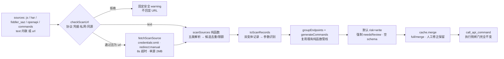

# SiteScan：放开分级与静态接口推导设计

> 增量变更 · 2026-11-05 · 状态：已实现并通过 168/168 全量回归
> 关联：`docs/api-command-set-prd.md`、`docs/api-command-set-design.md`、`docs/task-sedimentation-guide.md`

## 0. 决策摘要

用户指令：「继续推进，放开一些安全防范，确保复刻更高效」。

**现象**：上一轮交付的 `call_api_command` 执行侧已做到零 UI（不打开页面、不依赖抓包缓冲区），但**发现侧覆盖率等于人点过的路径**——接口唯一来源是「人工 start → 操作 UI → stop_and_analyze」的实时抓包。整站复刻做不到。

**结论**：瓶颈不在抓包质量，而在**接口供给源单一**。优化抓包（放开 `SAMPLE_CANDIDATE_RESOURCE_TYPES`、改 `includeStaticAssets`）要改存量常量、破坏 AC-03/26，且仍被 64KB / 20 条配额与 debugger attach 卡住。

**链路（更优解）**：JS bundle / HAR / OpenAPI / 声明式命令包都是**静态或归档数据**，不需要浏览器会话、不需要 Cookie、不需要 debugger、不需要 tab。MCP Server 本身就是 Node 进程，可以直接读。于是：

| | 原拟方案（扩展侧扩采样） | 采用方案（MCP 侧直读） |
| --- | --- | --- |
| 新增文件 | 4–5 个（含扩展侧消息、采样器） | 1 个纯函数模块 + 1 个测试 |
| 扩展侧改动 | 新增消息 case、`importScripts`、常量同步 | **零改动** |
| 存量常量 | 必须改 Q8 采样白名单与静态过滤默认值 | **一个都不改** |
| 前置条件 | 打开页面 + `debugger.attach(tabId)` + 登录态 | 无 |
| 可测性 | vm 沙箱 + stub CDP | 纯 Node 单测（含真实本地 HTTP） |
| 覆盖率 | 一次页面加载已加载的脚本 | 任意 bundle / 规格 / 归档流量 |
| 回归风险 | 高（触碰 149 个存量用例的常量契约） | 低（新增平行入口） |

**关键取舍**：放开的是「看见接口」的能力，**不放开「能做什么」**。执行侧 `call_api_command` 的安全闸门一行未改；静态推导产物默认全部按 `risk:"write"` 保守处理、强制 `needsReview`、`responseSchema` 为空。

---

## 1. 放开分级（绿 / 黄 / 红）

所有放开项都是**显式入参**，默认值即最保守状态；不传参时行为与上一轮完全一致。

### 1.1 绿区 —— 放开，默认开启

| 编号 | 项 | 之前 | 放开后 | 收回方式 |
| --- | --- | --- | --- | --- |
| G1 | 静态资源（JS/HTML）响应体读取 | 被 `SAMPLE_CANDIDATE_RESOURCE_TYPES=['xhr','fetch']` + `filterCandidates(includeStaticAssets=false)` 两层阻断 | 独立通道 `scan_site`，**不占用也不修改** Q8 的 20 条 / 64KB 配额 | 不调用 `scan_site` 即完全停用 |
| G2 | MCP 侧直读静态资源 | 无此能力（所有抓包必经扩展） | Node `fetch` 直接拉公开脚本，`credentials:'omit'`、`redirect:'manual'` | 同上 |
| G3 | HAR / OpenAPI / 声明式命令包导入 | Q9 否决导出分发，也无导入器 | 支持 `text` 内联与 `url` 读取，**只进不出**、不随包分发 | 同上 |
| G4 | 端点上限 | 抓包默认 20 | 静态推导默认 200（`maxEndpoints` 可调） | 传 `maxEndpoints` |

**独立配额**（与 Q8 完全隔离）：40 个数据源 / 单源 2MB / 总计 16MB / 单源超时 8s / 内联文本 2MB 字符。超限跳过并给固定 warning，不猜测、不截断后继续解析。

### 1.2 黄区 —— 放开但默认关闭，需显式开关

| 编号 | 开关 | 默认 | 风险 | 约束 |
| --- | --- | --- | --- | --- |
| Y1 | `allowPrivateHosts` | `false` | SSRF：可让 MCP 进程访问内网 / 回环 / 云元数据地址 | 仅限本次扫描；仍需同源；固定 warning |
| Y2 | `allowCrossHost` + `extraHosts` | `false` | 读取第三方 CDN 脚本 | **两个条件必须同时满足**：开关为 true 且 hostname 在 `extraHosts` 精确白名单内 |
| Y3 | `trustSpec` | `false` | 静态产物被当作只读命令自动执行 | 置 true 时仅 `openapi` / `commands` 来源按声明方法判定 risk；`js` / `har` 仍按 write |
| Y4 | `loosePaths` | `false` | 误报增多（把普通多段路径当 API） | 只影响 JS 扫描的路径前缀判定 |

### 1.3 红区 —— 明确不放开

| 编号 | 项 | 不放开的理由 |
| --- | --- | --- |
| R1 | 凭据 / Cookie / header 值 / 响应样本值落盘 | 设计根基；一旦放开，缓存文件即成为凭据库。扫描原文只在局部变量流转，扫完即弃 |
| R2 | 域名白名单、目标 URL 校验、`redirect:'manual'` fail-closed | 关闭后 `call_api_command` 会退化为任意 SSRF 代理 |
| R3 | `confirm` 闸门、只读模式、紧急停止 | 写操作最后一道人为确认；`confirm` 仍只在 server 侧防误触发，扩展侧不读 |
| R4 | 登录 / SSO / 验证码 / 二次验证自动化 | 合规边界，继续人工接管 |
| R5 | 无上限自主循环、并发写操作 | 沿用 `docs/task-sedimentation-guide.md:107-109` 边界 |

**执行侧零改动清单**：`browser-extension/background.js`、`api-command-helpers.js`、`page-tools.js`、`manifest.json`、`mcp-server/src/bridge.ts`、`api-command-render.ts`、`api-command-cache.ts` 的 `toCommand()` 白名单、`COMMAND_FORBIDDEN_KEYS`、`EXECUTE_OPTIONS_*`、`API_COMMAND_ALLOWED_HEADERS`、27 项错误码、`MSG` / `MSG_RESULT` / `TAB_SCOPED_API_MESSAGES` —— **全部一行未改**。

---

## 2. 架构与数据流



**为什么用「双变体记录」**：静态候选没有真实参数取值。若只生成一条记录，`inferParams()` 会把字段判为恒定常量并把伪值写成 `defaultValue` 落盘。每个候选生成 2 条取值不同的记录，既有推断逻辑会自然识别为「变化字段 → 参数」，无需改动任何存量推断代码。

**为什么静态产物一律 `needsReview` + 空 `responseSchema`**：没有真实响应体样本，任何字段结构都是推测。报告里 `sampledResponseCount` 恒为 0，`SITE_SCAN_REVIEW_REASON` 逐条标注来源，人工可用 `update_api_command` 校正后再用真实流量 `merge` 补齐。

---

## 3. 接口契约

复用现有 `analyze_page_apis`，新增 `action:"scan_site"`，不新增 MCP 工具（工具总数保持 7 个 API 命令集工具）。

| 入参 | 类型 | 默认 | 说明 |
| --- | --- | --- | --- |
| `action` | `"scan_site"` | 必填 | 静态推导入口 |
| `domain` | string | **必填** | 精确 hostname；不绑定标签，无法按当前页推断 |
| `sources` | `[{kind,url?,text?}]` | `[]` | `kind ∈ js / har / fiddler_saz / openapi / commands`；`text` 优先于 `url`；`fiddler_saz` 的 text 收 base64 的 .saz 本体 / raw HTTP 文本 / HTTP XML 文本 |
| `maxEndpoints` | number | 200 | clamp 1..200 |
| `mode` | `full` / `merge` | `merge` | 复用既有合并语义，人工修正默认保留 |
| `overwriteManual` | boolean | `false` | 同上 |
| `allowPrivateHosts` | boolean | `false` | Y1 |
| `allowCrossHost` / `extraHosts` | boolean / string[] | `false` / `[]` | Y2 |
| `trustSpec` | boolean | `false` | Y3 |
| `loosePaths` | boolean | `false` | Y4 |
| `scanTimeoutMs` | number | 8000 | clamp 100..30000 |

返回复用 `AnalysisReport`，附加固定诊断 warning：`静态推导读取 N 个数据源，产出 M 个端点候选（无响应体样本）`。

### 3.1 覆盖率口径：按域名算，不按批次算

`coverage` 段的 `scope` 显式标注统计口径，调用方不必再自己拿批次当分母去算：

| 字段 | 含义 |
| --- | --- |
| `scope` | `"domain"` = 统计的是**该域名自己的全量命令集**；`"batch"` = 只统计到本次批次的命令（取不到该域名全量时的诚实回退） |
| `denominator` | 显式分母（该口径下的命令总数），不再让调用方自行推断 |
| `coverageRate` | 真实覆盖率 = **端点维度** observed / `denominator`（0..1，保留 3 位小数）。分子刻意不用总档位：总档位取三维最弱，静态推导通道的响应维恒 `unknown`，拿总档位当分子会把「端点已被真实流量观测到」也算成 0 |
| `dimensionRates` | 端点 / 参数 / 响应三维各自的 observed 比例（分母同为 `denominator`） |
| `batchStats` | 本次**批次**的同口径统计（`commandCount` / `byTier` / `coverageRate`），与域名口径并列，批次虚高一眼可见 |
| `byDomain` | 按域名分别给 `commandCount` / `byTier` / `coverageRate`，跨域命令不被算丢 |

取不到该域名全量命令集时，`scope` 落回 `"batch"` 并附固定告警 `COVERAGE_SCOPE_BATCH_FALLBACK_WARNING`（不回显 host / 路径），**不把批次冒充成全域**。`endpointCount` 改为按 `method + host + pathTemplate` 去重后的真实端点数，不再拿命令数冒充端点数。

典型调用：

```json
{
  "action": "scan_site",
  "domain": "example.com",
  "sources": [
    { "kind": "js", "url": "https://example.com/static/app.8f3a.js" },
    { "kind": "openapi", "text": "{\"paths\":{\"/api/v1/orders\":{\"get\":{}}}}" }
  ],
  "mode": "merge"
}
```

---

## 4. 文件清单

| 文件 | 类型 | 职责 |
| --- | --- | --- |
| `mcp-server/src/api-command-types.ts` | 修改（末尾追加 §13） | SiteScan 常量、类型、固定安全文案；**未改任何既有常量值**（`SOURCE_ALLOWED_KEYS` / `PROVENANCE_ALLOWED_KEYS` / `COMMAND_TIERS` 与扩展侧逐字一致，未动） |
| `mcp-server/src/api-command-site-scan.ts` | 新增 | 无 IO 纯函数：URL 安全校验 + 五类解析 + 记录适配 |
| `mcp-server/src/api-command-saz.ts` | 新增 | 无 IO 纯函数：Fiddler SAZ（ZIP）归档解码 —— 只用 node:zlib 的 inflateRawSync，不碰文件系统 / 网络 / 时钟 |
| `mcp-server/src/api-command-service.ts` | 修改（增量） | `scanSite()` 编排 + `fetchScanSource()`（本层唯一新 IO）+ 分派 |
| `mcp-server/src/server.ts` | 修改（增量） | `analyze_page_apis` schema 的 action enum 与新入参、case 传参 |
| `mcp-server/test/api-command-site-scan.test.mjs` | 新增 | 19 个用例 |
| `mcp-server/test/api-command-fiddler-saz.test.mjs` | 新增 | 13 个用例：Fiddler SAZ 来源（base64 归档本体 / HTTP XML / raw HTTP）+ 证据档位（observed）+ 跨 origin 歧义 + 解析层无 IO |
| `mcp-server/test/api-command-coverage-scope.test.mjs` | 新增 | 10 个用例：覆盖率口径（显式分母 / 真实覆盖率 / 批次对照 / 按域名明细 / scope 诚实回退） |
| `docs/api-command-site-scan-design.md` | 新增 | 本文 |
| `README.md` / `README.zh.md` / `docs/task-sedimentation-guide.md` | 修改 | 工具说明、安全边界、推荐流程同步 |

**零新增 npm 依赖、零新增扩展权限、零新增扩展消息。**

---

## 5. 安全论证

1. **SSRF 链路**：`checkScanUrl()` 依次拒绝非 http(s)、URL 内嵌凭据、私网（除非 Y1）、跨 hostname（除非 Y2 且精确列出）；`fetchScanSource()` 再用 `redirect:'manual'` 杜绝跳转绕域、`credentials:'omit'` 杜绝带凭据、独立超时与单源 2MB 上限。理由文案是固定常量，**不回显原始 URL 或查询串**。
2. **敏感值不落盘的四道保证**：解析输出只含字段名 / 路径结构 / method；`safeParamName()` 过滤 token/secret/csrf/password 等敏感字段名；原文仅在 `fetchScanSource` → `scanSite` 局部变量中流转；最终仍要过缓存层 `toCommand()` 的既有白名单重建。
3. **风险保守**：静态推导无法证明只读，默认全部 `risk:"write"`，写命令仍需 `confirm:true` 且受扩展侧只读模式拦截。`trustSpec` 只对权威规格来源生效。
4. **可收回性**：所有放开项都是显式参数；不传即回到上一轮行为。移除 `action:"scan_site"` 即可完全停用整条通道，不残留状态、不需要改 manifest、不需要重载扩展。

---

## 6. 验收与实测

| 项 | 结果 |
| --- | --- |
| `npm run build`（tsc strict） | Exit 0，零诊断 |
| `npm test` | **168/168**（存量 149 零回归 + 新增 19） |
| `npm run doctor` | `7 pass, 1 info, 0 warn, 0 fail` |
| 扩展侧文件改动 | 0 |
| 执行侧安全常量改动 | 0 |

19 个新用例覆盖：四类解析（含空输入 / 非法 JSON / 超大文本 fail-closed）、路径归一与动态段、敏感字段名与样本值不泄漏、双变体参数识别、缓存落盘重载、SSRF 全套（协议 / 凭据 / 私网 / 跨 host / IPv6 / 黄区开关组合）、编排层**零扩展依赖**（注入会抛异常的 `sendFn`，断言调用 0 次）、风险保守与 `trustSpec`、真实本地 HTTP 读取。

**未覆盖 / 需真实环境验证**：
- 真实公网 CDN bundle 的抓取（本地回环已用真实 `node:http` 验证，公网未测）；
- 需登录态才能获取的 JS bundle（Node 侧无 Cookie，会失败 → 需 P1 扩展侧补充采集）；
- 代码分割 / 懒加载 chunk 的自动发现；
- 静态扫描在压缩混淆后的真实 bundle 上的召回率与误报率（需用真实站点样本标定）。

---

## 7. 批判性 review 清单（实现前逐条核对）

| # | 疑问 | 结论 |
| --- | --- | --- |
| 1 | 改 `SAMPLE_CANDIDATE_RESOURCE_TYPES` 不更省事吗？ | 否。会污染存量抓包分析，破坏 AC-03/26 与 149 个用例；且 64KB/20 条配额仍挡住 bundle |
| 2 | Q9 否决导出分发，导入是否也违规？ | 不违规。本次只做「本地只读、只进不出」，不写 `definitions/`、不随包分发 |
| 3 | 静态扫描能否承诺 100% 覆盖率？ | 不能。URL 运行时拼接、代码分割、配置注入都会漏；只给骨架，参数与响应需真实流量校准 |
| 4 | `trustSpec` 会不会让未验证命令被自动执行？ | 不会。`call_api_command` 必须显式调用；且仅规格类来源按声明判定，其余仍 write |
| 5 | 放开私网会不会把 MCP 变成内网探测工具？ | 有此风险，故 Y1 默认 false 且需显式开启；建议生产环境配合 `extraHosts` 收紧 |
| 6 | 新模块是否破坏纯函数纪律？ | 否。`api-command-site-scan.ts` 无 `node:fs` / `fetch` / `process.env` / 墙钟 / 运行时单例；IO 全在编排层 |

---

## 8. 已知限制与 Roadmap

**当前限制**：静态推导只产出接口骨架，不产出真实参数取值、枚举值、响应结构；动态 path id 仍需调用方提供；CSRF / nonce / 签名参数仍无法注入（`COMMAND_FORBIDDEN_KEYS` 红线未动）。

| 优先级 | 项 | 说明 |
| --- | --- | --- |
| P1 | 扩展侧补充采集 | 登录态 bundle / 懒加载 chunk：用浏览器会话取回文本，交回同一纯函数扫描器 |
| P1 | `provides` / `requires` 依赖图 + 复合命令 | 把「A 的响应 id → B 的入参」串成可调用编排，替代多步 UI 流程 |
| P1 | `runtimeRef` 受控字段 | CSRF / 临时 token 运行时提取，只落取值路径、绝不落值；需单独过安全评审 |
| P1 | 复刻覆盖率 / UI 依赖率指标 | 覆盖率 = 已生成命令数 / 可发现端点数；UI 依赖率 = 完成任务所需 UI 操作次数 / 总操作次数 |
| P2 | 自动只读遍历、语义标注、漂移监测 | 沿用 `task-sedimentation-guide.md` 中期规划 |

---

## 9. 实测修复记录（2026-11-05）

用真实站点跑端到端（public OpenAPI + 真实前端 bundle + 浏览器扩展补采 + 实际执行命令）时，
暴露出 3 个计数/metrics 全绿但**功能不可用**的缺陷。三者均已修复并加回归用例。

| # | 现象 | 根因 | 影响 | 修复 |
| --- | --- | --- | --- | --- |
| D-1 | 产出 `pathTemplate: "/$123456789"`，同一端点被算成 2 条命令 | `OPENAPI_PARAM_RE = /\{name\}/` 抢先匹配了 JS 模板插值 `${id}` 里的 `{id}`，`$` 残留；`$123456789` 又不被识别为动态段，两条用于参数推断的变体记录无法归并 | 误报入缓存；端点重复计数 | 正则加 `(?<!\$)`；新增 `isUsablePathTemplate()` 兜底（拒 `$` / 反引号 / 未闭合花括号 / 全动态段） |
| D-2 | OpenAPI 生成的命令全部 404 | `parseOpenApiText` 从不读 `servers[].url` / `basePath`，`paths` 是相对值 | **规格类来源整体不可用**（petstore 的 `/pet/findByStatus` 实际在 `/api/v3/pet/findByStatus`） | 新增 `openApiBasePrefix()`：OAS3 `servers[0].url` → `Swagger2 basePath` → 无；含 `{变量}` 放弃拼；已含前缀不重复拼 |
| D-3 | 列表接口执行后 `data` 恒为 `{}` | `redactAndProject` 只在 `isPlainObject(data)` 时投影，**顶层数组被整体丢弃** | 最常见的「查列表」命令等于不可用 | 顶层数组逐元素投影并保留数组形状；无 `fields` 时返回空数组而非空对象 |

**D-2 的教训**：`commandCount: 19` 看起来很成功，但 URL 全是错的。静态推导的验收不能只看条数，
必须**抽一条真实执行**（本次靠 `call_api_command` 的 404 才发现）。已在测试里补「端到端 urlTemplate 含完整前缀」用例。

**D-3 的边界**：无 `fields` 仍 fail-closed（不回显内容），只是形状从 `{}` 改为 `[]`，
避免把「有数据但不回显」误读成「接口返回空」。既有对象路径行为零变更。

**验证**：`npm test` 204/204（存量 149 + 前序 36 + 本轮 19 条回归）；`npm run doctor` 6 pass / 2 info / 0 fail；
真实链路复核 —— OpenAPI 19 条命令 URL 全部含 `/api/v3`，`GET /pet/findByStatus` 执行 **200**（原 404），
返回 `array[5]` 且仅含白名单字段；扩展补采在本地可控站点上「发现 2 个 bundle → 取回 2 个 → 扫描 5 个端点 → 落盘 → 回读 5 条」全通。
