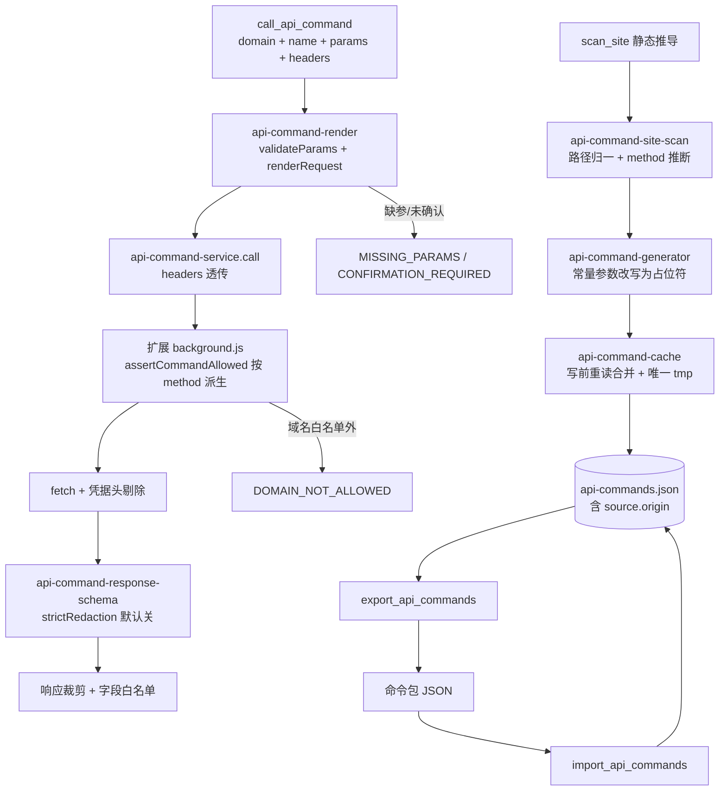

# WebPilot API 命令集升级 技术方案（lite）

> 适用场景：OpenSpec 变更 design 阶段，中小需求（tier3+ 档位）。
> lite 版仅保留方案骨架；四层扫描结构化输入/安全合规/性能可观测/前端全套等完整要求见 full 版 design.md。

---

## 一、概述（必须）

- **价值**：把「操作一个网页」变成「执行一条 API 命令」——不开页面、不依赖抓包缓冲区，且命令集可导出交付他人直接使用。
- **解决的问题**：现有静态推导在现代站点上产出为 0（B 站默认配置 0 条 / 召回 0%）、真实业务值落盘且调用方传值被静默忽略、请求头过窄导致站点校验 403、命令集不可导出导入、跨进程写缓存互删。
- **设计思路**：以「配置化放开 + 保留三项本地硬边界」为轴，拆成 T1–T9 九个可独立测试、可逐个回滚的改动批次，解析侧保持纯函数无 IO，扩展侧与 Node 侧常量逐字同步。

## 二、设计上下文（必须）

- **Change ID**：`webpilot-api-command-set`
- **分支**：`feature/webpilot-api-command-set-s1137748852001393342`（文档分支 `spec/webpilot-api-command-set-s1137748852001393342` 先行创建，代码分支从 `main` 拉出后 cherry-pick 规格提交）
- **关联 Spec**：`specs/spec.md`
- **设计范围（In Scope）**：`mcp-server/src/api-command-*`（types / normalize / cache / generator / render / response-schema / service / site-scan）、`mcp-server/src/baidu-ai-search.ts`、`mcp-server/src/server.ts`（MCP 工具注册）、`browser-extension/background.js`、`browser-extension/api-command-helpers.js`。
- **非范围（Out of Scope）**：CAPTCHA / SSO / 二次验证自动化；无上限自主循环与并发写操作；任意 JS 执行能力（`execute_js` 保持禁用）；命令集随 npm 包分发；本次不改动的 selector / tab / element 链路。

## 三、目标与非目标（必须）

- 目标1（可验证）：规格驱动路径命中 100%（petstore OpenAPI 19/19），静态推导召回 ≥ 50%（基线 0%），实打存活 ≥ 50%。
- 目标2（可验证）：调用方传入的参数值必须真实生效（AC-5）；`Cookie` / `Authorization` 一律不透传（AC-6）。
- 目标3（可验证）：命令集可导出 → 清空 → 导入，条数 / 名称 / 参数 / 响应裁剪规则一致且可直接调用（AC-7）。
- 目标4（可验证）：`npm test` 全绿（存量 245 条零回归 + 新增用例），`npm run doctor` 0 fail。
- 非目标1：不做跨进程强一致的缓存（只做到 hostname 粒度合并，同域名并发仍 last-writer-wins）。
- 非目标2：不做复合命令的取值路径语法定稿（T9 排在最后，语法细节留待实现时确认）。

---

## 四、方案总览（必须）

> 图优先于长段落：1 张流程图或时序图（可用 mermaid 简化）。后端遵循 Controller → Facade → Service → DAO 分层。

### 4.1 核心思路

- **改动点 1（发现覆盖 / T1+T2）**：`api-command-types.ts` 新增 `SITE_SCAN_DEFAULT_LOOSE` / `SITE_SCAN_DEFAULT_TRUST_SPEC` 两个默认放开常量；`api-command-service.ts` `scanSite()`（`:837`）改用常量取默认值；`api-command-site-scan.ts` `inferMethod()`（`:177`）扩展识别 `axios({method})` / 对象字面量 `method:` / `$.ajax({type})`，`toPathTemplate()`（`:207`）识别协议相对 URL 并把 host 从路径中剥离，`SiteScanCandidate` 增 `host?` 字段。
- **改动点 2（值落盘与参数可覆盖 / T4）**：`api-command-normalize.ts` 新增 `isPersistableLiteral()`（任意标量、字符串长度上限）替换 `isSafeLiteral()`（`:120`）作为落盘判据；`api-command-generator.ts` `buildBodyTemplate()`（`:186`）/ `buildQueryTemplate()`（`:173`）把恒定参数改写成 `{{name}}` 占位符、真值落到 `param.defaultValue`；`api-command-render.ts` `renderRequest()`（`:141`）优先用调用方入参、缺省才回落 `defaultValue`；`api-command-response-schema.ts`（`:227` / `:236`）的 `REDACTED_VALUE` 改为受 `strictRedaction` 开关控制，默认不强制打码。
- **改动点 3（请求头放开 / T3）**：`api-command-types.ts` 新增 `API_COMMAND_FORBIDDEN_HEADERS = ["cookie","authorization","proxy-authorization","set-cookie"]`，`API_COMMAND_ALLOWED_HEADERS`（`:271`）从「上限」降级为「最低保证集」，`EXECUTE_OPTIONS_ALLOWED_KEYS`（`:266`）加入 `headers`；`browser-extension/api-command-helpers.js` `rebuildExecuteOptions()`（`:446`）接受并按黑名单剔除 `headers`；`browser-extension/background.js` `cmdApiCommandExecute()`（`:2190`）把过滤后的头拼进 `fetch`。
- **改动点 4（导出导入闭环 / T5）**：`api-command-types.ts` `ApiCommand` 新增 `source.origin`（`capture` / `scan` / `spec` / `manual`）；`api-command-cache.ts` 新增 `export()` / `import()`；`api-command-site-scan.ts` `parseCommandSetText()`（`:438`）同时接受成品格式（`request.urlTemplate` / `risk` / `responseFields` / `manuallyEdited` / `note`）；`mcp-server/src/server.ts` 工具注册区（`:948`–`:991`）新增 `export_api_commands` / `import_api_commands`。
- **改动点 5（缓存一致性与破坏性默认值 / T6+T7）**：`api-command-cache.ts` `persist()`（`:576`）写前重读磁盘并按 hostname 合并、tmp 名改唯一；`ensureLoaded()`（`:504`）读失败置 `loadFailed`，该状态下只写本次新增域名；`server.ts` `invalidate_api_commands` 分支（`:1931`）+ `api-command-service.ts` `invalidate()`（`:655`）只认字面量 `clear_domain`，其余一律 `INVALID_PARAMS`；`browser-extension/background.js` `assertCommandAllowed()`（`:126`）只读门改按 `options.method` 派生，不再采信客户端上报的 `risk`。
- **改动点 6（ai_search 修正 / T8）**：`baidu-ai-search.ts` `parseBaiduBaikanSse()`（`:302`）增量/快照判定去掉前缀启发式，改用事件显式标记、缺标记一律按增量追加；`api-command-service.ts` `fetchBaikanSse()`（`:516`）改 `ReadableStream` 逐段读取、收到结束标记即返回；`aiSearch()`（`:445`）的 `timeoutMs` 改为跨通道总预算。
- **改动点 7（复合命令 / T9）**：`api-command-types.ts` `ApiCommand` 新增 `steps?: CommandStep[]`；`api-command-render.ts` 新增 `resolveCompositeSteps()` 按 `from` 路径取值注入下一步 `params`；`api-command-service.ts` `call()`（`:1156`）按序执行子命令并合并结果。

### 4.2 方案图

---

## 五、发布与回滚（必须）

| 端 | 回滚方式 | 触发条件 |
|----|---------|---------|
| 后端 | 每个放开项一个开关，改开关即回到保守模式；整体回滚用 `git revert` 对应批次 commit | 静态推导误报率异常升高 / 响应敏感值外泄 / 缓存合并引入写覆盖 |
| 扩展 | 扩展为独立发布单元，`assertCommandAllowed` 的域名白名单与紧急停止为热路径开关，回滚只需回退扩展版本 | 只读门误拦合法 GET / 域名白名单误放行 |
| 两侧一致性 | 常量（`api-command-types.ts` ↔ `browser-extension/api-command-helpers.js`）必须逐字同步，同步检查脚本在 `npm test` 中兜底 | 两端常量漂移导致请求头/字段名单不一致 |

## 六、测试与验收（必须）

- [x] 验收标准1（对应 AC-1）：`analyze_page_apis` `action=scan_site` 不传 `loosePaths` 时端点数 ≥ 1（B 站基线 0）。
- [x] 验收标准2（对应 AC-2）：GET/HEAD/OPTIONS 端点的 `risk` 为 `read`，其余为 `write`。
- [x] 验收标准3（对应 AC-3）：缺必填参数返回 `MISSING_PARAMS` 且零网络请求。
- [x] 验收标准4（对应 AC-4）：`risk=write` 未传 `confirm=true` 返回 `CONFIRMATION_REQUIRED` 且零网络请求。
- [x] 验收标准5（对应 AC-5）：调用方传 `params.nickname="lisi"` 时实际请求体为 `lisi`。
- [x] 验收标准6（对应 AC-6）：请求含 `X-Requested-With`，不含 `Cookie` / `Authorization`。
- [x] 验收标准7（对应 AC-7）：导出 → 清空 → 导入后命令条数、名称、参数、响应裁剪规则一致且可直接调用。
- [x] 验收标准8（对应 AC-8）：成品格式命令包导入产出 ≥ 1 条且 `request.urlTemplate` / `risk` / `responseFields` / `manuallyEdited` 被保留。
- [x] 验收标准9（对应 AC-9）：两个进程先后写不同域名，磁盘上两个域名的命令都存在。
- [x] 验收标准10（对应 AC-10）：`invalidate_api_commands` 的 `action` 缺失或非法时返回 `INVALID_PARAMS` 且该域名命令不被删除。
- [x] 验收标准11（对应 AC-11）：扩展域名白名单外的目标被拒绝且零网络请求（硬边界，一行不改）。
- [x] 验收标准12（对应 AC-12）：只读模式下 `risk=read` 但 `method=POST` 的命令被扩展侧拒绝。
- [x] 验收标准13（对应 AC-13）：petstore OpenAPI 19 个端点产出 19 条命令且路径 19/19 命中。
- [x] 验收标准14（对应 AC-14）：SSE 连续相同字符的增量片段拼接后不丢字。
- [x] 验收标准15（对应 A8）：`npm test` 全绿（存量 245 条零回归 + 每批次新增用例），`npm run doctor` 0 fail。

## 七、风险（必须）

| 风险 | 影响 | 缓解措施 |
|---|---|---|
| 扫描基线 gap `NO_ENDPOINT_DISCOVERED`：本项目对外暴露的是 MCP 工具而非 HTTP 路由，四层扫描器的端点抽取器识别到 0 个端点 | 契约层与调用图层为空，AC 无法自动映射到代码锚点 | 责任人：主开发（雷晓鹏）。处置：不用扫描器的端点层做验收依据，改用 `specs/spec.md` 的 AC ↔ `docs/api-command-set-upgrade-spec.md` 的实现位置人工映射表（见本文件第八节）；后续如需自动映射需为 MCP 工具注册补一层端点适配器（本期非目标） |
| 扫描基线 gap `UNMAPPED_ACCEPTANCE_CRITERIA`：14 条 AC 全部无确定性代码映射 | 覆盖报告无法自动回填证据 | 责任人：主开发（雷晓鹏）。处置：每批次新增用例在提交信息中显式标注 `AC-n`，`orbit_test_artifacts mode=record` 由人工按标注回填，不伪造映射 |
| 放开后 `api-commands.json` 落盘真实业务值（含昵称、订单号、OTP） | 个人使用场景已被用户拍板接受；但文件若被外发会泄露 | 全部放开项均配置化可回退；导出命令集时默认不含凭据头；导出文件由使用者自行决定分发范围 |
| 请求头放开可能被用于跨站伪造 | 站点返回 403/404 或被风控识别 | 域名白名单 + 目标 URL 校验（协议 + hostname 精确相等 + 不跟随跳转）+ 紧急停止三项硬边界一行不改；`Cookie` / `Authorization` / `Proxy-Authorization` / `Set-Cookie` 永不透传 |
| 缓存写前重读合并引入新的写竞争 | 同 hostname 仍 last-writer-wins | 合并按 hostname 粒度；tmp 文件名带 pid + 时间戳避免互相覆盖；合并逻辑用双进程用例覆盖（AC-9） |
| 改动面大（跨 MCP 侧与扩展侧，14 个源文件） | 一处回归可能影响既有 245 条用例 | 按 T1–T10 顺序分批，每批一个 commit 且独立可测；每批先跑 `npm test` 再推进 |
| 扩展侧与 Node 侧常量漂移 | 请求头/敏感字段名单不一致，出现隐蔽行为差异 | 两端常量逐字同步，并在 `npm test` 中加同步断言 |

---

## 八、AC 映射简表（必须）

> 每条 AC 映射到实现位置（接口/方法），保证 spec→design 可追溯。四层扫描完整映射见 full 版。

> **行号已于 2026-11-05 逐条复核**（原稿行号随实现漂移已失效，本表按当前 HEAD `442f3e1` 重校）。
> 每条 AC 的**执行证据用例**见 `test-artifacts/test-coverage-result.v1.json`（14/14 通过，gap 已显式登记）。

| AC ID | 实现位置（接口/方法） | 证据用例 | 备注 |
|-------|----------------------|---------|------|
| AC-1 | `api-command-service.ts:1087` `scanSite()` 的 loose 取值 + `api-command-types.ts:921` `SITE_SCAN_DEFAULT_LOOSE` + `api-command-site-scan.ts:705` `scanSources()` | `api-command-site-scan.test.mjs:500` | 默认 `loosePaths` 放开为 true |
| AC-2 | `api-command-site-scan.ts:267` `inferMethod()` + `api-command-types.ts:929` `SITE_SCAN_DEFAULT_TRUST_SPEC` + `api-command-service.ts:1124`/`:1127` trustSpec 与 risk 覆盖 | `api-command-site-scan.test.mjs:523` | GET/HEAD/OPTIONS → `read` |
| AC-3 | `api-command-render.ts:85` `validateParams()` + `api-command-service.ts:1364` `call()` + `:1551` `callComposite()` | `api-command-render.test.mjs:227`、`api-command-composite.test.mjs:291` | 缺参 → `MISSING_PARAMS`，渲染前拦截；复合命令同样受此门禁 |
| AC-4 | `api-command-service.ts:1364` `call()` + `:1551` `callComposite()` | `api-command-render.test.mjs:227`、`api-command-composite.test.mjs:262` | `risk=write` 未确认 → `CONFIRMATION_REQUIRED` |
| AC-5 | `api-command-generator.ts:194` `buildBodyTemplate()` + `:181` `buildQueryTemplate()` + `api-command-render.ts:145` `renderRequest()` + `api-command-service.ts:1763` `filterParamsForCommand()` | `api-command-render.test.mjs:354`/`:367`/`:378` | 常量改写为 `{{name}}` 占位符，调用方值优先 |
| AC-6 | `api-command-types.ts:313` `API_COMMAND_FORBIDDEN_HEADERS` + `:287` `EXECUTE_OPTIONS_ALLOWED_KEYS` + `browser-extension/api-command-helpers.js:236` `sanitizeRequestHeaders()` / `:489` `rebuildExecuteOptions()` + `browser-extension/background.js:2194` `cmdApiCommandExecute()` | `api-command-render.test.mjs:285`/`:315`、`api-command-security.test.mjs:279` | 仅剔 `Cookie` / `Authorization` 等凭据头 |
| AC-7 | `api-command-cache.ts:1127` `export()` + `:1174` `import()` + `:724` `rewriteCommandHost()` + `server.ts:993` / `:1006` 工具注册 | `api-command-cache.test.mjs:113`、`api-command-composite.test.mjs:447` | 导出导入闭环；复合命令随包往返 |
| AC-8 | `api-command-site-scan.ts:558` `parseCommandSetText()` | `api-command-site-scan.test.mjs:662`、`api-command-cache.test.mjs:164` | 成品格式优先，保全 `request.urlTemplate` / `risk` / `responseFields` / `manuallyEdited` / `note` |
| AC-9 | `api-command-cache.ts:891` `persist()` + `:759` `ensureLoaded()` + `:78` `buildCacheTmpName()` | `api-command-cache.test.mjs:529`/`:553`/`:569`/`:587` | 写前重读按 hostname 合并 + 唯一 tmp 名 + `loadFailed` 保护 |
| AC-10 | `server.ts:1979` `invalidate_api_commands` 分支 + `api-command-service.ts:771` `invalidate()` | `api-command-security.test.mjs:711` | 只认字面量 `clear_domain`，其余 `INVALID_PARAMS` 且不删数据 |
| AC-11 | `browser-extension/background.js:126` `assertCommandAllowed()` + `browser-extension/api-command-helpers.js:364` `assertApiTargetUrl()` | `api-command-security.test.mjs:363`/`:395`/`:412` | 硬边界，一行不改 |
| AC-12 | `browser-extension/background.js:126` `assertCommandAllowed()`（只读门按 `options.method` 派生） | `api-command-security.test.mjs:329`/`:311` | 不再采信客户端自述 `risk` |
| AC-13 | `api-command-site-scan.ts:483` `parseOpenApiText()` + `:705` `scanSources()` + `:188` `splitProtocolRelativeUrl()` + `:668` `applyHostCrossReference()` + `:224` `detectBaseUrlHosts()` | `api-command-site-scan.test.mjs:574`/`:581`/`:609`、`api-command-host-infer.test.mjs:60`–`:94` | 规格驱动路径命中 19/19；T10a 跨源 host 交叉引用 + baseURL 侦测 |
| AC-14 | `baidu-ai-search.ts:427` `parseBaiduBikanSse()` + `api-command-service.ts:567` `fetchBaiduSse()` + `:535` `buildAiSearchResult()` + `:483` `aiSearch()` | `baidu-ai-search.test.mjs:317`、`api-command-ai-search.test.mjs:47`/`:83`/`:116` | 增量判定改显式标记 + 流式读取 + 跨通道总预算 + attempts 真实计数 |

**基线 gap 处置（显式登记，不伪造自动映射）**：

| gap | 处置 |
|---|---|
| `NO_ENDPOINT_DISCOVERED` | 本项目暴露的是 MCP 工具而非 HTTP 路由，端点抽取器识别到 0 个端点。改用本表 + `test-artifacts/test-coverage-result.v1.json` 人工映射；后续如需自动映射需为 MCP 工具注册补一层端点适配器（本期非目标） |
| `UNMAPPED_ACCEPTANCE_CRITERIA` | 每批次新增用例在测试名中显式标注 `Tn`，覆盖产物按标注逐条人工回填用例编号与证据引用 |

---

**模板版本**：lite v1.0（派生自 full v2.0）
**最后更新**：2026-11-05
